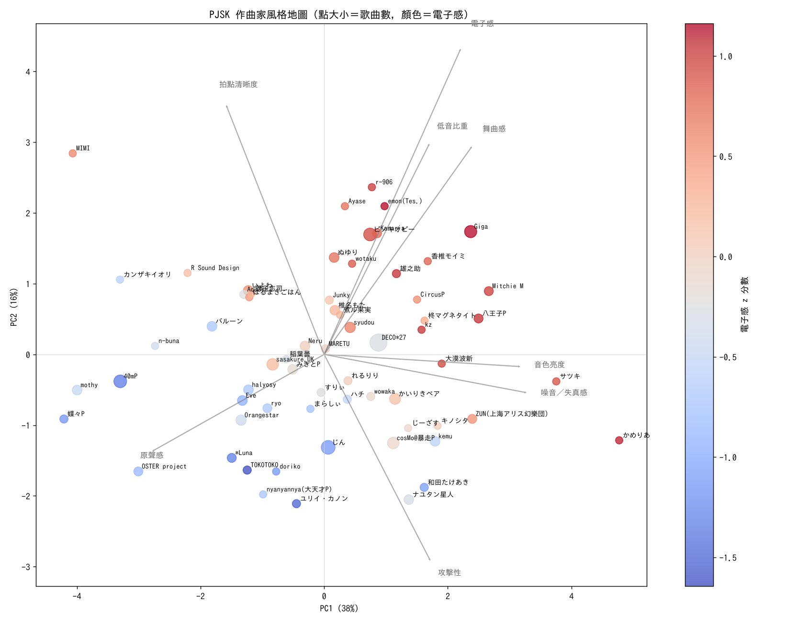
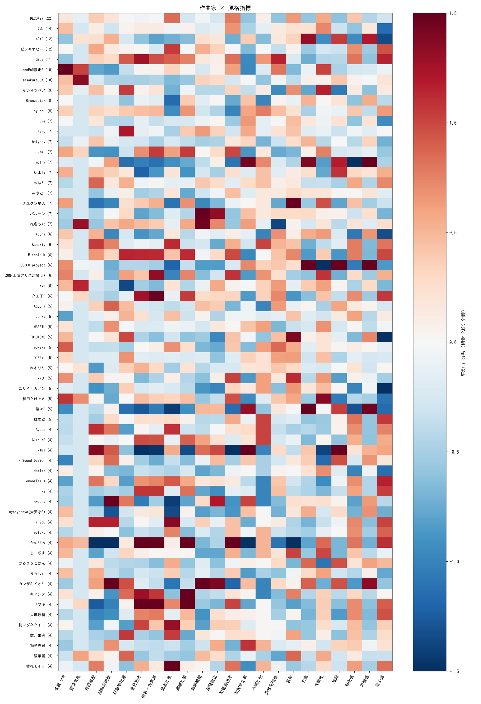

# PJSK 作曲家風格量化報告

用遊戲內 735 首歌的音訊，把「作曲家風格」拆成 22 項可量化指標、400 種曲風機率和 1280 維聲音嵌入，整理出 95 位作曲家（至少 3 首）的風格輪廓。

## 目錄

- [一、資料概覽](#一資料概覽)
- [二、方法](#二方法)
- [三、PJSK 全體基準](#三pjsk-全體基準)
- [四、團體風格比較](#四團體風格比較)
- [五、風格地圖與熱圖](#五風格地圖與熱圖)
- [六、風格辨識度](#六風格辨識度)
- [七、各指標排行](#七各指標排行)
- [八、聲音最相近的作曲家組合](#八聲音最相近的作曲家組合)
- [九、作曲家索引](#九作曲家索引)
- [十、作曲家個別輪廓](#十作曲家個別輪廓)
- [十一、只有 2 首歌的作曲家](#十一只有-2-首歌的作曲家)
- [十二、限制與注意事項](#十二限制與注意事項)

## 一、資料概覽

| 項目 | 數值 |
|---|---|
| 分析歌曲 | 735 首 |
| 不同作曲者（拆開合作曲後） | 309 位 |
| 至少 3 首（有完整輪廓） | 95 位 |
| 只有 2 首（簡表） | 59 位 |
| 歌曲總長 | 25.2 小時（平均 123 秒／首） |
| 遊戲收錄期間 | 2019-06-10 ～ 2026-10-26 |
| 使用的音源版本 | 原曲 465、バーチャル・シンガー ver. 244、伴奏 16、セカイ ver. 10 |
| 團體分布 | VIRTUAL SINGER 475、Leo/need 92、MORE MORE JUMP! 92、Vivid BAD SQUAD 92、ワンダーランズ×ショウタイム 92、25時、ナイトコードで。 91、其他 54 |

每首歌只取一個版本，優先順序：原曲 > バーチャル・シンガー ver. > セカイ ver. > アナザーボーカル。原曲最接近作曲家本人的編曲，所以排在最前面。

## 二、方法

### 流程

1. **取得音源**：從 sekai.best 下載遊戲內的 game size 音源，每首約 2 分鐘。音檔只在記憶體中處理，不會保存。
2. **去除頭尾靜音**：遊戲音源開頭有約 9 秒空白，先裁掉，避免動態類指標失真。
3. **可解釋特徵**：librosa 負責頻譜、能量、和聲；Essentia 負責調性和節拍；BPM 直接讀譜面檔。
4. **深度模型**：Essentia 的 `discogs-effnet` 先把音訊轉成 1280 維嵌入，再接分類頭：
   - Discogs 400 種曲風機率（例如 Electronic---Drum n Bass）
   - 7 個情緒／質感模型（歡快、哀傷、攻擊性、放鬆、舞曲感、原聲感、電子感）
5. **標準化**：每項指標以全部 PJSK 歌曲換算成 z 分數，0 是平均，±1 是一個標準差。
6. **作曲家彙整**：作曲家的值就是他們歌曲的平均。合作曲會同時算進每位作曲者。

### 指標說明

| 類別 | 指標 | 計算方式 | 怎麼解讀 |
|---|---|---|---|
| 節奏 | 速度 BPM | 讀取 master 譜面檔的 BPM 事件，取演奏時間最長的 BPM | 曲速。來自官方譜面，不是從音訊估計；慢速前奏或漸慢段落不會影響主 BPM |
| 節奏 | 變速次數 | 譜面中實際使用到的不同 BPM 數量 − 1（算 z 分數時取 log(1+x)） | 0 表示全曲同速；越多表示變速段落越多。漸快、漸慢在譜面上是連續一串 BPM，所以可能高達上百 |
| 節奏 | 音符密度 | librosa onset 偵測到的音頭數 ÷ 歌曲秒數 | 聽得出的「起音」密度。失真很重、壓縮成音牆的編曲，音頭會糊在一起，數值反而偏低 |
| 節奏 | 拍點清晰度 | 拍點上的 onset 強度 ÷ 全曲平均 onset 強度（拍點由 Essentia 偵測並自動對齊） | 越高代表重音越集中在拍點上（四拍踩踏、鼓點清楚）；低代表切分、律動柔和或拍點模糊 |
| 音色 | 打擊樂比重 | HPSS 分離後打擊成分能量 ÷ 總能量 | 鼓組與打擊樂在混音中佔的比重 |
| 音色 | 音色亮度 | 頻譜質心平均值（Hz） | 聲音的「亮度」。高頻樂器、合成器、明亮人聲會拉高 |
| 音色 | 噪音／失真感 | 頻譜平坦度平均值 | 越接近 1 越像白噪音。失真吉他、噪音合成器、大量鈸類會拉高 |
| 音色 | 低音比重 | 150 Hz 以下的能量 ÷ 總能量 | 低音（大鼓、貝斯、808）的厚重程度 |
| 音色 | 高頻比重 | 4 kHz 以上的能量 ÷ 總能量 | 高頻（鈸、齒音、閃亮合成器）的比重 |
| 動態 | 動態範圍 | RMS 音量（dB）第 95 百分位 − 第 10 百分位 | 全曲音量的落差。低代表壓縮重、始終很大聲 |
| 動態 | 段落對比 | 每 5 秒平均音量的標準差（dB） | 段落之間的起伏，例如安靜的 A 段接爆發的副歌 |
| 和聲 | 和聲複雜度 | 和聲成分 chroma 分布的熵（bit），最大值 log2(12)=3.58 | 同時響起的音高種類有多分散。高代表和聲厚、張力音多；低代表和聲單純 |
| 和聲 | 和弦變化率 | 逐拍 chroma 的餘弦距離平均 | 每拍之間和聲變化的程度，近似「和弦轉換頻率」 |
| 和聲 | 小調比例 | Essentia KeyExtractor（edma 調性模板）判定為小調 = 1 | 作曲家平均值即小調曲的比例 |
| 和聲 | 調性明確度 | KeyExtractor 的調性強度（0–1） | 越高越像單純的大／小調；低代表轉調多、調式曖昧或大量借用和弦 |
| 情緒／質感 | 歡快 | discogs-effnet + mood_happy 模型的機率 | 聽感的歡快程度 |
| 情緒／質感 | 哀傷 | discogs-effnet + mood_sad 模型的機率 | 聽感的哀傷程度 |
| 情緒／質感 | 攻擊性 | discogs-effnet + mood_aggressive 模型的機率 | 聽感的攻擊性（失真、重拍、咆哮感） |
| 情緒／質感 | 放鬆 | discogs-effnet + mood_relaxed 模型的機率 | 聽感的放鬆程度 |
| 情緒／質感 | 舞曲感 | discogs-effnet + danceability 模型的機率 | 穩定律動、適合跳舞的程度 |
| 情緒／質感 | 原聲感 | discogs-effnet + mood_acoustic 模型的機率 | 原聲樂器（鋼琴、木吉他、弦樂）主導的程度 |
| 情緒／質感 | 電子感 | discogs-effnet + mood_electronic 模型的機率 | 電子音色主導的程度 |

### 衍生指標

- **風格關鍵字**：作曲家平均 z 分數最極端的幾項，轉成文字。門檻是 max(0.45, 1.6/√歌曲數)，所以歌越少的作曲家，特徵要越極端才會列出，避免一兩首歌就下結論。
- **判讀等級**：z ≥ 1 為「非常高」，0.5 到 1 為「偏高」，−0.5 到 0.5 為「接近平均」，−1 到 −0.5 為「偏低」，z ≤ −1 為「非常低」。
- **百分位**：作曲家每首歌在全部 PJSK 歌曲中排第幾百分位，再取平均。
- **突出曲風（lift）**：作曲家的平均曲風機率 ÷ PJSK 全體平均，只看本身機率 ≥ 0.04 的曲風。×3 代表這種曲風在該作曲家身上出現的程度是平均的 3 倍。
- **聲音相似度**：每首歌的嵌入先扣掉 PJSK 全體平均（否則所有歌都很像），作曲家取平均向量，再算餘弦相似度。1 是完全同方向，0 是無關。
- **代表性**：單曲嵌入與作曲家平均向量的相似度。
- **風格辨識度**：只用「單獨作曲且至少 5 首」的 39 位作曲家。用嵌入訓練邏輯回歸（先標準化並 PCA 降到 48 維），做 5-fold 交叉驗證，算每位作曲家的歌被正確認出的比例。這代表聲音有多少「個人簽名」。
- **作曲者名稱整理**：先做 NFKC 正規化（例如 cosMo＠暴走P → cosMo@暴走P）。合作曲按 `/ × & 、 ,` 拆開。`・` 只在其中一邊單獨出現過時才拆（所以「ユリイ・カノン」不會被拆）。「名字（別名）」若「名字」單獨出現過，就併到該名字。另外合併 ギガ→Giga、堀江晶太→kemu。作曲者為「-」或「ロシア民謡」的歌不列入作曲家統計。

## 三、PJSK 全體基準

作曲家的「高／低」都是相對下表而言。

| 類別 | 指標 | 平均 | 標準差 | 第 10 百分位 | 中位數 | 第 90 百分位 |
|---|---|---|---|---|---|---|
| 節奏 | 速度 BPM | 157 BPM | 37 | 114 BPM | 150 BPM | 200 BPM |
| 節奏 | 變速次數 | 1.2 次（9% 的歌有變速） | 偏斜，z 分數改用 log(1+x) | 0.0 次 | 0.0 次 | 275.0 次（最大） |
| 節奏 | 音符密度 | 3.00 個/秒 | 1.03 個/秒 | 1.65 個/秒 | 2.99 個/秒 | 4.37 個/秒 |
| 節奏 | 拍點清晰度 | 2.42 | 0.51 | 1.81 | 2.38 | 3.06 |
| 音色 | 打擊樂比重 | 27% | 7% | 18% | 26% | 37% |
| 音色 | 音色亮度 | 2830 Hz | 441 | 2337 Hz | 2805 Hz | 3407 Hz |
| 音色 | 噪音／失真感 | 0.039 | 0.019 | 0.018 | 0.036 | 0.066 |
| 音色 | 低音比重 | 40% | 13% | 24% | 40% | 59% |
| 音色 | 高頻比重 | 5.3% | 3.1% | 2.1% | 4.7% | 9.3% |
| 動態 | 動態範圍 | 10.0 dB | 4.3 dB | 5.5 dB | 9.0 dB | 15.7 dB |
| 動態 | 段落對比 | 3.0 dB | 1.7 dB | 1.2 dB | 2.6 dB | 5.2 dB |
| 和聲 | 和聲複雜度 | 3.00 bit | 0.15 bit | 2.81 bit | 3.01 bit | 3.18 bit |
| 和聲 | 和弦變化率 | 0.226 | 0.062 | 0.153 | 0.220 | 0.307 |
| 和聲 | 小調比例 | 49% | — | — | — | — |
| 和聲 | 調性明確度 | 0.84 | 0.09 | 0.73 | 0.85 | 0.94 |
| 情緒／質感 | 歡快 | 0.57 | 0.17 | 0.33 | 0.58 | 0.77 |
| 情緒／質感 | 哀傷 | 0.17 | 0.12 | 0.07 | 0.13 | 0.34 |
| 情緒／質感 | 攻擊性 | 0.44 | 0.24 | 0.10 | 0.44 | 0.78 |
| 情緒／質感 | 放鬆 | 0.35 | 0.18 | 0.15 | 0.31 | 0.62 |
| 情緒／質感 | 舞曲感 | 0.83 | 0.15 | 0.63 | 0.90 | 0.96 |
| 情緒／質感 | 原聲感 | 0.12 | 0.12 | 0.04 | 0.08 | 0.26 |
| 情緒／質感 | 電子感 | 0.54 | 0.30 | 0.10 | 0.61 | 0.90 |

**大小調**：大調 372 首、小調 363 首。

**最常見的調**：F 小調 49、A 大調 47、Eb 大調 44、E 小調 41、F 大調 41、G 小調 38、E 大調 38、A 小調 35、C 大調 34、G 大調 34

**有變速的歌**：65 首（9%）。最快 300 BPM（幽玄ノ乱），最慢 69 BPM（Afterglow）。

**PJSK 全體最常見的曲風**（平均機率）：J-pop（Pop） 0.341、Synth-pop（Electronic） 0.061、House（Electronic） 0.051、K-pop（Pop） 0.045、Alternative Rock（Rock） 0.045、Pop Rock（Rock） 0.042、Dance-pop（Electronic） 0.039、Electro（Electronic） 0.037、Ballad（Pop） 0.037、Happy Hardcore（Electronic） 0.028、Techno（Electronic） 0.026、Trance（Electronic） 0.025

## 四、團體風格比較

以團體標籤分組（同一首歌若有多個標籤，會同時計入）。數值為平均 z 分數。

| 指標 | VIRTUAL SINGER（475） | Leo/need（92） | MORE MORE JUMP!（92） | Vivid BAD SQUAD（92） | ワンダーランズ×ショウタイム（92） | 25時、ナイトコードで。（91） | 其他（54） |
|---|---|---|---|---|---|---|---|
| 速度 BPM | -0.02 | +0.31 | -0.09 | -0.27 | +0.10 | -0.48 | +0.46 |
| 變速次數 | +0.05 | -0.12 | -0.19 | -0.26 | +0.03 | -0.22 | -0.04 |
| 音符密度 | -0.04 | -0.28 | +0.48 | +0.11 | -0.03 | +0.29 | -0.01 |
| 拍點清晰度 | -0.03 | -0.17 | +0.30 | +0.15 | -0.16 | +0.45 | -0.29 |
| 打擊樂比重 | -0.05 | -0.27 | +0.10 | +0.29 | +0.26 | +0.04 | +0.04 |
| 音色亮度 | +0.04 | -0.30 | -0.06 | +0.01 | +0.06 | -0.36 | +0.13 |
| 噪音／失真感 | +0.03 | -0.32 | -0.11 | -0.00 | -0.01 | -0.32 | +0.30 |
| 低音比重 | -0.02 | -0.19 | -0.03 | +0.32 | -0.04 | +0.08 | +0.15 |
| 高頻比重 | +0.03 | -0.26 | -0.09 | -0.08 | -0.00 | -0.30 | +0.10 |
| 動態範圍 | -0.01 | -0.10 | +0.12 | +0.07 | -0.21 | +0.57 | +0.25 |
| 段落對比 | +0.03 | -0.04 | -0.07 | +0.21 | -0.34 | +0.28 | +0.14 |
| 和聲複雜度 | -0.03 | -0.04 | -0.24 | +0.07 | +0.06 | -0.34 | +0.45 |
| 和弦變化率 | +0.02 | +0.03 | +0.19 | -0.01 | -0.01 | +0.31 | -0.46 |
| 小調比例 | +0.01 | -0.40 | -0.38 | +0.21 | +0.16 | +0.05 | +0.16 |
| 調性明確度 | -0.03 | +0.08 | +0.13 | +0.26 | +0.04 | +0.01 | +0.30 |
| 歡快 | -0.05 | +0.35 | +0.29 | -0.08 | +0.42 | -0.12 | -0.38 |
| 哀傷 | +0.00 | +0.28 | +0.01 | -0.26 | -0.06 | +0.22 | -0.21 |
| 攻擊性 | -0.02 | +0.45 | -0.23 | -0.21 | -0.01 | -0.27 | +0.36 |
| 放鬆 | +0.01 | -0.01 | +0.22 | -0.01 | -0.14 | +0.36 | -0.15 |
| 舞曲感 | +0.04 | -0.47 | +0.12 | +0.38 | +0.04 | +0.01 | +0.15 |
| 原聲感 | +0.01 | +0.25 | +0.02 | -0.24 | -0.01 | +0.21 | -0.26 |
| 電子感 | +0.06 | -1.02 | -0.10 | +0.33 | -0.11 | +0.04 | +0.13 |

- **VIRTUAL SINGER**（475 首）：接近平均。平均 156 BPM，小調 50%。突出曲風：—。最常合作的作曲家：DECO*27 15、40mP 9、cosMo@暴走P 9、sasakure.UK 9、Giga 8。
- **Leo/need**（92 首）：電子感弱、舞曲感弱、攻擊性強。平均 168 BPM，小調 29%。突出曲風：Punk（Rock） ×2.1、Alternative Rock（Rock） ×2.0、Pop Rock（Rock） ×1.8。最常合作的作曲家：DECO*27 6、じん 6、Orangestar 4、Eve 4、40mP 3。
- **MORE MORE JUMP!**（92 首）：音符密集。平均 153 BPM，小調 30%。突出曲風：—。最常合作的作曲家：40mP 6、Junky 4、じん 4、emon(Tes.) 3、MIMI 3。
- **Vivid BAD SQUAD**（92 首）：接近平均。平均 147 BPM，小調 60%。突出曲風：House（Electronic） ×1.6、K-pop（Pop） ×1.6、Dance-pop（Electronic） ×1.5。最常合作的作曲家：Giga 7、じん 5、バルーン 4、R Sound Design 3、Ayase 3。
- **ワンダーランズ×ショウタイム**（92 首）：接近平均。平均 160 BPM，小調 58%。突出曲風：—。最常合作的作曲家：ナユタン星人 5、ピノキオピー 4、じーざす 4、Neru 3、OSTER project 3。
- **25時、ナイトコードで。**（91 首）：動態起伏大、慢節奏。平均 139 BPM，小調 52%。突出曲風：K-pop（Pop） ×1.7、Ballad（Pop） ×1.4。最常合作的作曲家：syudou 6、バルーン 4、カンザキイオリ 4、DECO*27 4、かいりきベア 3。
- **其他**（54 首）：和弦變化少、快節奏、和聲豐富。平均 174 BPM，小調 57%。突出曲風：Hardcore（Electronic） ×2.6、Happy Hardcore（Electronic） ×2.3。最常合作的作曲家：ZUN(上海アリス幻樂団) 6、cosMo@暴走P 3、DECO*27 3、kemu 2、Mitchie M 2。

## 五、風格地圖與熱圖

**風格地圖**：把至少 4 首歌的作曲家，用 22 項 z 分數做 PCA 投影到平面。距離越近，風格越像。灰色箭頭是影響最大的指標方向，點的大小代表歌曲數，顏色代表電子感。

**熱圖**：紅色代表高於 PJSK 平均，藍色代表低於平均。

## 六、風格辨識度

共 39 位作曲家參與分類，亂猜的命中率是 2.6%。

| 排名 | 作曲家 | 歌曲數 | 辨識度 | 認錯時最常被當成 |
|---|---|---|---|---|
| 1 | [ナユタン星人](#ナユタン星人) | 7 | 100% | — |
| 2 | [cosMo@暴走P](#cosmo暴走p) | 10 | 90% | かいりきベア（1） |
| 3 | [いよわ](#いよわ) | 7 | 71% | sasakure.UK（2） |
| 4 | [Kanaria](#kanaria) | 6 | 67% | DECO*27（1）、Mitchie M（1） |
| 5 | [OSTER project](#oster-project) | 6 | 67% | ぬゆり（1）、40mP（1） |
| 6 | [ピノキオピー](#ピノキオピー) | 12 | 64% | DECO*27（1）、バルーン（1） |
| 7 | [DECO*27](#deco27) | 22 | 62% | ピノキオピー（3）、ryo（1） |
| 8 | [ユリイ・カノン](#ユリイカノン) | 5 | 60% | ryo（1）、40mP（1） |
| 9 | [蝶々P](#蝶々p) | 5 | 60% | 40mP（1）、sasakure.UK（1） |
| 10 | [Giga](#giga) | 11 | 57% | ぬゆり（1）、八王子P（1） |
| 11 | [ぬゆり](#ぬゆり) | 7 | 57% | sasakure.UK（1）、halyosy（1） |
| 12 | [かいりきベア](#かいりきベア) | 9 | 56% | TOKOTOKO（1）、Mitchie M（1） |
| 13 | [ZUN(上海アリス幻樂団)](#zun上海アリス幻樂団) | 6 | 50% | 八王子P（2）、Orangestar（1） |
| 14 | [kemu](#kemu) | 7 | 50% | 40mP（1）、cosMo@暴走P（1） |
| 15 | [ryo](#ryo) | 6 | 50% | 椎名もた（1）、DECO*27（1） |
| 16 | [じん](#じん) | 14 | 46% | Orangestar（2）、Eve（1） |
| 17 | [40mP](#40mp) | 12 | 45% | kemu（2）、蝶々P（2） |
| 18 | [mothy](#mothy) | 7 | 43% | Orangestar（1）、いよわ（1） |
| 19 | [syudou](#syudou) | 8 | 43% | ハチ（1）、バルーン（1） |
| 20 | [椎名もた](#椎名もた) | 7 | 43% | sasakure.UK（1）、cosMo@暴走P（1） |
| 21 | [MARETU](#maretu) | 5 | 40% | cosMo@暴走P（1）、DECO*27（1） |
| 22 | [TOKOTOKO](#tokotoko) | 5 | 40% | 40mP（2）、DECO*27（1） |
| 23 | [ハチ](#ハチ) | 5 | 40% | じん（1）、椎名もた（1） |
| 24 | [*Luna](#luna) | 6 | 33% | 椎名もた（1）、じん（1） |
| 25 | [sasakure.UK](#sasakureuk) | 10 | 33% | いよわ（1）、椎名もた（1） |
| 26 | [Eve](#eve) | 7 | 29% | バルーン（2）、ナユタン星人（1） |
| 27 | [halyosy](#halyosy) | 7 | 29% | Junky（2）、mothy（1） |
| 28 | [みきとP](#みきとp) | 7 | 29% | ぬゆり（1）、wowaka（1） |
| 29 | [Junky](#junky) | 5 | 20% | kemu（1）、ぬゆり（1） |
| 30 | [すりぃ](#すりぃ) | 5 | 20% | DECO*27（2）、バルーン（1） |
| 31 | [八王子P](#八王子p) | 6 | 20% | ZUN(上海アリス幻樂団)（2）、Mitchie M（1） |
| 32 | [和田たけあき](#和田たけあき) | 5 | 20% | DECO*27（2）、じん（1） |
| 33 | [Neru](#neru) | 7 | 17% | すりぃ（1）、ぬゆり（1） |
| 34 | [バルーン](#バルーン) | 7 | 17% | Eve（2）、halyosy（1） |
| 35 | [Aqu3ra](#aqu3ra) | 5 | 0% | ryo（1）、すりぃ（1） |
| 36 | [Mitchie M](#mitchie-m) | 6 | 0% | 八王子P（1）、DECO*27（1） |
| 37 | [Orangestar](#orangestar) | 8 | 0% | じん（2）、ピノキオピー（2） |
| 38 | [wowaka](#wowaka) | 5 | 0% | ハチ（2）、ナユタン星人（1） |
| 39 | [れるりり](#れるりり) | 5 | 0% | Orangestar（1）、cosMo@暴走P（1） |

辨識度低不代表沒有風格，而是聲音容易和別人重疊。常見原因有：（1）作品橫跨很多曲風；（2）由不同編曲者經手；（3）屬於 PJSK 中很常見的主流 J-pop／J-rock 聲音。

## 七、各指標排行

只計算至少 4 首歌的作曲家。括號內為平均值。

| 指標 | 最高 5 位 | 最低 5 位 |
|---|---|---|
| 速度 BPM | cosMo@暴走P（214 BPM）、和田たけあき（196 BPM）、wowaka（190 BPM）、ZUN(上海アリス幻樂団)（184 BPM）、OSTER project（182 BPM） | R Sound Design（120 BPM）、蝶々P（122 BPM）、Junky（127 BPM）、emon(Tes.)（127 BPM）、Giga（135 BPM） |
| 變速次數 | sasakure.UK（28.7 次）、椎名もた（17.0 次）、ryo（2.8 次）、cosMo@暴走P（3.2 次）、和田たけあき（1.4 次） | じん（0.0 次）、ピノキオピー（0.0 次）、Giga（0.0 次）、いよわ（0.0 次）、Neru（0.0 次） |
| 音符密度 | MIMI（4.42 個/秒）、r-906（4.21 個/秒）、Ayase（4.14 個/秒）、Kanaria（4.08 個/秒）、ぬゆり（3.89 個/秒） | かめりあ（1.00 個/秒）、サツキ（1.71 個/秒）、ナユタン星人（1.85 個/秒）、大漠波新（1.98 個/秒）、ユリイ・カノン（2.06 個/秒） |
| 拍點清晰度 | n-buna（3.48）、カンザキイオリ（3.19）、r-906（3.01）、MIMI（2.89）、Aqu3ra（2.87） | かめりあ（1.57）、nyanyannya(大天才P)（1.77）、サツキ（1.91）、ナユタン星人（1.93）、*Luna（1.94） |
| 打擊樂比重 | Neru（36%）、Mitchie M（35%）、煮ル果実（35%）、かいりきベア（35%）、TOKOTOKO（34%） | ryo（17%）、mothy（18%）、蝶々P（19%）、Ayase（21%）、柊マグネタイト（21%） |
| 音色亮度 | サツキ（3655 Hz）、かめりあ（3488 Hz）、キノシタ（3397 Hz）、Giga（3388 Hz）、八王子P（3387 Hz） | MIMI（1910 Hz）、蝶々P（2272 Hz）、いよわ（2293 Hz）、n-buna（2370 Hz）、mothy（2379 Hz） |
| 噪音／失真感 | かめりあ（0.087）、サツキ（0.075）、八王子P（0.068）、ZUN(上海アリス幻樂団)（0.065）、Mitchie M（0.061） | MIMI（0.011）、mothy（0.017）、蝶々P（0.019）、いよわ（0.022）、40mP（0.023） |
| 低音比重 | 香椎モイミ（60%）、r-906（58%）、柊マグネタイト（57%）、Kanaria（55%）、Ayase（54%） | n-buna（22%）、蝶々P（22%）、nyanyannya(大天才P)（23%）、OSTER project（25%）、Orangestar（26%） |
| 高頻比重 | かめりあ（11.4%）、キノシタ（11.1%）、サツキ（10.3%）、Mitchie M（8.8%）、kemu（8.6%） | MIMI（1.0%）、蝶々P（2.4%）、いよわ（2.4%）、n-buna（2.8%）、mothy（2.9%） |
| 動態範圍 | カンザキイオリ（18.9 dB）、バルーン（18.2 dB）、椎名もた（16.2 dB）、MIMI（13.6 dB）、Neru（12.7 dB） | ナユタン星人（5.9 dB）、大漠波新（6.2 dB）、ユリイ・カノン（6.3 dB）、OSTER project（6.4 dB）、nyanyannya(大天才P)（6.5 dB） |
| 段落對比 | カンザキイオリ（5.4 dB）、バルーン（5.3 dB）、n-buna（5.1 dB）、MIMI（4.7 dB）、椎名もた（4.2 dB） | ユリイ・カノン（1.3 dB）、TOKOTOKO（1.3 dB）、kz（1.4 dB）、OSTER project（1.6 dB）、じーざす（1.7 dB） |
| 和聲複雜度 | かめりあ（3.23 bit）、ZUN(上海アリス幻樂団)（3.16 bit）、ハチ（3.16 bit）、サツキ（3.15 bit）、kemu（3.15 bit） | MIMI（2.71 bit）、カンザキイオリ（2.82 bit）、蝶々P（2.82 bit）、mothy（2.83 bit）、syudou（2.85 bit） |
| 和弦變化率 | MIMI（0.322）、mothy（0.315）、蝶々P（0.307）、獅子志司（0.294）、n-buna（0.289） | かめりあ（0.134）、cosMo@暴走P（0.166）、Mitchie M（0.167）、Giga（0.167）、和田たけあき（0.168） |
| 小調比例 | Kanaria（100%）、CircusP（100%）、Ayase（100%）、雄之助（100%）、syudou（88%） | Orangestar（0%）、*Luna（0%）、Aqu3ra（0%）、キノシタ（0%）、MIMI（0%） |
| 調性明確度 | Giga（0.94）、wowaka（0.91）、cosMo@暴走P（0.91）、八王子P（0.90）、*Luna（0.90） | 椎名もた（0.72）、かめりあ（0.74）、かいりきベア（0.76）、稲葉曇（0.77）、ナユタン星人（0.77） |
| 歡快 | ナユタン星人（0.83）、TOKOTOKO（0.80）、ハチ（0.75）、じーざす（0.74）、稲葉曇（0.71） | かめりあ（0.29）、八王子P（0.42）、サツキ（0.43）、はるまきごはん（0.45）、kemu（0.45） |
| 哀傷 | OSTER project（0.39）、蝶々P（0.37）、mothy（0.35）、40mP（0.34）、カンザキイオリ（0.29） | Mitchie M（0.07）、かめりあ（0.08）、かいりきベア（0.08）、Giga（0.08）、Kanaria（0.08） |
| 攻擊性 | 和田たけあき（0.77）、かいりきベア（0.73）、ZUN(上海アリス幻樂団)（0.71）、cosMo@暴走P（0.69）、じーざす（0.68） | OSTER project（0.08）、MIMI（0.11）、R Sound Design（0.16）、はるまきごはん（0.18）、emon(Tes.)（0.21） |
| 放鬆 | MIMI（0.67）、OSTER project（0.63）、mothy（0.57）、いよわ（0.55）、40mP（0.54） | かいりきベア（0.16）、和田たけあき（0.16）、Mitchie M（0.19）、大漠波新（0.20）、ハチ（0.20） |
| 舞曲感 | 雄之助（0.96）、Giga（0.96）、かめりあ（0.95）、Kanaria（0.95）、Mitchie M（0.95） | mothy（0.52）、蝶々P（0.64）、*Luna（0.67）、OSTER project（0.68）、doriko（0.68） |
| 原聲感 | OSTER project（0.40）、mothy（0.32）、蝶々P（0.30）、カンザキイオリ（0.28）、40mP（0.27） | かめりあ（0.03）、Mitchie M（0.04）、Kanaria（0.04）、大漠波新（0.04）、r-906（0.05） |
| 電子感 | emon(Tes.)（0.90）、Giga（0.89）、かめりあ（0.88）、八王子P（0.87）、雄之助（0.86） | TOKOTOKO（0.05）、ユリイ・カノン（0.09）、40mP（0.14）、*Luna（0.14）、蝶々P（0.19） |

## 八、聲音最相近的作曲家組合

至少 4 首歌的作曲家之間，嵌入相似度最高的 25 組。

| # | 作曲家 A | 作曲家 B | 相似度 |
|---|---|---|---|
| 1 | 八王子P | かめりあ | 0.84 |
| 2 | じん | *Luna | 0.79 |
| 3 | 40mP | TOKOTOKO | 0.79 |
| 4 | じん | 和田たけあき | 0.74 |
| 5 | 八王子P | サツキ | 0.74 |
| 6 | emon(Tes.) | kz | 0.74 |
| 7 | Giga | 八王子P | 0.74 |
| 8 | かめりあ | サツキ | 0.74 |
| 9 | *Luna | doriko | 0.73 |
| 10 | ryo | doriko | 0.73 |
| 11 | じん | doriko | 0.73 |
| 12 | ユリイ・カノン | doriko | 0.73 |
| 13 | TOKOTOKO | ユリイ・カノン | 0.72 |
| 14 | *Luna | 和田たけあき | 0.72 |
| 15 | Giga | emon(Tes.) | 0.71 |
| 16 | 和田たけあき | doriko | 0.69 |
| 17 | じん | ryo | 0.69 |
| 18 | 40mP | ユリイ・カノン | 0.68 |
| 19 | Giga | 雄之助 | 0.68 |
| 20 | ZUN(上海アリス幻樂団) | 八王子P | 0.67 |
| 21 | 八王子P | 雄之助 | 0.67 |
| 22 | 40mP | 蝶々P | 0.67 |
| 23 | Giga | wotaku | 0.66 |
| 24 | *Luna | ryo | 0.66 |
| 25 | 40mP | OSTER project | 0.66 |

**聲音差異最大的 10 組**：Giga ↔ ユリイ・カノン（-0.72）、じん ↔ 雄之助（-0.71）、40mP ↔ 八王子P（-0.70）、Giga ↔ doriko（-0.69）、じん ↔ Giga（-0.69）、Giga ↔ ryo（-0.68）、40mP ↔ かめりあ（-0.67）、ryo ↔ 雄之助（-0.67）、じん ↔ wotaku（-0.67）、doriko ↔ wotaku（-0.66）

## 九、作曲家索引

| 作曲家 | 歌曲數 | 辨識度 | 風格關鍵字 | 詳細 |
|---|---|---|---|---|
| [DECO*27](#deco27) | 22 | 62% | 低音厚重、和聲豐富、明亮歡快、緊繃、和弦變化少、調性曖昧 | [完整](profiles/DECO27.md) |
| [じん](#じん) | 14 | 46% | 電子感弱、攻擊性強、和聲豐富、舞曲感弱、和弦變化少、快節奏 | [完整](profiles/じん.md) |
| [40mP](#40mp) | 12 | 45% | 電子感弱、哀傷感重、原聲樂器感重、放鬆、舞曲感弱、溫和 | [完整](profiles/40mP.md) |
| [ピノキオピー](#ピノキオピー) | 12 | 64% | 低音厚重、電子感強、舞曲感強、和弦變化少、音符密集、少哀傷 | [完整](profiles/ピノキオピー.md) |
| [Giga](#giga) | 11 | 57% | 音色明亮、電子感強、調性明確、失真噪音質感強、和弦變化少、鼓組厚重 | [完整](profiles/Giga.md) |
| [cosMo@暴走P](#cosmo暴走p) | 10 | 90% | 快節奏、常有變速、攻擊性強、和弦變化少、律動柔和、調性明確 | [完整](profiles/cosMo暴走P.md) |
| [sasakure.UK](#sasakureuk) | 10 | 33% | 常有變速、低音輕薄、偏好大調、高頻收斂 | [完整](profiles/sasakureUK.md) |
| [かいりきベア](#かいりきベア) | 9 | 56% | 攻擊性強、緊繃、鼓組厚重、調性曖昧、少哀傷、低音輕薄 | [完整](profiles/かいりきベア.md) |
| [Orangestar](#orangestar) | 8 | 0% | 低音輕薄、偏好大調、和聲簡潔、舞曲感弱、鼓組輕 | [完整](profiles/Orangestar.md) |
| [syudou](#syudou) | 8 | 43% | 和聲簡潔、低音輕薄、偏好小調、高頻閃亮、電子感強、和弦轉換頻繁 | [完整](profiles/syudou.md) |
| [Eve](#eve) | 7 | 29% | 電子感弱、和弦轉換頻繁、舞曲感弱 | [完整](profiles/Eve.md) |
| [Neru](#neru) | 7 | 17% | 鼓組厚重、動態起伏大 | [完整](profiles/Neru.md) |
| [halyosy](#halyosy) | 7 | 29% | 電子感弱、偏好大調 | [完整](profiles/halyosy.md) |
| [kemu](#kemu) | 7 | 50% | 失真噪音質感強、高頻閃亮、和聲豐富、律動柔和、音符疏朗、和弦變化少 | [完整](profiles/kemu.md) |
| [mothy](#mothy) | 7 | 43% | 舞曲感弱、原聲樂器感重、和弦轉換頻繁、哀傷感重、放鬆、鼓組輕 | [完整](profiles/mothy.md) |
| [いよわ](#いよわ) | 7 | 71% | 音色溫暖偏暗、放鬆、高頻收斂、音色乾淨、溫和 | [完整](profiles/いよわ.md) |
| [ぬゆり](#ぬゆり) | 7 | 57% | 音符密集、電子感強 | [完整](profiles/ぬゆり.md) |
| [みきとP](#みきとp) | 7 | 29% | 高頻收斂 | [完整](profiles/みきとP.md) |
| [ナユタン星人](#ナユタン星人) | 7 | 100% | 明亮歡快、音符疏朗、低音輕薄、律動柔和、壓縮感強、音量平均、攻擊性強 | [完整](profiles/ナユタン星人.md) |
| [バルーン](#バルーン) | 7 | 17% | 動態起伏大、段落落差大、音色溫暖偏暗、電子感弱、音色乾淨 | [完整](profiles/バルーン.md) |
| [椎名もた](#椎名もた) | 7 | 43% | 動態起伏大、調性曖昧、常有變速、段落落差大、和弦轉換頻繁 | [完整](profiles/椎名もた.md) |
| [*Luna](#luna) | 6 | 33% | 電子感弱、舞曲感弱、偏好大調、律動柔和、音色溫暖偏暗、音色乾淨 | [完整](profiles/Luna.md) |
| [Kanaria](#kanaria) | 6 | 67% | 低音厚重、音符密集、偏好小調、電子感強、舞曲感強、段落起伏小 | [完整](profiles/Kanaria.md) |
| [Mitchie M](#mitchie-m) | 6 | 0% | 鼓組厚重、音色明亮、失真噪音質感強、高頻閃亮、電子感強、和聲豐富 | [完整](profiles/MitchieM.md) |
| [OSTER project](#oster-project) | 6 | 67% | 原聲樂器感重、哀傷感重、放鬆、溫和、低音輕薄、舞曲感弱 | [完整](profiles/OSTERproject.md) |
| [ZUN(上海アリス幻樂団)](#zun上海アリス幻樂団) | 6 | 50% | 失真噪音質感強、攻擊性強、和聲豐富、低音輕薄、和弦變化少、快節奏 | [完整](profiles/ZUN上海アリス幻樂団.md) |
| [ryo](#ryo) | 6 | 50% | 鼓組輕、常有變速、電子感弱、音色乾淨 | [完整](profiles/ryo.md) |
| [八王子P](#八王子p) | 6 | 20% | 失真噪音質感強、音色明亮、電子感強、高頻閃亮、少走歡快路線、和弦變化少 | [完整](profiles/八王子P.md) |
| [Aqu3ra](#aqu3ra) | 5 | 0% | 偏好大調、拍點鮮明 | [完整](profiles/Aqu3ra.md) |
| [Junky](#junky) | 5 | 20% | 慢節奏 | [完整](profiles/Junky.md) |
| [MARETU](#maretu) | 5 | 40% | 接近平均 | [完整](profiles/MARETU.md) |
| [TOKOTOKO](#tokotoko) | 5 | 40% | 電子感弱、明亮歡快、鼓組厚重、段落起伏小、原聲樂器感重 | [完整](profiles/TOKOTOKO.md) |
| [wowaka](#wowaka) | 5 | 0% | 快節奏、調性明確、段落起伏小 | [完整](profiles/wowaka.md) |
| [すりぃ](#すりぃ) | 5 | 20% | 接近平均 | [完整](profiles/すりぃ.md) |
| [れるりり](#れるりり) | 5 | 0% | 音符疏朗 | [完整](profiles/れるりり.md) |
| [ハチ](#ハチ) | 5 | 40% | 明亮歡快、和聲豐富、和弦變化少、緊繃 | [完整](profiles/ハチ.md) |
| [ユリイ・カノン](#ユリイカノン) | 5 | 60% | 電子感弱、舞曲感弱、段落起伏小、音符疏朗、壓縮感強、音量平均、律動柔和 | [完整](profiles/ユリイカノン.md) |
| [和田たけあき](#和田たけあき) | 5 | 20% | 攻擊性強、電子感弱、快節奏、緊繃、和聲豐富、和弦變化少 | [完整](profiles/和田たけあき.md) |
| [蝶々P](#蝶々p) | 5 | 60% | 哀傷感重、原聲樂器感重、低音輕薄、和弦轉換頻繁、舞曲感弱、音色溫暖偏暗 | [完整](profiles/蝶々P.md) |
| [雄之助](#雄之助) | 5 |  | 電子感強、偏好小調、舞曲感強 | [完整](profiles/雄之助.md) |
| [Ayase](#ayase) | 4 |  | 音符密集、低音厚重、偏好小調、鼓組輕、拍點鮮明 | [完整](profiles/Ayase.md) |
| [CircusP](#circusp) | 4 |  | 偏好小調、音色明亮、失真噪音質感強、高頻閃亮 | [完整](profiles/CircusP.md) |
| [MIMI](#mimi) | 4 |  | 音色溫暖偏暗、和聲簡潔、放鬆、和弦轉換頻繁、音色乾淨、音符密集 | [完整](profiles/MIMI.md) |
| [R Sound Design](#r-sound-design) | 4 |  | 溫和、慢節奏、放鬆、拍點鮮明 | [完整](profiles/RSoundDesign.md) |
| [doriko](#doriko) | 4 |  | 電子感弱、舞曲感弱 | [完整](profiles/doriko.md) |
| [emon(Tes.)](#emontes) | 4 |  | 電子感強、偏好大調、溫和、低音厚重、鼓組輕、音符密集 | [完整](profiles/emonTes.md) |
| [kz](#kz) | 4 |  | 失真噪音質感強、音色明亮、電子感強、偏好大調、段落起伏小、高頻閃亮 | [完整](profiles/kz.md) |
| [n-buna](#n-buna) | 4 |  | 拍點鮮明、低音輕薄、段落落差大、音色溫暖偏暗、和弦轉換頻繁、偏好大調 | [完整](profiles/n-buna.md) |
| [nyanyannya(大天才P)](#nyanyannya大天才p) | 4 |  | 低音輕薄、律動柔和、和聲簡潔、壓縮感強、音量平均 | [完整](profiles/nyanyannya大天才P.md) |
| [r-906](#r-906) | 4 |  | 低音厚重、音符密集、拍點鮮明、電子感強 | [完整](profiles/r-906.md) |
| [wotaku](#wotaku) | 4 |  | 電子感強 | [完整](profiles/wotaku.md) |
| [かめりあ](#かめりあ) | 4 |  | 失真噪音質感強、音符疏朗、高頻閃亮、律動柔和、少走歡快路線、和聲豐富 | [完整](profiles/かめりあ.md) |
| [じーざす](#じーざす) | 4 |  | 明亮歡快、攻擊性強、音符疏朗 | [完整](profiles/じーざす.md) |
| [はるまきごはん](#はるまきごはん) | 4 |  | 溫和、放鬆、哀傷感重 | [完整](profiles/はるまきごはん.md) |
| [まらしぃ](#まらしぃ) | 4 |  | 和弦變化少 | [完整](profiles/まらしぃ.md) |
| [カンザキイオリ](#カンザキイオリ) | 4 |  | 動態起伏大、拍點鮮明、段落落差大、原聲樂器感重、和聲簡潔、低音輕薄 | [完整](profiles/カンザキイオリ.md) |
| [キノシタ](#キノシタ) | 4 |  | 高頻閃亮、音色明亮、失真噪音質感強、偏好大調、律動柔和、鼓組厚重 | [完整](profiles/キノシタ.md) |
| [サツキ](#サツキ) | 4 |  | 音色明亮、失真噪音質感強、高頻閃亮、音符疏朗、律動柔和、和聲豐富 | [完整](profiles/サツキ.md) |
| [大漠波新](#大漠波新) | 4 |  | 音符疏朗、電子感強、律動柔和、壓縮感強、音量平均、緊繃 | [完整](profiles/大漠波新.md) |
| [柊マグネタイト](#柊マグネタイト) | 4 |  | 低音厚重、音色明亮、鼓組輕、壓縮感強、音量平均、音符疏朗 | [完整](profiles/柊マグネタイト.md) |
| [煮ル果実](#煮ル果実) | 4 |  | 鼓組厚重、低音厚重 | [完整](profiles/煮ル果実.md) |
| [獅子志司](#獅子志司) | 4 |  | 和弦轉換頻繁 | [完整](profiles/獅子志司.md) |
| [稲葉曇](#稲葉曇) | 4 |  | 鼓組厚重、明亮歡快 | [完整](profiles/稲葉曇.md) |
| [香椎モイミ](#香椎モイミ) | 4 |  | 低音厚重、和弦變化少、電子感強、和聲豐富 | [完整](profiles/香椎モイミ.md) |
| [Azari](#azari) | 3 |  | 低音厚重、電子感強、偏好小調、鼓組厚重、拍點鮮明 | [完整](profiles/Azari.md) |
| [Chinozo](#chinozo) | 3 |  | 明亮歡快、電子感弱、調性曖昧、鼓組厚重 | [完整](profiles/Chinozo.md) |
| [DIVELA](#divela) | 3 |  | 攻擊性強、調性明確 | [完整](profiles/DIVELA.md) |
| [Guiano](#guiano) | 3 |  | 動態起伏大、偏好大調、和聲簡潔 | [完整](profiles/Guiano.md) |
| [Heavenz](#heavenz) | 3 |  | 動態起伏大、段落落差大、哀傷感重、舞曲感弱、原聲樂器感重、慢節奏 | [完整](profiles/Heavenz.md) |
| [Omoi](#omoi) | 3 |  | 和弦變化少、攻擊性強、失真噪音質感強、音符疏朗、段落落差大、律動柔和 | [完整](profiles/Omoi.md) |
| [Ponchi♪](#ponchi) | 3 |  | 快節奏、律動柔和、攻擊性強、失真噪音質感強、高頻閃亮、音色明亮 | [完整](profiles/Ponchi.md) |
| [Twinfield](#twinfield) | 3 |  | 音符密集、失真噪音質感強、音色明亮、高頻閃亮、段落落差大 | [完整](profiles/Twinfield.md) |
| [jon-YAKITORY](#jon-yakitory) | 3 |  | 接近平均 | [完整](profiles/jon-YAKITORY.md) |
| [てにをは](#てにをは) | 3 |  | 慢節奏、明亮歡快 | [完整](profiles/てにをは.md) |
| [とあ](#とあ) | 3 |  | 放鬆、拍點鮮明、和弦轉換頻繁、和聲簡潔、溫和、動態起伏大 | [完整](profiles/とあ.md) |
| [なきそ](#なきそ) | 3 |  | 低音厚重、拍點鮮明、調性曖昧、音符密集、電子感強、少走歡快路線 | [完整](profiles/なきそ.md) |
| [のぼる↑](#のぼる) | 3 |  | 電子感弱、調性曖昧、段落起伏小 | [完整](profiles/のぼる.md) |
| [ひとしずく](#ひとしずく) | 3 |  | 明亮歡快、段落落差大 | [完整](profiles/ひとしずく.md) |
| [めろくる](#めろくる) | 3 |  | 溫和、原聲樂器感重、和弦轉換頻繁 | [完整](profiles/めろくる.md) |
| [やま△](#やま) | 3 |  | 明亮歡快、段落落差大 | [完整](profiles/やま.md) |
| [ゆうゆ](#ゆうゆ) | 3 |  | 電子感弱、明亮歡快、偏好小調、音符疏朗、攻擊性強 | [完整](profiles/ゆうゆ.md) |
| [ゆよゆっぺ](#ゆよゆっぺ) | 3 |  | 少走歡快路線、律動柔和、電子感弱、攻擊性強、和聲簡潔 | [完整](profiles/ゆよゆっぺ.md) |
| [キタニタツヤ](#キタニタツヤ) | 3 |  | 鼓組厚重、慢節奏 | [完整](profiles/キタニタツヤ.md) |
| [ジミーサムP](#ジミーサムp) | 3 |  | 音色溫暖偏暗、音色乾淨、低音輕薄、拍點鮮明、慢節奏、哀傷感重 | [完整](profiles/ジミーサムP.md) |
| [ツミキ](#ツミキ) | 3 |  | 低音厚重、攻擊性強、偏好小調、和聲豐富 | [完整](profiles/ツミキ.md) |
| [トーマ](#トーマ) | 3 |  | 和聲豐富、攻擊性強、和弦變化少、緊繃 | [完整](profiles/トーマ.md) |
| [ポリスピカデリー](#ポリスピカデリー) | 3 |  | 拍點鮮明、溫和、放鬆 | [完整](profiles/ポリスピカデリー.md) |
| [傘村トータ](#傘村トータ) | 3 |  | 哀傷感重、原聲樂器感重、舞曲感弱、放鬆、慢節奏、少走歡快路線 | [完整](profiles/傘村トータ.md) |
| [原口沙輔](#原口沙輔) | 3 |  | 拍點鮮明、音色溫暖偏暗、動態起伏大、鼓組厚重、音色乾淨、高頻收斂 | [完整](profiles/原口沙輔.md) |
| [吉田夜世](#吉田夜世) | 3 |  | 音色明亮、失真噪音質感強、鼓組厚重、調性明確、電子感強 | [完整](profiles/吉田夜世.md) |
| [夏代孝明](#夏代孝明) | 3 |  | 偏好大調、壓縮感強、音量平均 | [完整](profiles/夏代孝明.md) |
| [岩見 陸](#岩見-陸) | 3 |  | 舞曲感弱、電子感弱 | [完整](profiles/岩見陸.md) |
| [栗山夕璃](#栗山夕璃) | 3 |  | 常有變速 | [完整](profiles/栗山夕璃.md) |
| [水野あつ](#水野あつ) | 3 |  | 哀傷感重、原聲樂器感重、放鬆、和弦轉換頻繁、和聲簡潔、溫和 | [完整](profiles/水野あつ.md) |
| [黒うさ](#黒うさ) | 3 |  | 舞曲感弱、低音輕薄、哀傷感重、原聲樂器感重、電子感弱、溫和 | [完整](profiles/黒うさ.md) |

## 十、作曲家個別輪廓

依歌曲數排序。這裡是每位作曲家的摘要；22 項完整指標、曲風、調性、編曲者和逐曲明細，請點各段最後的連結，進入 `profiles/` 底下的個別檔案。

### DECO*27

> 歌曲數 **22**　｜　風格關鍵字：**低音厚重、和聲豐富、明亮歡快、緊繃、和弦變化少、調性曖昧**

**風格辨識度**：62%（亂猜為 3%）。認錯時最常被當成：ピノキオピー（3 次）、ryo（1 次）、八王子P（1 次）

**節奏**：平均 163 BPM（接近平均，約第 56 百分位），範圍 110–210 BPM，22 首中有 2 首含變速。可辨識音頭密度接近平均，拍點清晰度接近平均。

**音色**：亮度接近平均（平均 2807 Hz），低音比重偏高，高頻比重接近平均，噪音／失真感接近平均，鼓組比重接近平均。動態範圍接近平均，段落對比接近平均。

**和聲**：22 首中 12 首判定為小調（55%），最常見的調是 E 大調、Eb 大調。和聲複雜度偏高，和弦變化率偏低，調性明確度偏低。

**情緒與質感**：情緒模型上相對突出的是歡快、攻擊性，較少放鬆、哀傷；舞曲感接近平均，整體電子與原聲比例接近 PJSK 平均（電子感 0.46，原聲感 0.07）。

**曲風**：除了 J-pop 以外，模型最常給出 Synth-pop（Electronic）、K-pop（Pop）、Alternative Rock（Rock）；和其他作曲家相比特別突出的是 K-pop（Pop）（×1.4）、J-pop（Pop）（×1.4）。

**編曲**：22 首中 2 首自己參與編曲（9%）；其他編曲者有 Rockwell、tepe、emon(Tes.) & Rockwell。 自編曲比例低時，上面的聲音特徵很大一部分反映的是編曲者的風格。

**聲音最相近**：[和田たけあき](#和田たけあき) 0.63、[DIVELA](#divela) 0.53、[Omoi](#omoi) 0.50、[*Luna](#luna) 0.49、[doriko](#doriko) 0.49

**最具代表性**：サラマンダー、ハオ、ヒバナ -Reloaded-　｜　**最不像平常的自己**：モニタリング、ファイアダンス

→ [完整指標表與曲目明細](profiles/DECO27.md)

### じん

> 歌曲數 **14**　｜　風格關鍵字：**電子感弱、攻擊性強、和聲豐富、舞曲感弱、和弦變化少、快節奏**

**風格辨識度**：46%（亂猜為 3%）。認錯時最常被當成：Orangestar（2 次）、Eve（1 次）、すりぃ（1 次）

**節奏**：平均 173 BPM（接近平均，約第 66 百分位），範圍 86–210 BPM，全部為單一速度。可辨識音頭密度接近平均，拍點清晰度接近平均。

**音色**：亮度接近平均（平均 2886 Hz），低音比重接近平均，高頻比重接近平均，噪音／失真感接近平均，鼓組比重接近平均。動態範圍接近平均，段落對比接近平均。

**和聲**：14 首中 6 首判定為小調（43%），最常見的調是 B 大調、E 大調。和聲複雜度偏高，和弦變化率接近平均，調性明確度接近平均。

**情緒與質感**：情緒模型上相對突出的是攻擊性，較少放鬆；舞曲感偏低，整體偏原聲（電子感 0.20，原聲感 0.14）。

**曲風**：除了 J-pop 以外，模型最常給出 Alternative Rock（Rock）、Pop Rock（Rock）、Ballad（Pop）；和其他作曲家相比特別突出的是 Punk（Rock）（×2.6）、Alternative Rock（Rock）（×2.4）、Pop Rock（Rock）（×2.2）。

**編曲**：14 首中 11 首自己參與編曲（79%）；其他編曲者有 堀江晶太(kemu)、TeddyLoid。

**聲音最相近**：[*Luna](#luna) 0.79、[のぼる↑](#のぼる) 0.79、[和田たけあき](#和田たけあき) 0.74、[doriko](#doriko) 0.73、[ゆうゆ](#ゆうゆ) 0.72

**最具代表性**：アディショナルメモリー、ロスタイムメモリー、オツキミリサイタル　｜　**最不像平常的自己**：Worlders、アヤノの幸福理論

→ [完整指標表與曲目明細](profiles/じん.md)

### 40mP

> 歌曲數 **12**　｜　風格關鍵字：**電子感弱、哀傷感重、原聲樂器感重、放鬆、舞曲感弱、溫和**

**風格辨識度**：45%（亂猜為 3%）。認錯時最常被當成：kemu（2 次）、蝶々P（2 次）、Eve（1 次）

**節奏**：平均 135 BPM（偏低，約第 30 百分位），範圍 102–174 BPM，12 首中有 1 首含變速。可辨識音頭密度接近平均，拍點清晰度偏高。

**音色**：亮度偏低（平均 2564 Hz），低音比重偏低，高頻比重偏低，噪音／失真感偏低，鼓組比重接近平均。動態範圍接近平均，段落對比接近平均。

**和聲**：12 首中 2 首判定為小調（17%），最常見的調是 Bb 大調、Ab 大調。和聲複雜度偏低，和弦變化率接近平均，調性明確度接近平均。

**情緒與質感**：情緒模型上相對突出的是哀傷、放鬆，較少攻擊性；舞曲感偏低，整體偏原聲（電子感 0.14，原聲感 0.27）。

**曲風**：除了 J-pop 以外，模型最常給出 Pop Rock（Rock）、Ballad（Pop）、Alternative Rock（Rock）；和其他作曲家相比特別突出的是 Ballad（Pop）（×2.1）、Pop Rock（Rock）（×1.8）。

**編曲**：12 首中 12 首自己參與編曲（100%）。

**聲音最相近**：[TOKOTOKO](#tokotoko) 0.79、[ユリイ・カノン](#ユリイカノン) 0.68、[蝶々P](#蝶々p) 0.67、[OSTER project](#oster-project) 0.66、[ゆうゆ](#ゆうゆ) 0.64

**最具代表性**：ドリーマーズビート、はじまりの未来、だんだん早くなる　｜　**最不像平常的自己**：星を繋ぐ、タイムマシン

→ [完整指標表與曲目明細](profiles/40mP.md)

### ピノキオピー

> 歌曲數 **12**　｜　風格關鍵字：**低音厚重、電子感強、舞曲感強、和弦變化少、音符密集、少哀傷**

**風格辨識度**：64%（亂猜為 3%）。認錯時最常被當成：DECO*27（1 次）、バルーン（1 次）、かいりきベア（1 次）

**節奏**：平均 157 BPM（接近平均，約第 50 百分位），範圍 138–260 BPM，全部為單一速度。可辨識音頭密度偏高，拍點清晰度接近平均。

**音色**：亮度接近平均（平均 2842 Hz），低音比重非常高，高頻比重接近平均，噪音／失真感接近平均，鼓組比重接近平均。動態範圍偏高，段落對比接近平均。

**和聲**：12 首中 6 首判定為小調（50%），最常見的調是 F 小調、F 大調。和聲複雜度接近平均，和弦變化率偏低，調性明確度接近平均。

**情緒與質感**：情緒模型上沒有特別突出的情緒，較少哀傷、放鬆；舞曲感偏高，整體偏電子（電子感 0.83，原聲感 0.06）。

**曲風**：除了 J-pop 以外，模型最常給出 Synth-pop（Electronic）、K-pop（Pop）、Dance-pop（Electronic）；和其他作曲家相比特別突出的是 Bubblegum（Pop）（×3.3）、Dance-pop（Electronic）（×1.8）、Trance（Electronic）（×1.7）。

**編曲**：12 首中 12 首自己參與編曲（100%）。

**聲音最相近**：[Giga](#giga) 0.65、[Azari](#azari) 0.65、[wotaku](#wotaku) 0.65、[CircusP](#circusp) 0.65、[雄之助](#雄之助) 0.65

**最具代表性**：魔法少女とチョコレゐト、アルティメットセンパイ、T氏の話を信じるな　｜　**最不像平常的自己**：愛されなくても君がいる、腐れ外道とチョコレゐト

→ [完整指標表與曲目明細](profiles/ピノキオピー.md)

### Giga

> 歌曲數 **11**　｜　風格關鍵字：**音色明亮、電子感強、調性明確、失真噪音質感強、和弦變化少、鼓組厚重**

**風格辨識度**：57%（亂猜為 3%）。認錯時最常被當成：ぬゆり（1 次）、八王子P（1 次）、れるりり（1 次）

**節奏**：平均 135 BPM（偏低，約第 30 百分位），範圍 105–175 BPM，全部為單一速度。可辨識音頭密度接近平均，拍點清晰度接近平均。

**音色**：亮度非常高（平均 3388 Hz），低音比重偏高，高頻比重偏高，噪音／失真感偏高，鼓組比重偏高。動態範圍接近平均，段落對比接近平均。

**和聲**：11 首中 9 首判定為小調（82%），最常見的調是 F 小調、F# 小調。和聲複雜度偏高，和弦變化率偏低，調性明確度非常高。

**情緒與質感**：情緒模型上沒有特別突出的情緒，較少哀傷、攻擊性；舞曲感偏高，整體偏電子（電子感 0.89，原聲感 0.05）。

**曲風**：除了 J-pop 以外，模型最常給出 K-pop（Pop）、House（Electronic）、Dance-pop（Electronic）；和其他作曲家相比特別突出的是 Electro House（Electronic）（×4.3）、K-pop（Pop）（×3.0）、House（Electronic）（×2.6）。

**編曲**：11 首中 7 首自己參與編曲（64%）；其他編曲者有 ギガ、ギガ(バーチャル・シンガーver.)。

**聲音最相近**：[八王子P](#八王子p) 0.74、[emon(Tes.)](#emontes) 0.71、[Azari](#azari) 0.71、[雄之助](#雄之助) 0.68、[wotaku](#wotaku) 0.66

**最具代表性**：CH4NGE、ULTRA C、Gimme×Gimme　｜　**最不像平常的自己**：おこちゃま戦争、drop pop candy

→ [完整指標表與曲目明細](profiles/Giga.md)

### cosMo@暴走P

> 歌曲數 **10**　｜　風格關鍵字：**快節奏、常有變速、攻擊性強、和弦變化少、律動柔和、調性明確**

**風格辨識度**：90%（亂猜為 3%）。認錯時最常被當成：かいりきベア（1 次）

**節奏**：平均 214 BPM（非常高，約第 86 百分位），範圍 100–257 BPM，10 首中有 3 首含變速。可辨識音頭密度偏低，拍點清晰度偏低。

**音色**：亮度接近平均（平均 2856 Hz），低音比重接近平均，高頻比重接近平均，噪音／失真感接近平均，鼓組比重接近平均。動態範圍接近平均，段落對比接近平均。

**和聲**：10 首中 4 首判定為小調（40%），最常見的調是 Ab 大調、F 大調。和聲複雜度偏高，和弦變化率偏低，調性明確度偏高。

**情緒與質感**：情緒模型上相對突出的是攻擊性，較少歡快、放鬆；舞曲感接近平均，整體電子與原聲比例接近 PJSK 平均（電子感 0.52，原聲感 0.09）。

**曲風**：除了 J-pop 以外，模型最常給出 Synth-pop（Electronic）、Chiptune（Electronic）、Heavy Metal（Rock）；和其他作曲家相比特別突出的是 Heavy Metal（Rock）（×3.5）、Breakcore（Electronic）（×2.8）、Chiptune（Electronic）（×2.3）。

**編曲**：10 首中 9 首自己參與編曲（90%）。

**聲音最相近**：[kemu](#kemu) 0.57、[トーマ](#トーマ) 0.52、[ryo](#ryo) 0.44、[Ponchi♪](#ponchi) 0.42、[Omoi](#omoi) 0.40

**最具代表性**：ウィーアーピコピコハンマーズ!!!!、マシンガンポエムドール、初音ミクの激唱　｜　**最不像平常的自己**：ダイジョブですか？、初音天地開闢神話

→ [完整指標表與曲目明細](profiles/cosMo暴走P.md)

### sasakure.UK

> 歌曲數 **10**　｜　風格關鍵字：**常有變速、低音輕薄、偏好大調、高頻收斂**

**風格辨識度**：33%（亂猜為 3%）。認錯時最常被當成：いよわ（1 次）、椎名もた（1 次）、40mP（1 次）

**節奏**：平均 173 BPM（接近平均，約第 61 百分位），範圍 115–240 BPM，10 首中有 4 首含變速。可辨識音頭密度接近平均，拍點清晰度接近平均。

**音色**：亮度偏低（平均 2609 Hz），低音比重偏低，高頻比重偏低，噪音／失真感接近平均，鼓組比重接近平均。動態範圍接近平均，段落對比接近平均。

**和聲**：10 首中 2 首判定為小調（20%），最常見的調是 G 大調、F# 大調。和聲複雜度接近平均，和弦變化率接近平均，調性明確度接近平均。

**情緒與質感**：情緒模型上相對突出的是放鬆，較少歡快；舞曲感接近平均，整體電子與原聲比例接近 PJSK 平均（電子感 0.61，原聲感 0.12）。

**曲風**：除了 J-pop 以外，模型最常給出 Chiptune（Electronic）、Synth-pop（Electronic）、Electro（Electronic）；和其他作曲家相比特別突出的是 Chiptune（Electronic）（×4.7）、Synth-pop（Electronic）（×1.4）、Electro（Electronic）（×1.4）。

**編曲**：10 首中 8 首自己參與編曲（80%）；其他編曲者有 有形ランペイジ。

**聲音最相近**：[いよわ](#いよわ) 0.38、[MIMI](#mimi) 0.25、[cosMo@暴走P](#cosmo暴走p) 0.22、[栗山夕璃](#栗山夕璃) 0.21、[蝶々P](#蝶々p) 0.20

**最具代表性**：ワンダーラスト、ぼくらの16bit戦争、ÅMARA(大未来電脳)　｜　**最不像平常的自己**：はじまりの未来、39

→ [完整指標表與曲目明細](profiles/sasakureUK.md)

### かいりきベア

> 歌曲數 **9**　｜　風格關鍵字：**攻擊性強、緊繃、鼓組厚重、調性曖昧、少哀傷、低音輕薄**

**風格辨識度**：56%（亂猜為 3%）。認錯時最常被當成：TOKOTOKO（1 次）、Mitchie M（1 次）、Kanaria（1 次）

**節奏**：平均 171 BPM（接近平均，約第 61 百分位），範圍 120–254 BPM，9 首中有 1 首含變速。可辨識音頭密度接近平均，拍點清晰度接近平均。

**音色**：亮度接近平均（平均 2857 Hz），低音比重偏低，高頻比重接近平均，噪音／失真感接近平均，鼓組比重非常高。動態範圍接近平均，段落對比接近平均。

**和聲**：9 首中 5 首判定為小調（56%），最常見的調是 F 小調、A 大調。和聲複雜度接近平均，和弦變化率接近平均，調性明確度偏低。

**情緒與質感**：情緒模型上相對突出的是攻擊性、歡快，較少放鬆、哀傷；舞曲感接近平均，整體偏電子（電子感 0.59，原聲感 0.05）。

**曲風**：除了 J-pop 以外，模型最常給出 Techno（Electronic）、Happy Hardcore（Electronic）、Synth-pop（Electronic）；和其他作曲家相比特別突出的是 Techno（Electronic）（×2.0）、Happy Hardcore（Electronic）（×1.8）、J-pop（Pop）（×1.6）。

**編曲**：9 首中 5 首自己參與編曲（56%）。

**聲音最相近**：[ツミキ](#ツミキ) 0.46、[Ponchi♪](#ponchi) 0.44、[ナユタン星人](#ナユタン星人) 0.44、[キノシタ](#キノシタ) 0.39、[トーマ](#トーマ) 0.39

**最具代表性**：ベノム、ルマ、ダーリンダンス　｜　**最不像平常的自己**：失敗作少女、ネクラチューンサーカス

→ [完整指標表與曲目明細](profiles/かいりきベア.md)

### Orangestar

> 歌曲數 **8**　｜　風格關鍵字：**低音輕薄、偏好大調、和聲簡潔、舞曲感弱、鼓組輕**

**風格辨識度**：0%（亂猜為 3%）。認錯時最常被當成：じん（2 次）、ピノキオピー（2 次）、Eve（1 次）

**節奏**：平均 157 BPM（接近平均，約第 51 百分位），範圍 120–185 BPM，全部為單一速度。可辨識音頭密度接近平均，拍點清晰度接近平均。

**音色**：亮度接近平均（平均 2785 Hz），低音比重非常低，高頻比重接近平均，噪音／失真感接近平均，鼓組比重偏低。動態範圍接近平均，段落對比接近平均。

**和聲**：8 首中 0 首判定為小調（0%），最常見的調是 A 大調、D 大調。和聲複雜度偏低，和弦變化率接近平均，調性明確度接近平均。

**情緒與質感**：情緒模型上相對突出的是哀傷；舞曲感偏低，整體偏原聲（電子感 0.42，原聲感 0.19）。

**曲風**：除了 J-pop 以外，模型最常給出 Synth-pop（Electronic）、Pop Rock（Rock）、Alternative Rock（Rock）；和其他作曲家相比特別突出的是 Pop Rock（Rock）（×1.4）。

**編曲**：8 首中 5 首自己參與編曲（62%）；其他編曲者有 Rockwell、n-buna。

**聲音最相近**：[Eve](#eve) 0.50、[doriko](#doriko) 0.45、[じん](#じん) 0.44、[ユリイ・カノン](#ユリイカノン) 0.42、[のぼる↑](#のぼる) 0.42

**最具代表性**：快晴、霽れを待つ、スターナイトスノウ　｜　**最不像平常的自己**：Surges、DAYBREAK FRONTLINE

→ [完整指標表與曲目明細](profiles/Orangestar.md)

### syudou

> 歌曲數 **8**　｜　風格關鍵字：**和聲簡潔、低音輕薄、偏好小調、高頻閃亮、電子感強、和弦轉換頻繁**

**風格辨識度**：43%（亂猜為 3%）。認錯時最常被當成：ハチ（1 次）、バルーン（1 次）、Mitchie M（1 次）

**節奏**：平均 170 BPM（接近平均，約第 62 百分位），範圍 109–209 BPM，全部為單一速度。可辨識音頭密度接近平均，拍點清晰度接近平均。

**音色**：亮度接近平均（平均 3031 Hz），低音比重偏低，高頻比重偏高，噪音／失真感接近平均，鼓組比重接近平均。動態範圍接近平均，段落對比接近平均。

**和聲**：8 首中 7 首判定為小調（88%），最常見的調是 B 小調、E 小調。和聲複雜度偏低，和弦變化率偏高，調性明確度接近平均。

**情緒與質感**：情緒模型上沒有特別突出的情緒，較少哀傷；舞曲感接近平均，整體偏電子（電子感 0.74，原聲感 0.08）。

**曲風**：除了 J-pop 以外，模型最常給出 Synth-pop（Electronic）、Drum n Bass（Electronic）、K-pop（Pop）；和其他作曲家相比特別突出的是 Drum n Bass（Electronic）（×3.7）、Breakcore（Electronic）（×2.8）、Experimental（Electronic）（×2.4）。

**編曲**：8 首中 8 首自己參與編曲（100%）。

**聲音最相近**：[原口沙輔](#原口沙輔) 0.49、[r-906](#r-906) 0.48、[なきそ](#なきそ) 0.47、[吉田夜世](#吉田夜世) 0.44、[Mitchie M](#mitchie-m) 0.42

**最具代表性**：ビターチョコデコレーション、キュートなカノジョ、ジャックポットサッドガール　｜　**最不像平常的自己**：ペンタトニック、うっせぇわ

→ [完整指標表與曲目明細](profiles/syudou.md)

### Eve

> 歌曲數 **7**　｜　風格關鍵字：**電子感弱、和弦轉換頻繁、舞曲感弱**

**風格辨識度**：29%（亂猜為 3%）。認錯時最常被當成：バルーン（2 次）、ナユタン星人（1 次）、ピノキオピー（1 次）

**節奏**：平均 156 BPM（接近平均，約第 52 百分位），範圍 143–184 BPM，全部為單一速度。可辨識音頭密度接近平均，拍點清晰度接近平均。

**音色**：亮度接近平均（平均 2764 Hz），低音比重接近平均，高頻比重接近平均，噪音／失真感接近平均，鼓組比重接近平均。動態範圍接近平均，段落對比接近平均。

**和聲**：7 首中 3 首判定為小調（43%），最常見的調是 Eb 大調、Eb 小調。和聲複雜度偏低，和弦變化率偏高，調性明確度接近平均。

**情緒與質感**：情緒模型上相對突出的是歡快；舞曲感偏低，整體偏原聲（電子感 0.26，原聲感 0.15）。

**曲風**：除了 J-pop 以外，模型最常給出 Indie Rock（Rock）、Alternative Rock（Rock）、Pop Rock（Rock）；和其他作曲家相比特別突出的是 Indie Rock（Rock）（×3.4）、Alternative Rock（Rock）（×1.4）、J-pop（Pop）（×1.4）。

**編曲**：7 首中 0 首自己參與編曲（0%）；其他編曲者有 Numa、TAKU INOUE、Numa。 自編曲比例低時，上面的聲音特徵很大一部分反映的是編曲者的風格。

**聲音最相近**：[ゆうゆ](#ゆうゆ) 0.67、[ユリイ・カノン](#ユリイカノン) 0.63、[TOKOTOKO](#tokotoko) 0.62、[Chinozo](#chinozo) 0.58、[40mP](#40mp) 0.58

**最具代表性**：ナンセンス文学、Sympathy、群青讃歌　｜　**最不像平常的自己**：心予報、僕らまだアンダーグラウンド

→ [完整指標表與曲目明細](profiles/Eve.md)

### Neru

> 歌曲數 **7**　｜　風格關鍵字：**鼓組厚重、動態起伏大**

**風格辨識度**：17%（亂猜為 3%）。認錯時最常被當成：すりぃ（1 次）、ぬゆり（1 次）、みきとP（1 次）

**節奏**：平均 147 BPM（接近平均，約第 42 百分位），範圍 115–204 BPM，全部為單一速度。可辨識音頭密度接近平均，拍點清晰度接近平均。

**音色**：亮度接近平均（平均 2764 Hz），低音比重接近平均，高頻比重接近平均，噪音／失真感接近平均，鼓組比重非常高。動態範圍偏高，段落對比接近平均。

**和聲**：7 首中 3 首判定為小調（43%），最常見的調是 Ab 大調、Eb 大調。和聲複雜度接近平均，和弦變化率偏高，調性明確度接近平均。

**情緒與質感**：情緒模型上相對突出的是歡快，較少放鬆；舞曲感接近平均，整體電子與原聲比例接近 PJSK 平均（電子感 0.54，原聲感 0.10）。

**曲風**：除了 J-pop 以外，模型最常給出 House（Electronic）、Punk（Rock）、Synth-pop（Electronic）；和其他作曲家相比特別突出的是 Melodic Hardcore（Rock）（×11.2）、Punk（Rock）（×3.1）、Electro House（Electronic）（×2.5）。

**編曲**：7 首中 4 首自己參與編曲（57%）。

**聲音最相近**：[やま△](#やま) 0.39、[ひとしずく](#ひとしずく) 0.39、[めろくる](#めろくる) 0.37、[R Sound Design](#r-sound-design) 0.26、[ぬゆり](#ぬゆり) 0.26

**最具代表性**：豚になってyeah yeah、potatoになっていく、い〜やい〜やい〜や　｜　**最不像平常的自己**：脱法ロック、ハウトゥー世界征服

→ [完整指標表與曲目明細](profiles/Neru.md)

### halyosy

> 歌曲數 **7**　｜　風格關鍵字：**電子感弱、偏好大調**

**風格辨識度**：29%（亂猜為 3%）。認錯時最常被當成：Junky（2 次）、mothy（1 次）、DECO*27（1 次）

**節奏**：平均 144 BPM（接近平均，約第 40 百分位），範圍 91–190 BPM，7 首中有 1 首含變速。可辨識音頭密度接近平均，拍點清晰度接近平均。

**音色**：亮度接近平均（平均 2705 Hz），低音比重接近平均，高頻比重接近平均，噪音／失真感接近平均，鼓組比重接近平均。動態範圍偏低，段落對比接近平均。

**和聲**：7 首中 1 首判定為小調（14%），最常見的調是 D 大調、G 大調。和聲複雜度接近平均，和弦變化率接近平均，調性明確度接近平均。

**情緒與質感**：情緒模型上相對突出的是哀傷，較少攻擊性；舞曲感接近平均，整體偏原聲（電子感 0.33，原聲感 0.16）。

**曲風**：除了 J-pop 以外，模型最常給出 Ballad（Pop）、Pop Rock（Rock）、Synth-pop（Electronic）；和其他作曲家相比特別突出的是 Ballad（Pop）（×1.9）、Pop Rock（Rock）（×1.6）、Dance-pop（Electronic）（×1.5）。

**編曲**：7 首中 6 首自己參與編曲（86%）。

**聲音最相近**：[まらしぃ](#まらしぃ) 0.54、[*Luna](#luna) 0.49、[Chinozo](#chinozo) 0.43、[傘村トータ](#傘村トータ) 0.43、[バルーン](#バルーン) 0.41

**最具代表性**：Flyway、Connecting、あったかいと　｜　**最不像平常的自己**：Blessing、アイムマイン

→ [完整指標表與曲目明細](profiles/halyosy.md)

### kemu

> 歌曲數 **7**　｜　風格關鍵字：**失真噪音質感強、高頻閃亮、和聲豐富、律動柔和、音符疏朗、和弦變化少**

**風格辨識度**：50%（亂猜為 3%）。認錯時最常被當成：40mP（1 次）、cosMo@暴走P（1 次）、じん（1 次）

**節奏**：平均 178 BPM（偏高，約第 70 百分位），範圍 133–192 BPM，7 首中有 2 首含變速。可辨識音頭密度偏低，拍點清晰度偏低。

**音色**：亮度偏高（平均 3135 Hz），低音比重偏高，高頻比重非常高，噪音／失真感非常高，鼓組比重接近平均。動態範圍接近平均，段落對比接近平均。

**和聲**：7 首中 4 首判定為小調（57%），最常見的調是 G 小調、B 小調。和聲複雜度非常高，和弦變化率偏低，調性明確度偏低。

**情緒與質感**：情緒模型上相對突出的是攻擊性，較少歡快；舞曲感接近平均，整體電子與原聲比例接近 PJSK 平均（電子感 0.37，原聲感 0.10）。

**曲風**：除了 J-pop 以外，模型最常給出 Alternative Rock（Rock）、Punk（Rock）、Heavy Metal（Rock）；和其他作曲家相比特別突出的是 Heavy Metal（Rock）（×4.3）、Punk（Rock）（×2.5）、Alternative Rock（Rock）（×1.5）。

**編曲**：7 首中 5 首自己參與編曲（71%）；其他編曲者有 Rockwell。

**聲音最相近**：[和田たけあき](#和田たけあき) 0.64、[Omoi](#omoi) 0.62、[ゆよゆっぺ](#ゆよゆっぺ) 0.62、[まらしぃ](#まらしぃ) 0.59、[cosMo@暴走P](#cosmo暴走p) 0.57

**最具代表性**：六兆年と一夜物語、インビジブル、地球最後の告白を　｜　**最不像平常的自己**：熱風、セカイ

→ [完整指標表與曲目明細](profiles/kemu.md)

### mothy

> 歌曲數 **7**　｜　風格關鍵字：**舞曲感弱、原聲樂器感重、和弦轉換頻繁、哀傷感重、放鬆、鼓組輕**

**風格辨識度**：43%（亂猜為 3%）。認錯時最常被當成：Orangestar（1 次）、いよわ（1 次）、halyosy（1 次）

**節奏**：平均 149 BPM（接近平均，約第 44 百分位），範圍 120–180 BPM，全部為單一速度。可辨識音頭密度接近平均，拍點清晰度偏高。

**音色**：亮度非常低（平均 2379 Hz），低音比重偏低，高頻比重偏低，噪音／失真感非常低，鼓組比重非常低。動態範圍接近平均，段落對比接近平均。

**和聲**：7 首中 6 首判定為小調（86%），最常見的調是 A 小調、Bb 小調。和聲複雜度非常低，和弦變化率非常高，調性明確度接近平均。

**情緒與質感**：情緒模型上相對突出的是哀傷、放鬆，較少攻擊性、歡快；舞曲感非常低，整體偏原聲（電子感 0.40，原聲感 0.32）。

**曲風**：除了 J-pop 以外，模型最常給出 Synth-pop（Electronic）、Ballad（Pop）、Pop Rock（Rock）；和其他作曲家相比特別突出的是 Chiptune（Electronic）（×2.0）、Ballad（Pop）（×1.6）。

**編曲**：7 首中 7 首自己參與編曲（100%）。

**聲音最相近**：[OSTER project](#oster-project) 0.46、[40mP](#40mp) 0.45、[黒うさ](#黒うさ) 0.41、[傘村トータ](#傘村トータ) 0.40、[カンザキイオリ](#カンザキイオリ) 0.40

**最具代表性**：円尾坂の仕立屋、悪徳のジャッジメント、眠らせ姫からの贈り物　｜　**最不像平常的自己**：去り人達のワルツ、悪ノ娘

→ [完整指標表與曲目明細](profiles/mothy.md)

### いよわ

> 歌曲數 **7**　｜　風格關鍵字：**音色溫暖偏暗、放鬆、高頻收斂、音色乾淨、溫和**

**風格辨識度**：71%（亂猜為 3%）。認錯時最常被當成：sasakure.UK（2 次）

**節奏**：平均 177 BPM（偏高，約第 68 百分位），範圍 100–220 BPM，全部為單一速度。可辨識音頭密度接近平均，拍點清晰度接近平均。

**音色**：亮度非常低（平均 2293 Hz），低音比重接近平均，高頻比重偏低，噪音／失真感偏低，鼓組比重接近平均。動態範圍接近平均，段落對比偏低。

**和聲**：7 首中 5 首判定為小調（71%），最常見的調是 E 小調、E 大調。和聲複雜度接近平均，和弦變化率接近平均，調性明確度接近平均。

**情緒與質感**：情緒模型上相對突出的是放鬆，較少攻擊性；舞曲感接近平均，整體電子與原聲比例接近 PJSK 平均（電子感 0.70，原聲感 0.15）。

**曲風**：除了 J-pop 以外，模型最常給出 Synth-pop（Electronic）、K-pop（Pop）、Chiptune（Electronic）；和其他作曲家相比特別突出的是 Chiptune（Electronic）（×3.1）、Experimental（Electronic）（×2.3）、Synth-pop（Electronic）（×1.7）。

**編曲**：7 首中 6 首自己參與編曲（86%）。

**聲音最相近**：[MIMI](#mimi) 0.48、[とあ](#とあ) 0.46、[原口沙輔](#原口沙輔) 0.43、[R Sound Design](#r-sound-design) 0.43、[sasakure.UK](#sasakureuk) 0.38

**最具代表性**：きゅうくらりん、熱異常、ももいろの鍵　｜　**最不像平常的自己**：SHIAWASE FOR YOU!、IMAWANOKIWA

→ [完整指標表與曲目明細](profiles/いよわ.md)

### ぬゆり

> 歌曲數 **7**　｜　風格關鍵字：**音符密集、電子感強**

**風格辨識度**：57%（亂猜為 3%）。認錯時最常被當成：sasakure.UK（1 次）、halyosy（1 次）、れるりり（1 次）

**節奏**：平均 141 BPM（接近平均，約第 35 百分位），範圍 124–200 BPM，全部為單一速度。可辨識音頭密度偏高，拍點清晰度接近平均。

**音色**：亮度接近平均（平均 2809 Hz），低音比重接近平均，高頻比重接近平均，噪音／失真感接近平均，鼓組比重偏高。動態範圍接近平均，段落對比接近平均。

**和聲**：7 首中 5 首判定為小調（71%），最常見的調是 F 小調、F# 小調。和聲複雜度接近平均，和弦變化率接近平均，調性明確度接近平均。

**情緒與質感**：情緒模型上沒有特別突出的情緒，較少放鬆、哀傷；舞曲感偏高，整體偏電子（電子感 0.76，原聲感 0.07）。

**曲風**：除了 J-pop 以外，模型最常給出 House（Electronic）、Electro（Electronic）、Synth-pop（Electronic）；和其他作曲家相比特別突出的是 House（Electronic）（×3.8）、Euro House（Electronic）（×2.3）、Electro（Electronic）（×2.1）。

**編曲**：7 首中 6 首自己參與編曲（86%）。

**聲音最相近**：[emon(Tes.)](#emontes) 0.64、[Ayase](#ayase) 0.58、[kz](#kz) 0.50、[Guiano](#guiano) 0.50、[Giga](#giga) 0.46

**最具代表性**：フラジール、フィクサー、ロウワー　｜　**最不像平常的自己**：folern、プロトディスコ

→ [完整指標表與曲目明細](profiles/ぬゆり.md)

### みきとP

> 歌曲數 **7**　｜　風格關鍵字：**高頻收斂**

**風格辨識度**：29%（亂猜為 3%）。認錯時最常被當成：ぬゆり（1 次）、wowaka（1 次）、Orangestar（1 次）

**節奏**：平均 146 BPM（接近平均，約第 43 百分位），範圍 130–168 BPM，全部為單一速度。可辨識音頭密度偏低，拍點清晰度接近平均。

**音色**：亮度偏低（平均 2598 Hz），低音比重接近平均，高頻比重偏低，噪音／失真感接近平均，鼓組比重接近平均。動態範圍接近平均，段落對比接近平均。

**和聲**：7 首中 4 首判定為小調（57%），最常見的調是 E 小調、B 小調。和聲複雜度接近平均，和弦變化率接近平均，調性明確度接近平均。

**情緒與質感**：情緒模型上沒有特別突出的情緒；舞曲感接近平均，整體電子與原聲比例接近 PJSK 平均（電子感 0.50，原聲感 0.15）。

**曲風**：除了 J-pop 以外，模型最常給出 Alternative Rock（Rock）、Synth-pop（Electronic）、Trance（Electronic）；和其他作曲家相比特別突出的是 Indie Rock（Rock）（×2.4）、Trance（Electronic）（×2.3）、Alternative Rock（Rock）（×1.5）。

**編曲**：7 首中 4 首自己參與編曲（57%）。

**聲音最相近**：[稲葉曇](#稲葉曇) 0.54、[wowaka](#wowaka) 0.35、[Junky](#junky) 0.32、[jon-YAKITORY](#jon-yakitory) 0.30、[Eve](#eve) 0.28

**最具代表性**：少女レイ、ロキ、Peaky Peaky　｜　**最不像平常的自己**：39みゅーじっく！、いーあるふぁんくらぶ

→ [完整指標表與曲目明細](profiles/みきとP.md)

### ナユタン星人

> 歌曲數 **7**　｜　風格關鍵字：**明亮歡快、音符疏朗、低音輕薄、律動柔和、壓縮感強、音量平均、攻擊性強**

**風格辨識度**：100%（亂猜為 3%）。每首都被正確認出

**節奏**：平均 180 BPM（偏高，約第 72 百分位），範圍 150–202 BPM，全部為單一速度。可辨識音頭密度非常低，拍點清晰度偏低。

**音色**：亮度接近平均（平均 3003 Hz），低音比重非常低，高頻比重偏高，噪音／失真感偏高，鼓組比重接近平均。動態範圍偏低，段落對比偏低。

**和聲**：7 首中 4 首判定為小調（57%），最常見的調是 B 小調、E 小調。和聲複雜度接近平均，和弦變化率接近平均，調性明確度偏低。

**情緒與質感**：情緒模型上相對突出的是歡快、攻擊性，較少放鬆、哀傷；舞曲感接近平均，整體電子與原聲比例接近 PJSK 平均（電子感 0.45，原聲感 0.06）。

**曲風**：除了 J-pop 以外，模型最常給出 Pop Rock（Rock）、Synth-pop（Electronic）、Alternative Rock（Rock）；和其他作曲家相比特別突出的是 Pop Rock（Rock）（×2.1）、J-pop（Pop）（×1.6）。

**編曲**：7 首中 7 首自己參與編曲（100%）。

**聲音最相近**：[Eve](#eve) 0.47、[かいりきベア](#かいりきベア) 0.44、[wowaka](#wowaka) 0.43、[栗山夕璃](#栗山夕璃) 0.41、[Orangestar](#orangestar) 0.40

**最具代表性**：惑星ループ、モア！ジャンプ！モア！、ロケットサイダー　｜　**最不像平常的自己**：エイリアンエイリアン、太陽系デスコ

→ [完整指標表與曲目明細](profiles/ナユタン星人.md)

### バルーン

> 歌曲數 **7**　｜　風格關鍵字：**動態起伏大、段落落差大、音色溫暖偏暗、電子感弱、音色乾淨**

**風格辨識度**：17%（亂猜為 3%）。認錯時最常被當成：Eve（2 次）、halyosy（1 次）、じん（1 次）

**節奏**：平均 139 BPM（接近平均，約第 41 百分位），範圍 85–195 BPM，全部為單一速度。可辨識音頭密度接近平均，拍點清晰度接近平均。

**音色**：亮度偏低（平均 2482 Hz），低音比重接近平均，高頻比重接近平均，噪音／失真感偏低，鼓組比重接近平均。動態範圍非常高，段落對比非常高。

**和聲**：7 首中 4 首判定為小調（57%），最常見的調是 G 小調、C 大調。和聲複雜度偏低，和弦變化率接近平均，調性明確度接近平均。

**情緒與質感**：情緒模型上沒有特別突出的情緒；舞曲感接近平均，整體偏原聲（電子感 0.33，原聲感 0.15）。

**曲風**：除了 J-pop 以外，模型最常給出 Pop Rock（Rock）、Alternative Rock（Rock）、Synth-pop（Electronic）；和其他作曲家相比特別突出的是 Pop Rock（Rock）（×1.7）、Alternative Rock（Rock）（×1.6）。

**編曲**：7 首中 7 首自己參與編曲（100%）。

**聲音最相近**：[Eve](#eve) 0.54、[Chinozo](#chinozo) 0.53、[じん](#じん) 0.49、[*Luna](#luna) 0.47、[ゆうゆ](#ゆうゆ) 0.46

**最具代表性**：雨とペトラ、ペンタトニック、ノマド　｜　**最不像平常的自己**：レム、パメラ

→ [完整指標表與曲目明細](profiles/バルーン.md)

### 椎名もた

> 歌曲數 **7**　｜　風格關鍵字：**動態起伏大、調性曖昧、常有變速、段落落差大、和弦轉換頻繁**

**風格辨識度**：43%（亂猜為 3%）。認錯時最常被當成：sasakure.UK（1 次）、cosMo@暴走P（1 次）、ぬゆり（1 次）

**節奏**：平均 137 BPM（偏低，約第 27 百分位），範圍 78–260 BPM，7 首中有 3 首含變速。可辨識音頭密度偏低，拍點清晰度接近平均。

**音色**：亮度接近平均（平均 3040 Hz），低音比重接近平均，高頻比重偏高，噪音／失真感接近平均，鼓組比重偏高。動態範圍非常高，段落對比偏高。

**和聲**：7 首中 3 首判定為小調（43%），最常見的調是 C# 小調、B 小調。和聲複雜度偏低，和弦變化率偏高，調性明確度非常低。

**情緒與質感**：情緒模型上沒有特別突出的情緒，較少放鬆；舞曲感接近平均，整體電子與原聲比例接近 PJSK 平均（電子感 0.62，原聲感 0.10）。

**曲風**：除了 J-pop 以外，模型最常給出 House（Electronic）、Synth-pop（Electronic）、Alternative Rock（Rock）；和其他作曲家相比特別突出的是 Indie Rock（Rock）（×2.8）、House（Electronic）（×1.9）、Electro（Electronic）（×1.9）。

**編曲**：7 首中 6 首自己參與編曲（86%）。

**聲音最相近**：[ぬゆり](#ぬゆり) 0.41、[n-buna](#n-buna) 0.29、[煮ル果実](#煮ル果実) 0.28、[ハチ](#ハチ) 0.27、[Ayase](#ayase) 0.26

**最具代表性**：ストロボラスト、ピッコーン！！、シティライツ　｜　**最不像平常的自己**：アストロノーツ、少女A

→ [完整指標表與曲目明細](profiles/椎名もた.md)

### *Luna

> 歌曲數 **6**　｜　風格關鍵字：**電子感弱、舞曲感弱、偏好大調、律動柔和、音色溫暖偏暗、音色乾淨**

**風格辨識度**：33%（亂猜為 3%）。認錯時最常被當成：椎名もた（1 次）、じん（1 次）、halyosy（1 次）

**節奏**：平均 172 BPM（接近平均，約第 65 百分位），範圍 110–196 BPM，全部為單一速度。可辨識音頭密度偏高，拍點清晰度偏低。

**音色**：亮度偏低（平均 2439 Hz），低音比重接近平均，高頻比重接近平均，噪音／失真感偏低，鼓組比重接近平均。動態範圍接近平均，段落對比接近平均。

**和聲**：6 首中 0 首判定為小調（0%），最常見的調是 C 大調、A 大調。和聲複雜度接近平均，和弦變化率接近平均，調性明確度偏高。

**情緒與質感**：情緒模型上相對突出的是攻擊性、哀傷；舞曲感非常低，整體偏原聲（電子感 0.14，原聲感 0.20）。

**曲風**：除了 J-pop 以外，模型最常給出 Alternative Rock（Rock）、Pop Rock（Rock）、Ballad（Pop）；和其他作曲家相比特別突出的是 Punk（Rock）（×2.3）、Alternative Rock（Rock）（×2.3）、Pop Rock（Rock）（×2.0）。

**編曲**：6 首中 5 首自己參與編曲（83%）。

**聲音最相近**：[じん](#じん) 0.79、[doriko](#doriko) 0.73、[のぼる↑](#のぼる) 0.73、[和田たけあき](#和田たけあき) 0.72、[ryo](#ryo) 0.66

**最具代表性**：アトラクトライト、インテグラル、メインキャラクター　｜　**最不像平常的自己**：8.32、ラストラス

→ [完整指標表與曲目明細](profiles/Luna.md)

### Kanaria

> 歌曲數 **6**　｜　風格關鍵字：**低音厚重、音符密集、偏好小調、電子感強、舞曲感強、段落起伏小**

**風格辨識度**：67%（亂猜為 3%）。認錯時最常被當成：DECO*27（1 次）、Mitchie M（1 次）

**節奏**：平均 165 BPM（接近平均，約第 58 百分位），範圍 115–195 BPM，全部為單一速度。可辨識音頭密度非常高，拍點清晰度偏高。

**音色**：亮度接近平均（平均 2794 Hz），低音比重非常高，高頻比重接近平均，噪音／失真感接近平均，鼓組比重接近平均。動態範圍接近平均，段落對比偏低。

**和聲**：6 首中 6 首判定為小調（100%），最常見的調是 C 小調、F# 小調。和聲複雜度偏高，和弦變化率接近平均，調性明確度偏高。

**情緒與質感**：情緒模型上相對突出的是歡快，較少哀傷、攻擊性；舞曲感偏高，整體偏電子（電子感 0.79，原聲感 0.04）。

**曲風**：除了 J-pop 以外，模型最常給出 Happy Hardcore（Electronic）、Synth-pop（Electronic）、Bubblegum（Pop）；和其他作曲家相比特別突出的是 Happy Hardcore（Electronic）（×4.3）、J-pop（Pop）（×1.6）。

**編曲**：6 首中 4 首自己參與編曲（67%）。

**聲音最相近**：[r-906](#r-906) 0.62、[Mitchie M](#mitchie-m) 0.56、[ツミキ](#ツミキ) 0.52、[吉田夜世](#吉田夜世) 0.42、[syudou](#syudou) 0.42

**最具代表性**：エンヴィーベイビー、QUEEN、デーモンロード　｜　**最不像平常的自己**：酔いどれ知らず、アイデンティティ

→ [完整指標表與曲目明細](profiles/Kanaria.md)

### Mitchie M

> 歌曲數 **6**　｜　風格關鍵字：**鼓組厚重、音色明亮、失真噪音質感強、高頻閃亮、電子感強、和聲豐富**

**風格辨識度**：0%（亂猜為 3%）。認錯時最常被當成：八王子P（1 次）、DECO*27（1 次）、Kanaria（1 次）

**節奏**：平均 160 BPM（接近平均，約第 54 百分位），範圍 129–178 BPM，全部為單一速度。可辨識音頭密度偏高，拍點清晰度接近平均。

**音色**：亮度非常高（平均 3329 Hz），低音比重接近平均，高頻比重非常高，噪音／失真感非常高，鼓組比重非常高。動態範圍接近平均，段落對比接近平均。

**和聲**：6 首中 3 首判定為小調（50%），最常見的調是 D 小調、F 大調。和聲複雜度偏高，和弦變化率偏低，調性明確度接近平均。

**情緒與質感**：情緒模型上相對突出的是歡快、攻擊性，較少放鬆、哀傷；舞曲感偏高，整體偏電子（電子感 0.85，原聲感 0.04）。

**曲風**：除了 J-pop 以外，模型最常給出 House（Electronic）、Happy Hardcore（Electronic）、Synth-pop（Electronic）；和其他作曲家相比特別突出的是 Drum n Bass（Electronic）（×3.3）、Happy Hardcore（Electronic）（×2.6）、House（Electronic）（×1.5）。

**編曲**：6 首中 5 首自己參與編曲（83%）；其他編曲者有 Giga。

**聲音最相近**：[雄之助](#雄之助) 0.60、[吉田夜世](#吉田夜世) 0.59、[r-906](#r-906) 0.59、[八王子P](#八王子p) 0.58、[Twinfield](#twinfield) 0.57

**最具代表性**：アイドル新鋭隊、徳川カップヌードル禁止令、FREELY TOMORROW　｜　**最不像平常的自己**：好き！雪！本気マジック、ビバハピ

→ [完整指標表與曲目明細](profiles/MitchieM.md)

### OSTER project

> 歌曲數 **6**　｜　風格關鍵字：**原聲樂器感重、哀傷感重、放鬆、溫和、低音輕薄、舞曲感弱**

**風格辨識度**：67%（亂猜為 3%）。認錯時最常被當成：ぬゆり（1 次）、40mP（1 次）

**節奏**：平均 182 BPM（偏高，約第 70 百分位），範圍 135–230 BPM，6 首中有 1 首含變速。可辨識音頭密度接近平均，拍點清晰度偏低。

**音色**：亮度接近平均（平均 2637 Hz），低音比重非常低，高頻比重接近平均，噪音／失真感偏低，鼓組比重接近平均。動態範圍偏低，段落對比偏低。

**和聲**：6 首中 4 首判定為小調（67%），最常見的調是 Bb 小調、Ab 大調。和聲複雜度接近平均，和弦變化率偏高，調性明確度接近平均。

**情緒與質感**：情緒模型上相對突出的是哀傷、放鬆，較少攻擊性；舞曲感非常低，整體偏原聲（電子感 0.28，原聲感 0.40）。

**曲風**：除了 J-pop 以外，模型最常給出 Pop Rock（Rock）、Soundtrack（Stage & Screen）、Big Band（Jazz）。

**編曲**：6 首中 6 首自己參與編曲（100%）。

**聲音最相近**：[40mP](#40mp) 0.66、[R Sound Design](#r-sound-design) 0.55、[TOKOTOKO](#tokotoko) 0.50、[水野あつ](#水野あつ) 0.49、[mothy](#mothy) 0.46

**最具代表性**：ニジイロストーリーズ、魔法みたいなミュージック！、ミラクルペイント　｜　**最不像平常的自己**：ピアノ×フォルテ×スキャンダル、on the rocks

→ [完整指標表與曲目明細](profiles/OSTERproject.md)

### ZUN(上海アリス幻樂団)

> 歌曲數 **6**　｜　風格關鍵字：**失真噪音質感強、攻擊性強、和聲豐富、低音輕薄、和弦變化少、快節奏**

**風格辨識度**：50%（亂猜為 3%）。認錯時最常被當成：八王子P（2 次）、Orangestar（1 次）

**節奏**：平均 184 BPM（偏高，約第 75 百分位），範圍 138–210 BPM，全部為單一速度。可辨識音頭密度接近平均，拍點清晰度偏低。

**音色**：亮度接近平均（平均 3014 Hz），低音比重偏低，高頻比重偏高，噪音／失真感非常高，鼓組比重偏高。動態範圍偏低，段落對比接近平均。

**和聲**：6 首中 5 首判定為小調（83%），最常見的調是 D 小調、Eb 小調。和聲複雜度非常高，和弦變化率偏低，調性明確度接近平均。

**情緒與質感**：情緒模型上相對突出的是攻擊性，較少放鬆、哀傷；舞曲感接近平均，整體偏電子（電子感 0.71，原聲感 0.06）。

**曲風**：除了 J-pop 以外，模型最常給出 Happy Hardcore（Electronic）、Hardcore（Electronic）、Speedcore（Electronic）；和其他作曲家相比特別突出的是 Speedcore（Electronic）（×10.2）、Gabber（Electronic）（×9.9）、Hardcore（Electronic）（×6.5）。

**編曲**：6 首中 0 首自己參與編曲（0%）；其他編曲者有 ビートまりお×まろん、ビートまりお×まろん、まらしぃ、Masayoshi Minoshima、ビートまりお×まろん、東京アクティブNEETs。 自編曲比例低時，上面的聲音特徵很大一部分反映的是編曲者的風格。

**聲音最相近**：[八王子P](#八王子p) 0.67、[吉田夜世](#吉田夜世) 0.66、[かめりあ](#かめりあ) 0.66、[Twinfield](#twinfield) 0.65、[ツミキ](#ツミキ) 0.55

**最具代表性**：とうほう☆ワンダーランド、Help me, ERINNNNNN!!、超ナイト・オブ・ナイツ　｜　**最不像平常的自己**：Bad Apple!! feat.SEKAI、チルノのパーフェクトさんすう学園

→ [完整指標表與曲目明細](profiles/ZUN上海アリス幻樂団.md)

### ryo

> 歌曲數 **6**　｜　風格關鍵字：**鼓組輕、常有變速、電子感弱、音色乾淨**

**風格辨識度**：50%（亂猜為 3%）。認錯時最常被當成：椎名もた（1 次）、DECO*27（1 次）、じん（1 次）

**節奏**：平均 174 BPM（接近平均，約第 67 百分位），範圍 165–192 BPM，6 首中有 3 首含變速。可辨識音頭密度接近平均，拍點清晰度接近平均。

**音色**：亮度偏低（平均 2599 Hz），低音比重接近平均，高頻比重接近平均，噪音／失真感偏低，鼓組比重非常低。動態範圍接近平均，段落對比偏高。

**和聲**：6 首中 4 首判定為小調（67%），最常見的調是 D 大調、F 小調。和聲複雜度接近平均，和弦變化率接近平均，調性明確度偏高。

**情緒與質感**：情緒模型上相對突出的是攻擊性、哀傷；舞曲感接近平均，整體偏原聲（電子感 0.34，原聲感 0.16）。

**曲風**：除了 J-pop 以外，模型最常給出 Alternative Rock（Rock）、Pop Rock（Rock）、Indie Rock（Rock）；和其他作曲家相比特別突出的是 Indie Rock（Rock）（×2.9）、Alternative Rock（Rock）（×2.8）、Punk（Rock）（×1.8）。

**編曲**：6 首中 6 首自己參與編曲（100%）。

**聲音最相近**：[doriko](#doriko) 0.73、[じん](#じん) 0.69、[*Luna](#luna) 0.66、[のぼる↑](#のぼる) 0.59、[ゆうゆ](#ゆうゆ) 0.58

**最具代表性**：ブラック★ロックシューター、恋は戦争、初めての恋が終わる時　｜　**最不像平常的自己**：メルト、ODDS＆ENDS

→ [完整指標表與曲目明細](profiles/ryo.md)

### 八王子P

> 歌曲數 **6**　｜　風格關鍵字：**失真噪音質感強、音色明亮、電子感強、高頻閃亮、少走歡快路線、和弦變化少**

**風格辨識度**：20%（亂猜為 3%）。認錯時最常被當成：ZUN(上海アリス幻樂団)（2 次）、Mitchie M（1 次）、Orangestar（1 次）

**節奏**：平均 156 BPM（接近平均，約第 51 百分位），範圍 105–200 BPM，6 首中有 1 首含變速。可辨識音頭密度接近平均，拍點清晰度接近平均。

**音色**：亮度非常高（平均 3387 Hz），低音比重接近平均，高頻比重非常高，噪音／失真感非常高，鼓組比重接近平均。動態範圍接近平均，段落對比接近平均。

**和聲**：6 首中 4 首判定為小調（67%），最常見的調是 F 小調、G 小調。和聲複雜度接近平均，和弦變化率偏低，調性明確度偏高。

**情緒與質感**：情緒模型上相對突出的是攻擊性，較少歡快、哀傷；舞曲感偏高，整體偏電子（電子感 0.87，原聲感 0.06）。

**曲風**：除了 J-pop 以外，模型最常給出 Trance（Electronic）、Happy Hardcore（Electronic）、House（Electronic）；和其他作曲家相比特別突出的是 Eurobeat（Electronic）（×4.3）、Breakcore（Electronic）（×3.1）、Trance（Electronic）（×2.9）。

**編曲**：6 首中 6 首自己參與編曲（100%）。

**聲音最相近**：[かめりあ](#かめりあ) 0.84、[Twinfield](#twinfield) 0.81、[サツキ](#サツキ) 0.74、[Giga](#giga) 0.74、[吉田夜世](#吉田夜世) 0.72

**最具代表性**：嬢王、バイオレンストリガー、Gimme×Gimme　｜　**最不像平常的自己**：気まぐれメルシィ、Blue Star

→ [完整指標表與曲目明細](profiles/八王子P.md)

### Aqu3ra

> 歌曲數 **5**　｜　風格關鍵字：**偏好大調、拍點鮮明**

**風格辨識度**：0%（亂猜為 3%）。認錯時最常被當成：ryo（1 次）、すりぃ（1 次）、Junky（1 次）

**節奏**：平均 159 BPM（接近平均，約第 53 百分位），範圍 100–210 BPM，全部為單一速度。可辨識音頭密度接近平均，拍點清晰度偏高。

**音色**：亮度接近平均（平均 2737 Hz），低音比重接近平均，高頻比重接近平均，噪音／失真感接近平均，鼓組比重接近平均。動態範圍接近平均，段落對比接近平均。

**和聲**：5 首中 0 首判定為小調（0%），最常見的調是 Eb 大調、D 大調。和聲複雜度偏低，和弦變化率接近平均，調性明確度偏高。

**情緒與質感**：情緒模型上相對突出的是放鬆，較少攻擊性；舞曲感接近平均，整體電子與原聲比例接近 PJSK 平均（電子感 0.47，原聲感 0.13）。

**曲風**：除了 J-pop 以外，模型最常給出 K-pop（Pop）、Synth-pop（Electronic）、Pop Rock（Rock）；和其他作曲家相比特別突出的是 K-pop（Pop）（×1.8）、Pop Rock（Rock）（×1.6）、Dance-pop（Electronic）（×1.6）。

**編曲**：5 首中 5 首自己參與編曲（100%）。

**聲音最相近**：[ポリスピカデリー](#ポリスピカデリー) 0.36、[jon-YAKITORY](#jon-yakitory) 0.35、[halyosy](#halyosy) 0.32、[とあ](#とあ) 0.28、[水野あつ](#水野あつ) 0.27

**最具代表性**：アイスドロップ、透明なパレット、ロンリーユニバース　｜　**最不像平常的自己**：ラムネ、クリスタルスノウ

→ [完整指標表與曲目明細](profiles/Aqu3ra.md)

### Junky

> 歌曲數 **5**　｜　風格關鍵字：**慢節奏**

**風格辨識度**：20%（亂猜為 3%）。認錯時最常被當成：kemu（1 次）、ぬゆり（1 次）、DECO*27（1 次）

**節奏**：平均 127 BPM（偏低，約第 21 百分位），範圍 120–140 BPM，全部為單一速度。可辨識音頭密度接近平均，拍點清晰度接近平均。

**音色**：亮度接近平均（平均 2932 Hz），低音比重接近平均，高頻比重接近平均，噪音／失真感接近平均，鼓組比重偏高。動態範圍接近平均，段落對比接近平均。

**和聲**：5 首中 2 首判定為小調（40%），最常見的調是 Ab 大調、C 小調。和聲複雜度接近平均，和弦變化率接近平均，調性明確度接近平均。

**情緒與質感**：情緒模型上相對突出的是歡快；舞曲感偏高，整體電子與原聲比例接近 PJSK 平均（電子感 0.58，原聲感 0.07）。

**曲風**：除了 J-pop 以外，模型最常給出 House（Electronic）、Synth-pop（Electronic）、Electro（Electronic）；和其他作曲家相比特別突出的是 House（Electronic）（×1.8）、Electro（Electronic）（×1.6）、Dance-pop（Electronic）（×1.6）。

**編曲**：5 首中 4 首自己參與編曲（80%）。

**聲音最相近**：[てにをは](#てにをは) 0.54、[獅子志司](#獅子志司) 0.39、[ポリスピカデリー](#ポリスピカデリー) 0.39、[みきとP](#みきとp) 0.32、[jon-YAKITORY](#jon-yakitory) 0.30

**最具代表性**：アイノマテリアル、MOTTO!!!、スイートマジック　｜　**最不像平常的自己**：メランコリック、Happy Halloween

→ [完整指標表與曲目明細](profiles/Junky.md)

### MARETU

> 歌曲數 **5**　｜　風格關鍵字：**接近 PJSK 平均**

**風格辨識度**：40%（亂猜為 3%）。認錯時最常被當成：cosMo@暴走P（1 次）、DECO*27（1 次）、ハチ（1 次）

**節奏**：平均 164 BPM（接近平均，約第 56 百分位），範圍 92–240 BPM，全部為單一速度。可辨識音頭密度接近平均，拍點清晰度偏高。

**音色**：亮度接近平均（平均 2737 Hz），低音比重接近平均，高頻比重接近平均，噪音／失真感接近平均，鼓組比重接近平均。動態範圍接近平均，段落對比接近平均。

**和聲**：5 首中 4 首判定為小調（80%），最常見的調是 C 小調、Bb 小調。和聲複雜度接近平均，和弦變化率接近平均，調性明確度偏低。

**情緒與質感**：情緒模型上相對突出的是攻擊性，較少歡快；舞曲感接近平均，整體電子與原聲比例接近 PJSK 平均（電子感 0.53，原聲感 0.08）。

**曲風**：除了 J-pop 以外，模型最常給出 Synth-pop（Electronic）、Alternative Rock（Rock）、Pop Rock（Rock）。

**編曲**：5 首中 5 首自己參與編曲（100%）。

**聲音最相近**：[DIVELA](#divela) 0.48、[和田たけあき](#和田たけあき) 0.47、[Omoi](#omoi) 0.46、[Ponchi♪](#ponchi) 0.41、[岩見 陸](#岩見-陸) 0.37

**最具代表性**：ホワイトハッピー、ダーリン、マインドブランド　｜　**最不像平常的自己**：あいしていたのに、脳内革命ガール

→ [完整指標表與曲目明細](profiles/MARETU.md)

### TOKOTOKO

> 歌曲數 **5**　｜　風格關鍵字：**電子感弱、明亮歡快、鼓組厚重、段落起伏小、原聲樂器感重**

**風格辨識度**：40%（亂猜為 3%）。認錯時最常被當成：40mP（2 次）、DECO*27（1 次）

**節奏**：平均 175 BPM（偏高，約第 65 百分位），範圍 142–220 BPM，全部為單一速度。可辨識音頭密度接近平均，拍點清晰度接近平均。

**音色**：亮度接近平均（平均 2626 Hz），低音比重接近平均，高頻比重偏低，噪音／失真感偏低，鼓組比重非常高。動態範圍偏低，段落對比偏低。

**和聲**：5 首中 1 首判定為小調（20%），最常見的調是 E 大調、Eb 大調。和聲複雜度接近平均，和弦變化率接近平均，調性明確度接近平均。

**情緒與質感**：情緒模型上相對突出的是歡快；舞曲感偏低，整體偏原聲（電子感 0.05，原聲感 0.21）。

**曲風**：除了 J-pop 以外，模型最常給出 Pop Rock（Rock）、Alternative Rock（Rock）、Punk（Rock）；和其他作曲家相比特別突出的是 Math Rock（Rock）（×4.0）、Soundtrack（Stage & Screen）（×2.3）、Punk（Rock）（×2.3）。

**編曲**：5 首中 5 首自己參與編曲（100%）。

**聲音最相近**：[40mP](#40mp) 0.79、[ゆうゆ](#ゆうゆ) 0.79、[ユリイ・カノン](#ユリイカノン) 0.72、[Chinozo](#chinozo) 0.65、[蝶々P](#蝶々p) 0.63

**最具代表性**：夜もすがら君想ふ、ワールドワイドワンダー、四角い地球を丸くする　｜　**最不像平常的自己**：星に一番近い場所、Booo!

→ [完整指標表與曲目明細](profiles/TOKOTOKO.md)

### wowaka

> 歌曲數 **5**　｜　風格關鍵字：**快節奏、調性明確、段落起伏小**

**風格辨識度**：0%（亂猜為 3%）。認錯時最常被當成：ハチ（2 次）、ナユタン星人（1 次）、みきとP（1 次）

**節奏**：平均 190 BPM（偏高，約第 78 百分位），範圍 159–222 BPM，全部為單一速度。可辨識音頭密度接近平均，拍點清晰度接近平均。

**音色**：亮度接近平均（平均 2829 Hz），低音比重偏高，高頻比重接近平均，噪音／失真感接近平均，鼓組比重偏低。動態範圍偏低，段落對比偏低。

**和聲**：5 首中 4 首判定為小調（80%），最常見的調是 D 大調、E 小調。和聲複雜度接近平均，和弦變化率偏低，調性明確度偏高。

**情緒與質感**：情緒模型上相對突出的是歡快；舞曲感接近平均，整體電子與原聲比例接近 PJSK 平均（電子感 0.51，原聲感 0.13）。

**曲風**：除了 J-pop 以外，模型最常給出 Alternative Rock（Rock）、Synth-pop（Electronic）、Pop Rock（Rock）；和其他作曲家相比特別突出的是 Indie Rock（Rock）（×2.3）、Alternative Rock（Rock）（×1.6）、Pop Rock（Rock）（×1.3）。

**編曲**：5 首中 5 首自己參與編曲（100%）。

**聲音最相近**：[ハチ](#ハチ) 0.53、[ナユタン星人](#ナユタン星人) 0.43、[稲葉曇](#稲葉曇) 0.39、[ryo](#ryo) 0.37、[みきとP](#みきとp) 0.35

**最具代表性**：裏表ラバーズ、ワールズエンド・ダンスホール、ローリンガール　｜　**最不像平常的自己**：アンノウン・マザーグース、アンハッピーリフレイン

→ [完整指標表與曲目明細](profiles/wowaka.md)

### すりぃ

> 歌曲數 **5**　｜　風格關鍵字：**接近 PJSK 平均**

**風格辨識度**：20%（亂猜為 3%）。認錯時最常被當成：DECO*27（2 次）、バルーン（1 次）、Neru（1 次）

**節奏**：平均 169 BPM（接近平均，約第 59 百分位），範圍 108–225 BPM，全部為單一速度。可辨識音頭密度接近平均，拍點清晰度接近平均。

**音色**：亮度接近平均（平均 2754 Hz），低音比重接近平均，高頻比重接近平均，噪音／失真感接近平均，鼓組比重偏高。動態範圍接近平均，段落對比偏低。

**和聲**：5 首中 3 首判定為小調（60%），最常見的調是 Eb 大調、A 大調。和聲複雜度接近平均，和弦變化率接近平均，調性明確度偏高。

**情緒與質感**：情緒模型上相對突出的是歡快、攻擊性，較少放鬆；舞曲感接近平均，整體電子與原聲比例接近 PJSK 平均（電子感 0.47，原聲感 0.09）。

**曲風**：除了 J-pop 以外，模型最常給出 K-pop（Pop）、Synth-pop（Electronic）、Pop Rock（Rock）；和其他作曲家相比特別突出的是 K-pop（Pop）（×1.7）、Punk（Rock）（×1.7）。

**編曲**：5 首中 4 首自己參與編曲（80%）。

**聲音最相近**：[岩見 陸](#岩見-陸) 0.40、[Omoi](#omoi) 0.37、[かいりきベア](#かいりきベア) 0.34、[和田たけあき](#和田たけあき) 0.32、[栗山夕璃](#栗山夕璃) 0.31

**最具代表性**：テレキャスタービーボーイ、エゴロック、ラヴィ　｜　**最不像平常的自己**：限りなく灰色へ、ジャンキーナイトタウンオーケストラ

→ [完整指標表與曲目明細](profiles/すりぃ.md)

### れるりり

> 歌曲數 **5**　｜　風格關鍵字：**音符疏朗**

**風格辨識度**：0%（亂猜為 3%）。認錯時最常被當成：Orangestar（1 次）、cosMo@暴走P（1 次）、DECO*27（1 次）

**節奏**：平均 158 BPM（接近平均，約第 52 百分位），範圍 124–190 BPM，5 首中有 2 首含變速。可辨識音頭密度偏低，拍點清晰度接近平均。

**音色**：亮度偏高（平均 3061 Hz），低音比重偏低，高頻比重接近平均，噪音／失真感接近平均，鼓組比重接近平均。動態範圍接近平均，段落對比接近平均。

**和聲**：5 首中 3 首判定為小調（60%），最常見的調是 F 小調、Eb 大調。和聲複雜度接近平均，和弦變化率接近平均，調性明確度接近平均。

**情緒與質感**：情緒模型上相對突出的是歡快；舞曲感接近平均，整體電子與原聲比例接近 PJSK 平均（電子感 0.55，原聲感 0.09）。

**曲風**：除了 J-pop 以外，模型最常給出 Synth-pop（Electronic）、K-pop（Pop）、Pop Rock（Rock）。

**編曲**：5 首中 2 首自己參與編曲（40%）；其他編曲者有 tepe、tepe(OTOIRO)。 自編曲比例低時，上面的聲音特徵很大一部分反映的是編曲者的風格。

**聲音最相近**：[ナユタン星人](#ナユタン星人) 0.36、[kemu](#kemu) 0.29、[cosMo@暴走P](#cosmo暴走p) 0.27、[Ponchi♪](#ponchi) 0.23、[キノシタ](#キノシタ) 0.22

**最具代表性**：脳漿炸裂ガール、厨病激発ボーイ、神のまにまに　｜　**最不像平常的自己**：Iなんです、ハッピーチートデー

→ [完整指標表與曲目明細](profiles/れるりり.md)

### ハチ

> 歌曲數 **5**　｜　風格關鍵字：**明亮歡快、和聲豐富、和弦變化少、緊繃**

**風格辨識度**：40%（亂猜為 3%）。認錯時最常被當成：じん（1 次）、椎名もた（1 次）、ryo（1 次）

**節奏**：平均 182 BPM（偏高，約第 67 百分位），範圍 95–252 BPM，全部為單一速度。可辨識音頭密度接近平均，拍點清晰度接近平均。

**音色**：亮度偏低（平均 2540 Hz），低音比重接近平均，高頻比重接近平均，噪音／失真感接近平均，鼓組比重接近平均。動態範圍偏低，段落對比接近平均。

**和聲**：5 首中 4 首判定為小調（80%），最常見的調是 B 小調、F 小調。和聲複雜度非常高，和弦變化率偏低，調性明確度接近平均。

**情緒與質感**：情緒模型上相對突出的是歡快、攻擊性，較少放鬆、哀傷；舞曲感接近平均，整體電子與原聲比例接近 PJSK 平均（電子感 0.39，原聲感 0.11）。

**曲風**：除了 J-pop 以外，模型最常給出 Punk（Rock）、Alternative Rock（Rock）、Indie Rock（Rock）；和其他作曲家相比特別突出的是 Punk（Rock）（×4.4）、Indie Rock（Rock）（×3.5）、Alternative Rock（Rock）（×2.1）。

**編曲**：5 首中 5 首自己參與編曲（100%）。

**聲音最相近**：[wowaka](#wowaka) 0.53、[トーマ](#トーマ) 0.48、[ryo](#ryo) 0.46、[jon-YAKITORY](#jon-yakitory) 0.39、[n-buna](#n-buna) 0.39

**最具代表性**：パンダヒーロー、ドーナツホール 2024、結ンデ開イテ羅刹ト骸　｜　**最不像平常的自己**：砂の惑星、マトリョシカ

→ [完整指標表與曲目明細](profiles/ハチ.md)

### ユリイ・カノン

> 歌曲數 **5**　｜　風格關鍵字：**電子感弱、舞曲感弱、段落起伏小、音符疏朗、壓縮感強、音量平均、律動柔和**

**風格辨識度**：60%（亂猜為 3%）。認錯時最常被當成：ryo（1 次）、40mP（1 次）

**節奏**：平均 151 BPM（接近平均，約第 45 百分位），範圍 125–176 BPM，全部為單一速度。可辨識音頭密度偏低，拍點清晰度偏低。

**音色**：亮度接近平均（平均 2732 Hz），低音比重接近平均，高頻比重接近平均，噪音／失真感接近平均，鼓組比重接近平均。動態範圍偏低，段落對比偏低。

**和聲**：5 首中 4 首判定為小調（80%），最常見的調是 Ab 小調、A 小調。和聲複雜度接近平均，和弦變化率接近平均，調性明確度偏低。

**情緒與質感**：情緒模型上相對突出的是歡快、攻擊性；舞曲感偏低，整體偏原聲（電子感 0.09，原聲感 0.12）。

**曲風**：除了 J-pop 以外，模型最常給出 Soundtrack（Stage & Screen）、Pop Rock（Rock）、Ballad（Pop）；和其他作曲家相比特別突出的是 Soundtrack（Stage & Screen）（×3.4）、J-pop（Pop）（×2.0）、Pop Rock（Rock）（×1.4）。

**編曲**：5 首中 4 首自己參與編曲（80%）；其他編曲者有 月詠み。

**聲音最相近**：[ゆうゆ](#ゆうゆ) 0.79、[Chinozo](#chinozo) 0.75、[のぼる↑](#のぼる) 0.75、[doriko](#doriko) 0.73、[TOKOTOKO](#tokotoko) 0.72

**最具代表性**：イフ、おどりゃんせ、だれかの心臓になれたなら　｜　**最不像平常的自己**：スーサイドパレヱド、世界の歩き方

→ [完整指標表與曲目明細](profiles/ユリイカノン.md)

### 和田たけあき

> 歌曲數 **5**　｜　風格關鍵字：**攻擊性強、電子感弱、快節奏、緊繃、和聲豐富、和弦變化少**

**風格辨識度**：20%（亂猜為 3%）。認錯時最常被當成：DECO*27（2 次）、じん（1 次）、syudou（1 次）

**節奏**：平均 196 BPM（非常高，約第 82 百分位），範圍 152–220 BPM，5 首中有 2 首含變速。可辨識音頭密度接近平均，拍點清晰度偏低。

**音色**：亮度接近平均（平均 3033 Hz），低音比重接近平均，高頻比重接近平均，噪音／失真感接近平均，鼓組比重接近平均。動態範圍偏低，段落對比接近平均。

**和聲**：5 首中 2 首判定為小調（40%），最常見的調是 Eb 大調、B 小調。和聲複雜度偏高，和弦變化率偏低，調性明確度接近平均。

**情緒與質感**：情緒模型上相對突出的是攻擊性、歡快，較少放鬆、哀傷；舞曲感接近平均，整體偏原聲（電子感 0.21，原聲感 0.06）。

**曲風**：除了 J-pop 以外，模型最常給出 Alternative Rock（Rock）、Pop Rock（Rock）、Punk（Rock）；和其他作曲家相比特別突出的是 Heavy Metal（Rock）（×3.9）、Alternative Rock（Rock）（×3.6）、Pop Punk（Rock）（×3.5）。

**編曲**：5 首中 5 首自己參與編曲（100%）。

**聲音最相近**：[Omoi](#omoi) 0.80、[じん](#じん) 0.74、[*Luna](#luna) 0.72、[doriko](#doriko) 0.69、[DIVELA](#divela) 0.68

**最具代表性**：トラッシュ・アンド・トラッシュ！、オールイン・ワン、てらてら　｜　**最不像平常的自己**：チュルリラ・チュルリラ・ダッダッダ！、ブレス・ユア・ブレス

→ [完整指標表與曲目明細](profiles/和田たけあき.md)

### 蝶々P

> 歌曲數 **5**　｜　風格關鍵字：**哀傷感重、原聲樂器感重、低音輕薄、和弦轉換頻繁、舞曲感弱、音色溫暖偏暗**

**風格辨識度**：60%（亂猜為 3%）。認錯時最常被當成：40mP（1 次）、sasakure.UK（1 次）

**節奏**：平均 122 BPM（偏低，約第 26 百分位），範圍 84–192 BPM，全部為單一速度。可辨識音頭密度接近平均，拍點清晰度接近平均。

**音色**：亮度非常低（平均 2272 Hz），低音比重非常低，高頻比重偏低，噪音／失真感非常低，鼓組比重非常低。動態範圍接近平均，段落對比接近平均。

**和聲**：5 首中 1 首判定為小調（20%），最常見的調是 E 大調、D 大調。和聲複雜度非常低，和弦變化率非常高，調性明確度接近平均。

**情緒與質感**：情緒模型上相對突出的是哀傷、放鬆；舞曲感非常低，整體偏原聲（電子感 0.19，原聲感 0.30）。

**曲風**：除了 J-pop 以外，模型最常給出 Ballad（Pop）、Pop Rock（Rock）、Alternative Rock（Rock）；和其他作曲家相比特別突出的是 Indie Rock（Rock）（×3.3）、Ballad（Pop）（×2.6）、Pop Rock（Rock）（×2.1）。

**編曲**：5 首中 5 首自己參與編曲（100%）。

**聲音最相近**：[40mP](#40mp) 0.67、[ゆうゆ](#ゆうゆ) 0.66、[TOKOTOKO](#tokotoko) 0.63、[ジミーサムP](#ジミーサムp) 0.59、[ryo](#ryo) 0.55

**最具代表性**：その絵の名前は、心做し、え？あぁ、そう。　｜　**最不像平常的自己**：About me、心拍数♯0822

→ [完整指標表與曲目明細](profiles/蝶々P.md)

### 雄之助

> 歌曲數 **5**　｜　風格關鍵字：**電子感強、偏好小調、舞曲感強**

**節奏**：平均 142 BPM（接近平均，約第 38 百分位），範圍 105–180 BPM，全部為單一速度。可辨識音頭密度偏低，拍點清晰度接近平均。

**音色**：亮度接近平均（平均 2941 Hz），低音比重接近平均，高頻比重接近平均，噪音／失真感接近平均，鼓組比重接近平均。動態範圍接近平均，段落對比接近平均。

**和聲**：5 首中 5 首判定為小調（100%），最常見的調是 Eb 小調、C# 小調。和聲複雜度偏高，和弦變化率接近平均，調性明確度接近平均。

**情緒與質感**：情緒模型上沒有特別突出的情緒，較少哀傷、攻擊性；舞曲感偏高，整體偏電子（電子感 0.86，原聲感 0.05）。

**曲風**：除了 J-pop 以外，模型最常給出 K-pop（Pop）、Synth-pop（Electronic）、Dance-pop（Electronic）；和其他作曲家相比特別突出的是 K-pop（Pop）（×2.4）、Bubblegum（Pop）（×2.4）、Dance-pop（Electronic）（×2.3）。

**編曲**：5 首中 5 首自己參與編曲（100%）。

**聲音最相近**：[Twinfield](#twinfield) 0.71、[Giga](#giga) 0.68、[八王子P](#八王子p) 0.67、[ピノキオピー](#ピノキオピー) 0.65、[Mitchie M](#mitchie-m) 0.60

**最具代表性**：Awake Now、PaⅢ.SENSATION、Intergalactic Bound　｜　**最不像平常的自己**：ジェットブラック、Supernova

→ [完整指標表與曲目明細](profiles/雄之助.md)

### Ayase

> 歌曲數 **4**　｜　風格關鍵字：**音符密集、低音厚重、偏好小調、鼓組輕、拍點鮮明**

**節奏**：平均 142 BPM（接近平均，約第 35 百分位），範圍 124–190 BPM，全部為單一速度。可辨識音頭密度非常高，拍點清晰度偏高。

**音色**：亮度接近平均（平均 2846 Hz），低音比重非常高，高頻比重接近平均，噪音／失真感接近平均，鼓組比重偏低。動態範圍接近平均，段落對比接近平均。

**和聲**：4 首中 4 首判定為小調（100%），最常見的調是 G 小調、C 小調。和聲複雜度接近平均，和弦變化率接近平均，調性明確度接近平均。

**情緒與質感**：情緒模型上沒有特別突出的情緒，較少攻擊性、歡快；舞曲感偏高，整體偏電子（電子感 0.77，原聲感 0.05）。

**曲風**：除了 J-pop 以外，模型最常給出 House（Electronic）、Dance-pop（Electronic）、Synth-pop（Electronic）；和其他作曲家相比特別突出的是 Tropical House（Electronic）（×5.5）、House（Electronic）（×3.5）、Dance-pop（Electronic）（×3.3）。

**編曲**：4 首中 4 首自己參與編曲（100%）。

**聲音最相近**：[emon(Tes.)](#emontes) 0.66、[ぬゆり](#ぬゆり) 0.58、[kz](#kz) 0.52、[Giga](#giga) 0.48、[めろくる](#めろくる) 0.42

**最具代表性**：幽霊東京、シネマ、夜に駆ける　｜　**最不像平常的自己**：HERO

→ [完整指標表與曲目明細](profiles/Ayase.md)

### CircusP

> 歌曲數 **4**　｜　風格關鍵字：**偏好小調、音色明亮、失真噪音質感強、高頻閃亮**

**節奏**：平均 144 BPM（接近平均，約第 40 百分位），範圍 133–165 BPM，全部為單一速度。可辨識音頭密度接近平均，拍點清晰度接近平均。

**音色**：亮度偏高（平均 3263 Hz），低音比重接近平均，高頻比重偏高，噪音／失真感偏高，鼓組比重接近平均。動態範圍偏高，段落對比接近平均。

**和聲**：4 首中 4 首判定為小調（100%），最常見的調是 D 小調、C 小調。和聲複雜度接近平均，和弦變化率接近平均，調性明確度接近平均。

**情緒與質感**：情緒模型上沒有特別突出的情緒，較少哀傷、放鬆；舞曲感偏高，整體偏電子（電子感 0.71，原聲感 0.05）。

**曲風**：除了 J-pop 以外，模型最常給出 Hands Up（Electronic）、Trance（Electronic）、House（Electronic）；和其他作曲家相比特別突出的是 Hands Up（Electronic）（×8.1）、Hard Trance（Electronic）（×4.9）、Trance（Electronic）（×4.4）。

**編曲**：4 首中 3 首自己參與編曲（75%）；其他編曲者有 雄之助。

**聲音最相近**：[ピノキオピー](#ピノキオピー) 0.65、[emon(Tes.)](#emontes) 0.65、[kz](#kz) 0.64、[大漠波新](#大漠波新) 0.61、[八王子P](#八王子p) 0.61

**最具代表性**：Goodbye、Copycat、Intergalactic Bound　｜　**最不像平常的自己**：Twilight Melody

→ [完整指標表與曲目明細](profiles/CircusP.md)

### MIMI

> 歌曲數 **4**　｜　風格關鍵字：**音色溫暖偏暗、和聲簡潔、放鬆、和弦轉換頻繁、音色乾淨、音符密集**

**節奏**：平均 147 BPM（接近平均，約第 40 百分位），範圍 119–182 BPM，全部為單一速度。可辨識音頭密度非常高，拍點清晰度偏高。

**音色**：亮度非常低（平均 1910 Hz），低音比重偏高，高頻比重非常低，噪音／失真感非常低，鼓組比重偏低。動態範圍偏高，段落對比偏高。

**和聲**：4 首中 0 首判定為小調（0%），最常見的調是 F# 大調、F 大調。和聲複雜度非常低，和弦變化率非常高，調性明確度接近平均。

**情緒與質感**：情緒模型上相對突出的是放鬆、哀傷，較少攻擊性、歡快；舞曲感接近平均，整體電子與原聲比例接近 PJSK 平均（電子感 0.72，原聲感 0.19）。

**曲風**：除了 J-pop 以外，模型最常給出 Dance-pop（Electronic）、Synth-pop（Electronic）、House（Electronic）；和其他作曲家相比特別突出的是 Dance-pop（Electronic）（×2.4）、Electro（Electronic）（×1.7）、House（Electronic）（×1.3）。

**編曲**：4 首中 3 首自己參與編曲（75%）。

**聲音最相近**：[めろくる](#めろくる) 0.51、[いよわ](#いよわ) 0.48、[とあ](#とあ) 0.48、[原口沙輔](#原口沙輔) 0.44、[はるまきごはん](#はるまきごはん) 0.42

**最具代表性**：ハナタバ、はぐ、くうになる　｜　**最不像平常的自己**：マシュマリー

→ [完整指標表與曲目明細](profiles/MIMI.md)

### R Sound Design

> 歌曲數 **4**　｜　風格關鍵字：**溫和、慢節奏、放鬆、拍點鮮明**

**節奏**：平均 120 BPM（偏低，約第 17 百分位），範圍 103–140 BPM，全部為單一速度。可辨識音頭密度接近平均，拍點清晰度偏高。

**音色**：亮度偏低（平均 2601 Hz），低音比重接近平均，高頻比重偏低，噪音／失真感偏低，鼓組比重接近平均。動態範圍接近平均，段落對比接近平均。

**和聲**：4 首中 1 首判定為小調（25%），最常見的調是 E 大調、Eb 大調。和聲複雜度接近平均，和弦變化率接近平均，調性明確度接近平均。

**情緒與質感**：情緒模型上相對突出的是放鬆、哀傷，較少攻擊性；舞曲感接近平均，整體電子與原聲比例接近 PJSK 平均（電子感 0.60，原聲感 0.20）。

**曲風**：除了 J-pop 以外，模型最常給出 House（Electronic）、Synth-pop（Electronic）、Alternative Rock（Rock）。

**編曲**：4 首中 4 首自己參與編曲（100%）。

**聲音最相近**：[OSTER project](#oster-project) 0.55、[いよわ](#いよわ) 0.43、[めろくる](#めろくる) 0.41、[40mP](#40mp) 0.38、[MIMI](#mimi) 0.38

**最具代表性**：flos、帝国少女、blender　｜　**最不像平常的自己**：Forward

→ [完整指標表與曲目明細](profiles/RSoundDesign.md)

### doriko

> 歌曲數 **4**　｜　風格關鍵字：**電子感弱、舞曲感弱**

**節奏**：平均 160 BPM（接近平均，約第 54 百分位），範圍 130–174 BPM，全部為單一速度。可辨識音頭密度接近平均，拍點清晰度偏低。

**音色**：亮度接近平均（平均 2682 Hz），低音比重接近平均，高頻比重接近平均，噪音／失真感接近平均，鼓組比重偏低。動態範圍偏低，段落對比偏低。

**和聲**：4 首中 1 首判定為小調（25%），最常見的調是 F# 大調、C# 大調。和聲複雜度接近平均，和弦變化率接近平均，調性明確度接近平均。

**情緒與質感**：情緒模型上相對突出的是攻擊性；舞曲感非常低，整體偏原聲（電子感 0.20，原聲感 0.11）。

**曲風**：除了 J-pop 以外，模型最常給出 Alternative Rock（Rock）、Pop Rock（Rock）、Ballad（Pop）；和其他作曲家相比特別突出的是 Heavy Metal（Rock）（×3.7）、Alternative Rock（Rock）（×1.9）、Pop Rock（Rock）（×1.8）。

**編曲**：4 首中 4 首自己參與編曲（100%）。

**聲音最相近**：[のぼる↑](#のぼる) 0.75、[*Luna](#luna) 0.73、[ryo](#ryo) 0.73、[じん](#じん) 0.73、[ユリイ・カノン](#ユリイカノン) 0.73

**最具代表性**：ロミオとシンデレラ、キャットフード、雪がとける前に　｜　**最不像平常的自己**：purpose

→ [完整指標表與曲目明細](profiles/doriko.md)

### emon(Tes.)

> 歌曲數 **4**　｜　風格關鍵字：**電子感強、偏好大調、溫和、低音厚重、鼓組輕、音符密集**

**節奏**：平均 127 BPM（偏低，約第 21 百分位），範圍 123–130 BPM，全部為單一速度。可辨識音頭密度偏高，拍點清晰度接近平均。

**音色**：亮度偏高（平均 3129 Hz），低音比重偏高，高頻比重偏高，噪音／失真感偏高，鼓組比重偏低。動態範圍接近平均，段落對比接近平均。

**和聲**：4 首中 0 首判定為小調（0%），最常見的調是 Eb 大調、C 大調。和聲複雜度接近平均，和弦變化率接近平均，調性明確度接近平均。

**情緒與質感**：情緒模型上沒有特別突出的情緒，較少攻擊性、哀傷；舞曲感偏高，整體偏電子（電子感 0.90，原聲感 0.07）。

**曲風**：除了 J-pop 以外，模型最常給出 House（Electronic）、Electro House（Electronic）、Dance-pop（Electronic）；和其他作曲家相比特別突出的是 Progressive House（Electronic）（×7.8）、Electro House（Electronic）（×7.2）、House（Electronic）（×3.9）。

**編曲**：4 首中 4 首自己參與編曲（100%）。

**聲音最相近**：[kz](#kz) 0.74、[Giga](#giga) 0.71、[Ayase](#ayase) 0.66、[CircusP](#circusp) 0.65、[ぬゆり](#ぬゆり) 0.64

**最具代表性**：どりーみんチュチュ、shake it!、ラッキー☆オーブ　｜　**最不像平常的自己**：メタモリボン

→ [完整指標表與曲目明細](profiles/emonTes.md)

### kz

> 歌曲數 **4**　｜　風格關鍵字：**失真噪音質感強、音色明亮、電子感強、偏好大調、段落起伏小、高頻閃亮**

**節奏**：平均 139 BPM（接近平均，約第 35 百分位），範圍 125–153 BPM，全部為單一速度。可辨識音頭密度偏低，拍點清晰度接近平均。

**音色**：亮度非常高（平均 3301 Hz），低音比重接近平均，高頻比重偏高，噪音／失真感非常高，鼓組比重偏低。動態範圍偏低，段落對比偏低。

**和聲**：4 首中 0 首判定為小調（0%），最常見的調是 Eb 大調、F 大調。和聲複雜度接近平均，和弦變化率接近平均，調性明確度接近平均。

**情緒與質感**：情緒模型上沒有特別突出的情緒，較少攻擊性、哀傷；舞曲感偏高，整體偏電子（電子感 0.86，原聲感 0.07）。

**曲風**：除了 J-pop 以外，模型最常給出 House（Electronic）、Hands Up（Electronic）、Electro House（Electronic）；和其他作曲家相比特別突出的是 Eurobeat（Electronic）（×9.6）、Hands Up（Electronic）（×7.1）、Electro House（Electronic）（×5.6）。

**編曲**：4 首中 4 首自己參與編曲（100%）。

**聲音最相近**：[emon(Tes.)](#emontes) 0.74、[Giga](#giga) 0.65、[CircusP](#circusp) 0.64、[大漠波新](#大漠波新) 0.63、[八王子P](#八王子p) 0.62

**最具代表性**：Hand in Hand、Catch the Wave、Tell Your World　｜　**最不像平常的自己**：Packaged

→ [完整指標表與曲目明細](profiles/kz.md)

### n-buna

> 歌曲數 **4**　｜　風格關鍵字：**拍點鮮明、低音輕薄、段落落差大、音色溫暖偏暗、和弦轉換頻繁、偏好大調**

**節奏**：平均 138 BPM（偏低，約第 34 百分位），範圍 80–220 BPM，全部為單一速度。可辨識音頭密度偏低，拍點清晰度非常高。

**音色**：亮度非常低（平均 2370 Hz），低音比重非常低，高頻比重偏低，噪音／失真感偏低，鼓組比重偏高。動態範圍接近平均，段落對比非常高。

**和聲**：4 首中 0 首判定為小調（0%），最常見的調是 G 大調、Bb 大調。和聲複雜度偏低，和弦變化率非常高，調性明確度偏低。

**情緒與質感**：情緒模型上沒有特別突出的情緒；舞曲感偏低，整體偏原聲（電子感 0.42，原聲感 0.20）。

**曲風**：除了 J-pop 以外，模型最常給出 Alternative Rock（Rock）、Pop Rock（Rock）、Ballad（Pop）；和其他作曲家相比特別突出的是 Indie Rock（Rock）（×2.5）、Punk（Rock）（×1.7）、Alternative Rock（Rock）（×1.6）。

**編曲**：4 首中 4 首自己參與編曲（100%）。

**聲音最相近**：[ハチ](#ハチ) 0.39、[蝶々P](#蝶々p) 0.38、[jon-YAKITORY](#jon-yakitory) 0.35、[*Luna](#luna) 0.30、[ジミーサムP](#ジミーサムp) 0.29

**最具代表性**：透明エレジー、夜明けと蛍、メリュー　｜　**最不像平常的自己**：ウミユリ海底譚

→ [完整指標表與曲目明細](profiles/n-buna.md)

### nyanyannya(大天才P)

> 歌曲數 **4**　｜　風格關鍵字：**低音輕薄、律動柔和、和聲簡潔、壓縮感強、音量平均**

**節奏**：平均 174 BPM（接近平均，約第 67 百分位），範圍 150–200 BPM，全部為單一速度。可辨識音頭密度接近平均，拍點清晰度非常低。

**音色**：亮度接近平均（平均 2891 Hz），低音比重非常低，高頻比重接近平均，噪音／失真感接近平均，鼓組比重接近平均。動態範圍偏低，段落對比偏低。

**和聲**：4 首中 2 首判定為小調（50%），最常見的調是 D 小調、A 大調。和聲複雜度偏低，和弦變化率接近平均，調性明確度偏低。

**情緒與質感**：情緒模型上相對突出的是哀傷；舞曲感偏低，整體偏原聲（電子感 0.32，原聲感 0.20）。

**曲風**：除了 J-pop 以外，模型最常給出 K-pop（Pop）、Ballad（Pop）、Synth-pop（Electronic）；和其他作曲家相比特別突出的是 K-pop（Pop）（×2.0）、Ballad（Pop）（×1.7）。

**編曲**：4 首中 4 首自己參與編曲（100%）。

**聲音最相近**：[halyosy](#halyosy) 0.39、[まらしぃ](#まらしぃ) 0.35、[岩見 陸](#岩見-陸) 0.32、[傘村トータ](#傘村トータ) 0.32、[Heavenz](#heavenz) 0.30

**最具代表性**：フロイライン＝ビブリォチカ、キラピピ★キラピカ、フロイライン＝オジョウサマ　｜　**最不像平常的自己**：ドクター＝ファンクビート

→ [完整指標表與曲目明細](profiles/nyanyannya大天才P.md)

### r-906

> 歌曲數 **4**　｜　風格關鍵字：**低音厚重、音符密集、拍點鮮明、電子感強**

**節奏**：平均 165 BPM（接近平均，約第 59 百分位），範圍 150–174 BPM，全部為單一速度。可辨識音頭密度非常高，拍點清晰度非常高。

**音色**：亮度接近平均（平均 2841 Hz），低音比重非常高，高頻比重接近平均，噪音／失真感接近平均，鼓組比重接近平均。動態範圍接近平均，段落對比接近平均。

**和聲**：4 首中 2 首判定為小調（50%），最常見的調是 C 小調、C# 大調。和聲複雜度接近平均，和弦變化率偏低，調性明確度接近平均。

**情緒與質感**：情緒模型上沒有特別突出的情緒，較少哀傷、歡快；舞曲感偏高，整體偏電子（電子感 0.85，原聲感 0.05）。

**曲風**：除了 J-pop 以外，模型最常給出 Happy Hardcore（Electronic）、Synth-pop（Electronic）、K-pop（Pop）；和其他作曲家相比特別突出的是 Eurobeat（Electronic）（×4.1）、Happy Hardcore（Electronic）（×2.7）、Hardcore（Electronic）（×1.8）。

**編曲**：4 首中 4 首自己參與編曲（100%）。

**聲音最相近**：[吉田夜世](#吉田夜世) 0.64、[Kanaria](#kanaria) 0.62、[Twinfield](#twinfield) 0.61、[Mitchie M](#mitchie-m) 0.59、[八王子P](#八王子p) 0.57

**最具代表性**：三日月ステップ、まにまに、JUMPIN’ OVER !　｜　**最不像平常的自己**：あなたしか見えないの

→ [完整指標表與曲目明細](profiles/r-906.md)

### wotaku

> 歌曲數 **4**　｜　風格關鍵字：**電子感強**

**節奏**：平均 140 BPM（接近平均，約第 38 百分位），範圍 128–150 BPM，全部為單一速度。可辨識音頭密度接近平均，拍點清晰度接近平均。

**音色**：亮度接近平均（平均 2684 Hz），低音比重偏高，高頻比重偏低，噪音／失真感接近平均，鼓組比重偏低。動態範圍接近平均，段落對比接近平均。

**和聲**：4 首中 3 首判定為小調（75%），最常見的調是 Eb 小調、F# 大調。和聲複雜度接近平均，和弦變化率接近平均，調性明確度接近平均。

**情緒與質感**：情緒模型上沒有特別突出的情緒，較少哀傷、歡快；舞曲感偏高，整體偏電子（電子感 0.81，原聲感 0.06）。

**曲風**：除了 J-pop 以外，模型最常給出 Dubstep（Electronic）、Synth-pop（Electronic）、Chiptune（Electronic）；和其他作曲家相比特別突出的是 Jumpstyle（Electronic）（×11.4）、Dubstep（Electronic）（×6.6）、Chiptune（Electronic）（×2.7）。

**編曲**：4 首中 3 首自己參與編曲（75%）。

**聲音最相近**：[なきそ](#なきそ) 0.67、[Giga](#giga) 0.66、[ピノキオピー](#ピノキオピー) 0.65、[Azari](#azari) 0.59、[kz](#kz) 0.57

**最具代表性**：マンハッタン、シャンティ、snooze　｜　**最不像平常的自己**：ジェヘナ

→ [完整指標表與曲目明細](profiles/wotaku.md)

### かめりあ

> 歌曲數 **4**　｜　風格關鍵字：**失真噪音質感強、音符疏朗、高頻閃亮、律動柔和、少走歡快路線、和聲豐富**

**節奏**：平均 178 BPM（偏高，約第 66 百分位），範圍 134–225 BPM，4 首中有 1 首含變速。可辨識音頭密度非常低，拍點清晰度非常低。

**音色**：亮度非常高（平均 3488 Hz），低音比重接近平均，高頻比重非常高，噪音／失真感非常高，鼓組比重接近平均。動態範圍偏低，段落對比接近平均。

**和聲**：4 首中 3 首判定為小調（75%），最常見的調是 Bb 小調、G 小調。和聲複雜度非常高，和弦變化率非常低，調性明確度非常低。

**情緒與質感**：情緒模型上相對突出的是攻擊性，較少歡快、哀傷；舞曲感偏高，整體偏電子（電子感 0.88，原聲感 0.03）。

**曲風**：除了 J-pop 以外，模型最常給出 Breakcore（Electronic）、Trance（Electronic）、Speedcore（Electronic）；和其他作曲家相比特別突出的是 Tech Trance（Electronic）（×14.3）、Breakcore（Electronic）（×9.6）、Speedcore（Electronic）（×9.1）。

**編曲**：4 首中 4 首自己參與編曲（100%）。

**聲音最相近**：[八王子P](#八王子p) 0.84、[サツキ](#サツキ) 0.74、[吉田夜世](#吉田夜世) 0.66、[ZUN(上海アリス幻樂団)](#zun上海アリス幻樂団) 0.66、[Twinfield](#twinfield) 0.65

**最具代表性**：生命性シンドロウム、Sage、電光刹歌　｜　**最不像平常的自己**：ヒアソビ

→ [完整指標表與曲目明細](profiles/かめりあ.md)

### じーざす

> 歌曲數 **4**　｜　風格關鍵字：**明亮歡快、攻擊性強、音符疏朗**

**節奏**：平均 175 BPM（偏高，約第 68 百分位），範圍 165–180 BPM，全部為單一速度。可辨識音頭密度偏低，拍點清晰度接近平均。

**音色**：亮度接近平均（平均 2872 Hz），低音比重接近平均，高頻比重接近平均，噪音／失真感接近平均，鼓組比重接近平均。動態範圍偏低，段落對比偏低。

**和聲**：4 首中 3 首判定為小調（75%），最常見的調是 A 小調、C# 小調。和聲複雜度偏高，和弦變化率偏低，調性明確度接近平均。

**情緒與質感**：情緒模型上相對突出的是歡快、攻擊性，較少放鬆、哀傷；舞曲感接近平均，整體電子與原聲比例接近 PJSK 平均（電子感 0.51，原聲感 0.07）。

**曲風**：除了 J-pop 以外，模型最常給出 Synth-pop（Electronic）、Alternative Rock（Rock）、Chiptune（Electronic）；和其他作曲家相比特別突出的是 Chiptune（Electronic）（×3.2）、Synth-pop（Electronic）（×1.6）、Alternative Rock（Rock）（×1.5）。

**編曲**：4 首中 0 首自己參與編曲（0%）；其他編曲者有 ワンダフル☆オポチュニティ!。 自編曲比例低時，上面的聲音特徵很大一部分反映的是編曲者的風格。

**聲音最相近**：[和田たけあき](#和田たけあき) 0.46、[Omoi](#omoi) 0.45、[DECO*27](#deco27) 0.44、[kemu](#kemu) 0.38、[まらしぃ](#まらしぃ) 0.37

**最具代表性**：リモコン、にっこり^^調査隊のテーマ、成敗いたAAAAAす！　｜　**最不像平常的自己**：ぼうけんのしょがきえました！

→ [完整指標表與曲目明細](profiles/じーざす.md)

### はるまきごはん

> 歌曲數 **4**　｜　風格關鍵字：**溫和、放鬆、哀傷感重**

**節奏**：平均 153 BPM（接近平均，約第 44 百分位），範圍 109–227 BPM，全部為單一速度。可辨識音頭密度接近平均，拍點清晰度接近平均。

**音色**：亮度接近平均（平均 2629 Hz），低音比重偏高，高頻比重偏低，噪音／失真感偏低，鼓組比重接近平均。動態範圍接近平均，段落對比偏低。

**和聲**：4 首中 2 首判定為小調（50%），最常見的調是 E 小調、G 大調。和聲複雜度接近平均，和弦變化率接近平均，調性明確度接近平均。

**情緒與質感**：情緒模型上相對突出的是放鬆、哀傷，較少攻擊性、歡快；舞曲感接近平均，整體電子與原聲比例接近 PJSK 平均（電子感 0.69，原聲感 0.19）。

**曲風**：除了 J-pop 以外，模型最常給出 K-pop（Pop）、Synth-pop（Electronic）、House（Electronic）；和其他作曲家相比特別突出的是 K-pop（Pop）（×1.8）、Trance（Electronic）（×1.7）。

**編曲**：4 首中 4 首自己參與編曲（100%）。

**聲音最相近**：[Guiano](#guiano) 0.48、[めろくる](#めろくる) 0.46、[MIMI](#mimi) 0.42、[ポリスピカデリー](#ポリスピカデリー) 0.41、[ぬゆり](#ぬゆり) 0.41

**最具代表性**：ぽかぽかの星、エンパープル、月光　｜　**最不像平常的自己**：メルティランドナイトメア

→ [完整指標表與曲目明細](profiles/はるまきごはん.md)

### まらしぃ

> 歌曲數 **4**　｜　風格關鍵字：**和弦變化少**

**節奏**：平均 174 BPM（接近平均，約第 66 百分位），範圍 144–190 BPM，全部為單一速度。可辨識音頭密度偏高，拍點清晰度接近平均。

**音色**：亮度接近平均（平均 2711 Hz），低音比重接近平均，高頻比重接近平均，噪音／失真感接近平均，鼓組比重偏低。動態範圍接近平均，段落對比接近平均。

**和聲**：4 首中 1 首判定為小調（25%），最常見的調是 G 大調、B 大調。和聲複雜度接近平均，和弦變化率偏低，調性明確度偏低。

**情緒與質感**：情緒模型上相對突出的是攻擊性，較少放鬆；舞曲感接近平均，整體偏原聲（電子感 0.31，原聲感 0.13）。

**曲風**：除了 J-pop 以外，模型最常給出 Pop Rock（Rock）、Alternative Rock（Rock）、Synth-pop（Electronic）；和其他作曲家相比特別突出的是 Pop Rock（Rock）（×2.3）、Alternative Rock（Rock）（×2.0）、Ballad（Pop）（×1.5）。

**編曲**：4 首中 0 首自己參與編曲（0%）；其他編曲者有 堀江晶太(kemu)、KOUICHI。 自編曲比例低時，上面的聲音特徵很大一部分反映的是編曲者的風格。

**聲音最相近**：[*Luna](#luna) 0.62、[のぼる↑](#のぼる) 0.61、[じん](#じん) 0.61、[doriko](#doriko) 0.61、[kemu](#kemu) 0.59

**最具代表性**：SnowMix♪、青く駆けろ！、88☆彡　｜　**最不像平常的自己**：新人類

→ [完整指標表與曲目明細](profiles/まらしぃ.md)

### カンザキイオリ

> 歌曲數 **4**　｜　風格關鍵字：**動態起伏大、拍點鮮明、段落落差大、原聲樂器感重、和聲簡潔、低音輕薄**

**節奏**：平均 136 BPM（偏低，約第 39 百分位），範圍 86–200 BPM，全部為單一速度。可辨識音頭密度偏高，拍點清晰度非常高。

**音色**：亮度接近平均（平均 2752 Hz），低音比重非常低，高頻比重接近平均，噪音／失真感接近平均，鼓組比重偏高。動態範圍非常高，段落對比非常高。

**和聲**：4 首中 0 首判定為小調（0%），最常見的調是 C 大調、E 大調。和聲複雜度非常低，和弦變化率接近平均，調性明確度接近平均。

**情緒與質感**：情緒模型上相對突出的是放鬆、哀傷，較少攻擊性；舞曲感偏低，整體偏原聲（電子感 0.37，原聲感 0.28）。

**曲風**：除了 J-pop 以外，模型最常給出 K-pop（Pop）、Pop Rock（Rock）、Dance-pop（Electronic）；和其他作曲家相比特別突出的是 K-pop（Pop）（×2.2）、Ballad（Pop）（×1.4）、Dance-pop（Electronic）（×1.4）。

**編曲**：4 首中 4 首自己參與編曲（100%）。

**聲音最相近**：[40mP](#40mp) 0.46、[傘村トータ](#傘村トータ) 0.45、[OSTER project](#oster-project) 0.43、[黒うさ](#黒うさ) 0.42、[mothy](#mothy) 0.40

**最具代表性**：25時の情熱、命に嫌われている、あの夏が飽和する。　｜　**最不像平常的自己**：旅に帰る

→ [完整指標表與曲目明細](profiles/カンザキイオリ.md)

### キノシタ

> 歌曲數 **4**　｜　風格關鍵字：**高頻閃亮、音色明亮、失真噪音質感強、偏好大調、律動柔和、鼓組厚重**

**節奏**：平均 165 BPM（接近平均，約第 56 百分位），範圍 128–210 BPM，全部為單一速度。可辨識音頭密度接近平均，拍點清晰度偏低。

**音色**：亮度非常高（平均 3397 Hz），低音比重偏低，高頻比重非常高，噪音／失真感非常高，鼓組比重偏高。動態範圍接近平均，段落對比接近平均。

**和聲**：4 首中 0 首判定為小調（0%），最常見的調是 A 大調、F# 大調。和聲複雜度接近平均，和弦變化率接近平均，調性明確度偏低。

**情緒與質感**：情緒模型上相對突出的是歡快、攻擊性，較少哀傷、放鬆；舞曲感接近平均，整體電子與原聲比例接近 PJSK 平均（電子感 0.55，原聲感 0.07）。

**曲風**：除了 J-pop 以外，模型最常給出 Synth-pop（Electronic）、Happy Hardcore（Electronic）、Dance-pop（Electronic）；和其他作曲家相比特別突出的是 Happy Hardcore（Electronic）（×2.5）、J-pop（Pop）（×1.6）。

**編曲**：4 首中 4 首自己參與編曲（100%）。

**聲音最相近**：[夏代孝明](#夏代孝明) 0.41、[ナユタン星人](#ナユタン星人) 0.40、[かいりきベア](#かいりきベア) 0.39、[Ponchi♪](#ponchi) 0.38、[Kanaria](#kanaria) 0.36

**最具代表性**：ポッピンキャンディ☆フィーバー！、ポジティブ☆ダンスタイム、Glory Steady Go!　｜　**最不像平常的自己**：Be The MUSIC!

→ [完整指標表與曲目明細](profiles/キノシタ.md)

### サツキ

> 歌曲數 **4**　｜　風格關鍵字：**音色明亮、失真噪音質感強、高頻閃亮、音符疏朗、律動柔和、和聲豐富**

**節奏**：平均 154 BPM（接近平均，約第 49 百分位），範圍 135–185 BPM，4 首中有 1 首含變速。可辨識音頭密度非常低，拍點清晰度非常低。

**音色**：亮度非常高（平均 3655 Hz），低音比重偏高，高頻比重非常高，噪音／失真感非常高，鼓組比重接近平均。動態範圍偏低，段落對比偏低。

**和聲**：4 首中 2 首判定為小調（50%），最常見的調是 G 大調、Bb 小調。和聲複雜度非常高，和弦變化率偏低，調性明確度偏低。

**情緒與質感**：情緒模型上相對突出的是攻擊性，較少歡快、哀傷；舞曲感偏高，整體偏電子（電子感 0.82，原聲感 0.05）。

**曲風**：除了 J-pop 以外，模型最常給出 Eurobeat（Electronic）、Trance（Electronic）、House（Electronic）；和其他作曲家相比特別突出的是 Eurobeat（Electronic）（×7.1）、Disco Polo（Electronic）（×5.5）、Breakcore（Electronic）（×4.1）。

**編曲**：4 首中 4 首自己參與編曲（100%）。

**聲音最相近**：[八王子P](#八王子p) 0.74、[かめりあ](#かめりあ) 0.74、[kz](#kz) 0.59、[Twinfield](#twinfield) 0.59、[吉田夜世](#吉田夜世) 0.58

**最具代表性**：オブソミート、CIRCUS PANIC!!!、メズマライザー　｜　**最不像平常的自己**：ヘレディティ

→ [完整指標表與曲目明細](profiles/サツキ.md)

### 大漠波新

> 歌曲數 **4**　｜　風格關鍵字：**音符疏朗、電子感強、律動柔和、壓縮感強、音量平均、緊繃**

**節奏**：平均 141 BPM（接近平均，約第 40 百分位），範圍 139–143 BPM，全部為單一速度。可辨識音頭密度偏低，拍點清晰度偏低。

**音色**：亮度偏高（平均 3157 Hz），低音比重接近平均，高頻比重接近平均，噪音／失真感偏高，鼓組比重接近平均。動態範圍偏低，段落對比接近平均。

**和聲**：4 首中 2 首判定為小調（50%），最常見的調是 G 小調、D 大調。和聲複雜度接近平均，和弦變化率接近平均，調性明確度偏低。

**情緒與質感**：情緒模型上相對突出的是攻擊性，較少放鬆、哀傷；舞曲感偏高，整體偏電子（電子感 0.83，原聲感 0.04）。

**曲風**：除了 J-pop 以外，模型最常給出 Hands Up（Electronic）、Trance（Electronic）、Hard Trance（Electronic）；和其他作曲家相比特別突出的是 Hands Up（Electronic）（×17.4）、Hard Trance（Electronic）（×13.3）、Trance（Electronic）（×8.6）。

**編曲**：4 首中 4 首自己參與編曲（100%）。

**聲音最相近**：[kz](#kz) 0.63、[CircusP](#circusp) 0.61、[香椎モイミ](#香椎モイミ) 0.57、[サツキ](#サツキ) 0.56、[八王子P](#八王子p) 0.50

**最具代表性**：げんてん、のだ、あいのうた　｜　**最不像平常的自己**：スター

→ [完整指標表與曲目明細](profiles/大漠波新.md)

### 柊マグネタイト

> 歌曲數 **4**　｜　風格關鍵字：**低音厚重、音色明亮、鼓組輕、壓縮感強、音量平均、音符疏朗**

**節奏**：平均 158 BPM（接近平均，約第 55 百分位），範圍 147–190 BPM，全部為單一速度。可辨識音頭密度偏低，拍點清晰度接近平均。

**音色**：亮度非常高（平均 3277 Hz），低音比重非常高，高頻比重接近平均，噪音／失真感接近平均，鼓組比重偏低。動態範圍偏低，段落對比接近平均。

**和聲**：4 首中 2 首判定為小調（50%），最常見的調是 D 大調、Eb 大調。和聲複雜度接近平均，和弦變化率接近平均，調性明確度接近平均。

**情緒與質感**：情緒模型上沒有特別突出的情緒，較少歡快、哀傷；舞曲感接近平均，整體偏電子（電子感 0.65，原聲感 0.05）。

**曲風**：除了 J-pop 以外，模型最常給出 Synth-pop（Electronic）、Dance-pop（Electronic）、Techno（Electronic）；和其他作曲家相比特別突出的是 Techno（Electronic）（×1.7）、J-pop（Pop）（×1.7）、Dance-pop（Electronic）（×1.4）。

**編曲**：4 首中 4 首自己參與編曲（100%）。

**聲音最相近**：[ツミキ](#ツミキ) 0.47、[吉田夜世](#吉田夜世) 0.44、[サツキ](#サツキ) 0.44、[八王子P](#八王子p) 0.39、[Twinfield](#twinfield) 0.37

**最具代表性**：リアライズ、アンテナ39、終焉逃避行　｜　**最不像平常的自己**：マーシャル・マキシマイザー

→ [完整指標表與曲目明細](profiles/柊マグネタイト.md)

### 煮ル果実

> 歌曲數 **4**　｜　風格關鍵字：**鼓組厚重、低音厚重**

**節奏**：平均 141 BPM（接近平均，約第 37 百分位），範圍 130–160 BPM，全部為單一速度。可辨識音頭密度接近平均，拍點清晰度偏低。

**音色**：亮度接近平均（平均 2615 Hz），低音比重非常高，高頻比重偏低，噪音／失真感偏低，鼓組比重非常高。動態範圍接近平均，段落對比接近平均。

**和聲**：4 首中 2 首判定為小調（50%），最常見的調是 F# 小調、E 大調。和聲複雜度接近平均，和弦變化率接近平均，調性明確度接近平均。

**情緒與質感**：情緒模型上相對突出的是歡快，較少放鬆、哀傷；舞曲感接近平均，整體偏電子（電子感 0.62，原聲感 0.07）。

**曲風**：除了 J-pop 以外，模型最常給出 House（Electronic）、K-pop（Pop）、Electro（Electronic）；和其他作曲家相比特別突出的是 K-pop（Pop）（×1.9）、House（Electronic）（×1.9）、Electro（Electronic）（×1.9）。

**編曲**：4 首中 4 首自己參與編曲（100%）。

**聲音最相近**：[原口沙輔](#原口沙輔) 0.43、[Guiano](#guiano) 0.38、[Azari](#azari) 0.37、[ピノキオピー](#ピノキオピー) 0.35、[wotaku](#wotaku) 0.34

**最具代表性**：トラフィック・ジャム、トリコロージュ、ヘイヴン　｜　**最不像平常的自己**：紗痲

→ [完整指標表與曲目明細](profiles/煮ル果実.md)

### 獅子志司

> 歌曲數 **4**　｜　風格關鍵字：**和弦轉換頻繁**

**節奏**：平均 136 BPM（偏低，約第 32 百分位），範圍 124–153 BPM，全部為單一速度。可辨識音頭密度接近平均，拍點清晰度偏高。

**音色**：亮度接近平均（平均 2678 Hz），低音比重接近平均，高頻比重偏低，噪音／失真感接近平均，鼓組比重接近平均。動態範圍接近平均，段落對比偏高。

**和聲**：4 首中 3 首判定為小調（75%），最常見的調是 A 大調、G 小調。和聲複雜度偏低，和弦變化率非常高，調性明確度接近平均。

**情緒與質感**：情緒模型上相對突出的是放鬆；舞曲感接近平均，整體電子與原聲比例接近 PJSK 平均（電子感 0.61，原聲感 0.12）。

**曲風**：除了 J-pop 以外，模型最常給出 Synth-pop（Electronic）、House（Electronic）、Ballad（Pop）；和其他作曲家相比特別突出的是 House（Electronic）（×1.4）、J-pop（Pop）（×1.3）。

**編曲**：4 首中 4 首自己參與編曲（100%）。

**聲音最相近**：[Junky](#junky) 0.39、[ぬゆり](#ぬゆり) 0.28、[稲葉曇](#稲葉曇) 0.28、[halyosy](#halyosy) 0.26、[Heavenz](#heavenz) 0.26

**最具代表性**：絶え間なく藍色、虚ろを扇ぐ、傀儡のうつつ　｜　**最不像平常的自己**：永遠甚だしい

→ [完整指標表與曲目明細](profiles/獅子志司.md)

### 稲葉曇

> 歌曲數 **4**　｜　風格關鍵字：**鼓組厚重、明亮歡快**

**節奏**：平均 145 BPM（接近平均，約第 43 百分位），範圍 137–151 BPM，4 首中有 1 首含變速。可辨識音頭密度接近平均，拍點清晰度接近平均。

**音色**：亮度偏低（平均 2580 Hz），低音比重偏低，高頻比重偏低，噪音／失真感接近平均，鼓組比重偏高。動態範圍接近平均，段落對比接近平均。

**和聲**：4 首中 1 首判定為小調（25%），最常見的調是 C 大調、G 小調。和聲複雜度接近平均，和弦變化率接近平均，調性明確度偏低。

**情緒與質感**：情緒模型上相對突出的是歡快、攻擊性，較少哀傷；舞曲感接近平均，整體電子與原聲比例接近 PJSK 平均（電子感 0.44，原聲感 0.08）。

**曲風**：除了 J-pop 以外，模型最常給出 Alternative Rock（Rock）、Synth-pop（Electronic）、Pop Rock（Rock）；和其他作曲家相比特別突出的是 Math Rock（Rock）（×3.7）、Alternative Rock（Rock）（×1.4）。

**編曲**：4 首中 4 首自己參與編曲（100%）。

**聲音最相近**：[みきとP](#みきとp) 0.54、[TOKOTOKO](#tokotoko) 0.46、[Eve](#eve) 0.43、[ゆうゆ](#ゆうゆ) 0.40、[ユリイ・カノン](#ユリイカノン) 0.40

**最具代表性**：ラグトレイン、私は雨、ロストアンブレラ　｜　**最不像平常的自己**：リレイアウター

→ [完整指標表與曲目明細](profiles/稲葉曇.md)

### 香椎モイミ

> 歌曲數 **4**　｜　風格關鍵字：**低音厚重、和弦變化少、電子感強、和聲豐富**

**節奏**：平均 153 BPM（接近平均，約第 49 百分位），範圍 139–171 BPM，全部為單一速度。可辨識音頭密度偏高，拍點清晰度接近平均。

**音色**：亮度偏高（平均 3068 Hz），低音比重非常高，高頻比重接近平均，噪音／失真感接近平均，鼓組比重偏低。動態範圍接近平均，段落對比接近平均。

**和聲**：4 首中 3 首判定為小調（75%），最常見的調是 C# 小調、C# 大調。和聲複雜度偏高，和弦變化率偏低，調性明確度接近平均。

**情緒與質感**：情緒模型上沒有特別突出的情緒，較少歡快、哀傷；舞曲感偏高，整體偏電子（電子感 0.79，原聲感 0.06）。

**曲風**：除了 J-pop 以外，模型最常給出 Synth-pop（Electronic）、Trance（Electronic）、Happy Hardcore（Electronic）；和其他作曲家相比特別突出的是 Eurobeat（Electronic）（×4.1）、Trance（Electronic）（×3.3）、Happy Hardcore（Electronic）（×2.7）。

**編曲**：4 首中 4 首自己參與編曲（100%）。

**聲音最相近**：[大漠波新](#大漠波新) 0.57、[ピノキオピー](#ピノキオピー) 0.56、[サツキ](#サツキ) 0.56、[ツミキ](#ツミキ) 0.54、[八王子P](#八王子p) 0.54

**最具代表性**：LEADER、ガーネットの涙、キャットラビング　｜　**最不像平常的自己**：オールセーブチャレンジ

→ [完整指標表與曲目明細](profiles/香椎モイミ.md)

### Azari

> 歌曲數 **3**　｜　風格關鍵字：**低音厚重、電子感強、偏好小調、鼓組厚重、拍點鮮明**

**節奏**：平均 138 BPM（偏低，約第 34 百分位），範圍 128–150 BPM，全部為單一速度。可辨識音頭密度偏高，拍點清晰度非常高。

**音色**：亮度接近平均（平均 2630 Hz），低音比重非常高，高頻比重接近平均，噪音／失真感接近平均，鼓組比重非常高。動態範圍接近平均，段落對比接近平均。

**和聲**：3 首中 3 首判定為小調（100%），最常見的調是 Ab 小調、F# 小調。和聲複雜度接近平均，和弦變化率接近平均，調性明確度偏高。

**情緒與質感**：情緒模型上沒有特別突出的情緒，較少攻擊性、哀傷；舞曲感偏高，整體偏電子（電子感 0.86，原聲感 0.06）。

**曲風**：除了 J-pop 以外，模型最常給出 K-pop（Pop）、Trap（Hip Hop）、Dance-pop（Electronic）；和其他作曲家相比特別突出的是 Cloud Rap（Hip Hop）（×37.2）、Trap（Hip Hop）（×34.3）、Pop Rap（Hip Hop）（×7.4）。

**編曲**：3 首中 3 首自己參與編曲（100%）。

**聲音最相近**：[Giga](#giga) 0.71、[ピノキオピー](#ピノキオピー) 0.65、[なきそ](#なきそ) 0.60、[wotaku](#wotaku) 0.59、[原口沙輔](#原口沙輔) 0.55

**最具代表性**：Shadow Shadow、Who?、D/N/A　｜　**最不像平常的自己**：—

→ [完整指標表與曲目明細](profiles/Azari.md)

### Chinozo

> 歌曲數 **3**　｜　風格關鍵字：**明亮歡快、電子感弱、調性曖昧、鼓組厚重**

**節奏**：平均 162 BPM（接近平均，約第 55 百分位），範圍 129–188 BPM，全部為單一速度。可辨識音頭密度接近平均，拍點清晰度接近平均。

**音色**：亮度接近平均（平均 2887 Hz），低音比重接近平均，高頻比重接近平均，噪音／失真感接近平均，鼓組比重偏高。動態範圍偏低，段落對比偏高。

**和聲**：3 首中 2 首判定為小調（67%），最常見的調是 F 小調、A 小調。和聲複雜度接近平均，和弦變化率接近平均，調性明確度非常低。

**情緒與質感**：情緒模型上相對突出的是歡快、攻擊性，較少放鬆；舞曲感接近平均，整體偏原聲（電子感 0.13，原聲感 0.08）。

**曲風**：除了 J-pop 以外，模型最常給出 Pop Rock（Rock）、Alternative Rock（Rock）、Punk（Rock）；和其他作曲家相比特別突出的是 Soundtrack（Stage & Screen）（×2.2）、Pop Rock（Rock）（×2.1）、J-pop（Pop）（×1.9）。

**編曲**：3 首中 3 首自己參與編曲（100%）。

**聲音最相近**：[ユリイ・カノン](#ユリイカノン) 0.75、[TOKOTOKO](#tokotoko) 0.65、[ゆうゆ](#ゆうゆ) 0.64、[40mP](#40mp) 0.63、[doriko](#doriko) 0.62

**最具代表性**：グッバイ宣言、Flyer!、アンチユー　｜　**最不像平常的自己**：—

→ [完整指標表與曲目明細](profiles/Chinozo.md)

### DIVELA

> 歌曲數 **3**　｜　風格關鍵字：**攻擊性強、調性明確**

**節奏**：平均 164 BPM（接近平均，約第 57 百分位），範圍 130–193 BPM，全部為單一速度。可辨識音頭密度偏高，拍點清晰度接近平均。

**音色**：亮度接近平均（平均 2820 Hz），低音比重接近平均，高頻比重接近平均，噪音／失真感接近平均，鼓組比重偏低。動態範圍接近平均，段落對比接近平均。

**和聲**：3 首中 1 首判定為小調（33%），最常見的調是 Bb 大調、C 大調。和聲複雜度接近平均，和弦變化率接近平均，調性明確度偏高。

**情緒與質感**：情緒模型上相對突出的是攻擊性，較少放鬆、哀傷；舞曲感接近平均，整體電子與原聲比例接近 PJSK 平均（電子感 0.46，原聲感 0.06）。

**曲風**：除了 J-pop 以外，模型最常給出 Alternative Rock（Rock）、Synth-pop（Electronic）、Electro House（Electronic）；和其他作曲家相比特別突出的是 Heavy Metal（Rock）（×3.1）、Electro House（Electronic）（×2.8）、Alternative Rock（Rock）（×1.6）。

**編曲**：3 首中 3 首自己參與編曲（100%）。

**聲音最相近**：[和田たけあき](#和田たけあき) 0.68、[Omoi](#omoi) 0.65、[DECO*27](#deco27) 0.53、[MARETU](#maretu) 0.48、[Ponchi♪](#ponchi) 0.48

**最具代表性**：METEOR、天使のクローバー、ぼかろころしあむ　｜　**最不像平常的自己**：—

→ [完整指標表與曲目明細](profiles/DIVELA.md)

### Guiano

> 歌曲數 **3**　｜　風格關鍵字：**動態起伏大、偏好大調、和聲簡潔**

**節奏**：平均 147 BPM（接近平均，約第 42 百分位），範圍 132–170 BPM，全部為單一速度。可辨識音頭密度接近平均，拍點清晰度偏高。

**音色**：亮度接近平均（平均 2912 Hz），低音比重偏高，高頻比重接近平均，噪音／失真感接近平均，鼓組比重接近平均。動態範圍非常高，段落對比偏高。

**和聲**：3 首中 0 首判定為小調（0%），最常見的調是 B 大調、E 大調。和聲複雜度偏低，和弦變化率偏高，調性明確度接近平均。

**情緒與質感**：情緒模型上沒有特別突出的情緒，較少攻擊性；舞曲感接近平均，整體電子與原聲比例接近 PJSK 平均（電子感 0.64，原聲感 0.18）。

**曲風**：除了 J-pop 以外，模型最常給出 House（Electronic）、Synth-pop（Electronic）、K-pop（Pop）；和其他作曲家相比特別突出的是 House（Electronic）（×1.6）。

**編曲**：3 首中 3 首自己參與編曲（100%）。

**聲音最相近**：[Giga](#giga) 0.58、[emon(Tes.)](#emontes) 0.57、[ピノキオピー](#ピノキオピー) 0.55、[wotaku](#wotaku) 0.54、[ぬゆり](#ぬゆり) 0.50

**最具代表性**：スーパーヒーロー、光線歌、私は、私達は　｜　**最不像平常的自己**：—

→ [完整指標表與曲目明細](profiles/Guiano.md)

### Heavenz

> 歌曲數 **3**　｜　風格關鍵字：**動態起伏大、段落落差大、哀傷感重、舞曲感弱、原聲樂器感重、慢節奏**

**節奏**：平均 119 BPM（非常低，約第 25 百分位），範圍 77–141 BPM，3 首中有 2 首含變速。可辨識音頭密度接近平均，拍點清晰度偏高。

**音色**：亮度接近平均（平均 2923 Hz），低音比重偏低，高頻比重接近平均，噪音／失真感接近平均，鼓組比重偏低。動態範圍非常高，段落對比非常高。

**和聲**：3 首中 0 首判定為小調（0%），最常見的調是 E 大調。和聲複雜度偏低，和弦變化率接近平均，調性明確度接近平均。

**情緒與質感**：情緒模型上相對突出的是哀傷、放鬆，較少攻擊性；舞曲感非常低，整體偏原聲（電子感 0.37，原聲感 0.26）。

**曲風**：除了 J-pop 以外，模型最常給出 Ballad（Pop）、Synth-pop（Electronic）、Pop Rock（Rock）；和其他作曲家相比特別突出的是 Ballad（Pop）（×2.6）、Pop Rock（Rock）（×2.0）、Synth-pop（Electronic）（×1.5）。

**編曲**：3 首中 3 首自己參與編曲（100%）。

**聲音最相近**：[傘村トータ](#傘村トータ) 0.59、[40mP](#40mp) 0.58、[蝶々P](#蝶々p) 0.41、[Eve](#eve) 0.39、[水野あつ](#水野あつ) 0.39

**最具代表性**：Fondant Step、それがあなたの幸せとしても、フロート・プランナー　｜　**最不像平常的自己**：—

→ [完整指標表與曲目明細](profiles/Heavenz.md)

### Omoi

> 歌曲數 **3**　｜　風格關鍵字：**和弦變化少、攻擊性強、失真噪音質感強、音符疏朗、段落落差大、律動柔和**

**節奏**：平均 198 BPM（非常高，約第 86 百分位），範圍 185–210 BPM，全部為單一速度。可辨識音頭密度非常低，拍點清晰度非常低。

**音色**：亮度偏高（平均 3129 Hz），低音比重接近平均，高頻比重非常高，噪音／失真感非常高，鼓組比重偏低。動態範圍接近平均，段落對比非常高。

**和聲**：3 首中 1 首判定為小調（33%），最常見的調是 Ab 小調、B 大調。和聲複雜度偏高，和弦變化率非常低，調性明確度偏高。

**情緒與質感**：情緒模型上相對突出的是攻擊性，較少放鬆、哀傷；舞曲感偏低，整體電子與原聲比例接近 PJSK 平均（電子感 0.34，原聲感 0.08）。

**曲風**：除了 J-pop 以外，模型最常給出 Alternative Rock（Rock）、Heavy Metal（Rock）、Pop Rock（Rock）；和其他作曲家相比特別突出的是 Heavy Metal（Rock）（×5.8）、Alternative Rock（Rock）（×2.7）、Pop Rock（Rock）（×1.6）。

**編曲**：3 首中 3 首自己參與編曲（100%）。

**聲音最相近**：[和田たけあき](#和田たけあき) 0.80、[DIVELA](#divela) 0.65、[kemu](#kemu) 0.62、[doriko](#doriko) 0.57、[*Luna](#luna) 0.57

**最具代表性**：テオ、グリーンライツ・セレナーデ、君が飛び降りるのならば　｜　**最不像平常的自己**：—

→ [完整指標表與曲目明細](profiles/Omoi.md)

### Ponchi♪

> 歌曲數 **3**　｜　風格關鍵字：**快節奏、律動柔和、攻擊性強、失真噪音質感強、高頻閃亮、音色明亮**

**節奏**：平均 218 BPM（非常高，約第 76 百分位），範圍 132–268 BPM，3 首中有 1 首含變速。可辨識音頭密度偏低，拍點清晰度非常低。

**音色**：亮度偏高（平均 3269 Hz），低音比重偏低，高頻比重非常高，噪音／失真感非常高，鼓組比重偏高。動態範圍偏低，段落對比偏低。

**和聲**：3 首中 1 首判定為小調（33%），最常見的調是 A 大調、G 小調。和聲複雜度接近平均，和弦變化率偏低，調性明確度偏高。

**情緒與質感**：情緒模型上相對突出的是攻擊性，較少放鬆、哀傷；舞曲感接近平均，整體電子與原聲比例接近 PJSK 平均（電子感 0.53，原聲感 0.05）。

**曲風**：除了 J-pop 以外，模型最常給出 Alternative Rock（Rock）、Pop Rock（Rock）、Synth-pop（Electronic）；和其他作曲家相比特別突出的是 Alternative Rock（Rock）（×2.1）、Pop Rock（Rock）（×1.9）、J-pop（Pop）（×1.5）。

**編曲**：3 首中 3 首自己參與編曲（100%）。

**聲音最相近**：[和田たけあき](#和田たけあき) 0.53、[Omoi](#omoi) 0.52、[DIVELA](#divela) 0.48、[kemu](#kemu) 0.45、[かいりきベア](#かいりきベア) 0.44

**最具代表性**：トレジャーガーデン、おぎゃりないざー、それでもいいんだよ　｜　**最不像平常的自己**：—

→ [完整指標表與曲目明細](profiles/Ponchi.md)

### Twinfield

> 歌曲數 **3**　｜　風格關鍵字：**音符密集、失真噪音質感強、音色明亮、高頻閃亮、段落落差大**

**節奏**：平均 154 BPM（接近平均，約第 48 百分位），範圍 128–174 BPM，3 首中有 1 首含變速。可辨識音頭密度非常高，拍點清晰度偏低。

**音色**：亮度非常高（平均 3329 Hz），低音比重接近平均，高頻比重非常高，噪音／失真感非常高，鼓組比重接近平均。動態範圍接近平均，段落對比非常高。

**和聲**：3 首中 2 首判定為小調（67%），最常見的調是 F 小調、Bb 小調。和聲複雜度接近平均，和弦變化率接近平均，調性明確度接近平均。

**情緒與質感**：情緒模型上沒有特別突出的情緒，較少歡快、哀傷；舞曲感偏高，整體偏電子（電子感 0.78，原聲感 0.08）。

**曲風**：除了 J-pop 以外，模型最常給出 Happy Hardcore（Electronic）、Hardcore（Electronic）、K-pop（Pop）；和其他作曲家相比特別突出的是 Happy Hardcore（Electronic）（×4.5）、Drum n Bass（Electronic）（×3.8）、Hardcore（Electronic）（×3.6）。

**編曲**：3 首中 3 首自己參與編曲（100%）。

**聲音最相近**：[八王子P](#八王子p) 0.81、[吉田夜世](#吉田夜世) 0.75、[雄之助](#雄之助) 0.71、[かめりあ](#かめりあ) 0.65、[ZUN(上海アリス幻樂団)](#zun上海アリス幻樂団) 0.65

**最具代表性**：ONESELF、レッドランドマーカー、夏に透明　｜　**最不像平常的自己**：—

→ [完整指標表與曲目明細](profiles/Twinfield.md)

### jon-YAKITORY

> 歌曲數 **3**　｜　風格關鍵字：**接近 PJSK 平均**

**節奏**：平均 151 BPM（接近平均，約第 45 百分位），範圍 128–190 BPM，全部為單一速度。可辨識音頭密度接近平均，拍點清晰度接近平均。

**音色**：亮度接近平均（平均 2631 Hz），低音比重接近平均，高頻比重偏低，噪音／失真感接近平均，鼓組比重接近平均。動態範圍接近平均，段落對比接近平均。

**和聲**：3 首中 2 首判定為小調（67%），最常見的調是 G 大調、A 小調。和聲複雜度接近平均，和弦變化率接近平均，調性明確度接近平均。

**情緒與質感**：情緒模型上相對突出的是歡快；舞曲感接近平均，整體偏原聲（電子感 0.33，原聲感 0.14）。

**曲風**：除了 J-pop 以外，模型最常給出 Alternative Rock（Rock）、K-pop（Pop）、Pop Rock（Rock）；和其他作曲家相比特別突出的是 Indie Rock（Rock）（×2.6）、Alternative Rock（Rock）（×1.8）、Pop Rock（Rock）（×1.8）。

**編曲**：3 首中 3 首自己參與編曲（100%）。

**聲音最相近**：[バルーン](#バルーン) 0.44、[ハチ](#ハチ) 0.39、[*Luna](#luna) 0.37、[てにをは](#てにをは) 0.37、[halyosy](#halyosy) 0.37

**最具代表性**：ファイター、街、混沌ブギ　｜　**最不像平常的自己**：—

→ [完整指標表與曲目明細](profiles/jon-YAKITORY.md)

### てにをは

> 歌曲數 **3**　｜　風格關鍵字：**慢節奏、明亮歡快**

**節奏**：平均 121 BPM（偏低，約第 20 百分位），範圍 102–140 BPM，全部為單一速度。可辨識音頭密度接近平均，拍點清晰度接近平均。

**音色**：亮度接近平均（平均 2875 Hz），低音比重接近平均，高頻比重接近平均，噪音／失真感接近平均，鼓組比重偏高。動態範圍接近平均，段落對比接近平均。

**和聲**：3 首中 1 首判定為小調（33%），最常見的調是 E 小調、F 大調。和聲複雜度接近平均，和弦變化率偏高，調性明確度接近平均。

**情緒與質感**：情緒模型上相對突出的是歡快，較少攻擊性、哀傷；舞曲感接近平均，整體電子與原聲比例接近 PJSK 平均（電子感 0.57，原聲感 0.07）。

**曲風**：除了 J-pop 以外，模型最常給出 Synth-pop（Electronic）、Dance-pop（Electronic）、K-pop（Pop）；和其他作曲家相比特別突出的是 Dance-pop（Electronic）（×1.9）、K-pop（Pop）（×1.5）、Alternative Rock（Rock）（×1.5）。

**編曲**：3 首中 3 首自己參與編曲（100%）。

**聲音最相近**：[Junky](#junky) 0.54、[jon-YAKITORY](#jon-yakitory) 0.37、[キタニタツヤ](#キタニタツヤ) 0.34、[カンザキイオリ](#カンザキイオリ) 0.33、[めろくる](#めろくる) 0.31

**最具代表性**：ヴィラン、ザムザ、古書屋敷殺人事件　｜　**最不像平常的自己**：—

→ [完整指標表與曲目明細](profiles/てにをは.md)

### とあ

> 歌曲數 **3**　｜　風格關鍵字：**放鬆、拍點鮮明、和弦轉換頻繁、和聲簡潔、溫和、動態起伏大**

**節奏**：平均 133 BPM（偏低，約第 35 百分位），範圍 88–171 BPM，全部為單一速度。可辨識音頭密度偏高，拍點清晰度非常高。

**音色**：亮度偏低（平均 2576 Hz），低音比重接近平均，高頻比重偏低，噪音／失真感偏低，鼓組比重接近平均。動態範圍非常高，段落對比偏高。

**和聲**：3 首中 1 首判定為小調（33%），最常見的調是 G 大調、F# 小調。和聲複雜度非常低，和弦變化率非常高，調性明確度偏低。

**情緒與質感**：情緒模型上相對突出的是放鬆、哀傷，較少攻擊性；舞曲感接近平均，整體電子與原聲比例接近 PJSK 平均（電子感 0.57，原聲感 0.20）。

**曲風**：除了 J-pop 以外，模型最常給出 Ballad（Pop）、K-pop（Pop）、Synth-pop（Electronic）；和其他作曲家相比特別突出的是 Ballad（Pop）（×3.7）、Downtempo（Electronic）（×3.5）、Bubblegum（Pop）（×2.9）。

**編曲**：3 首中 3 首自己參與編曲（100%）。

**聲音最相近**：[MIMI](#mimi) 0.48、[いよわ](#いよわ) 0.46、[ポリスピカデリー](#ポリスピカデリー) 0.42、[キタニタツヤ](#キタニタツヤ) 0.41、[はるまきごはん](#はるまきごはん) 0.39

**最具代表性**：トワイライトライト、ツギハギスタッカート、アイディスマイル　｜　**最不像平常的自己**：—

→ [完整指標表與曲目明細](profiles/とあ.md)

### なきそ

> 歌曲數 **3**　｜　風格關鍵字：**低音厚重、拍點鮮明、調性曖昧、音符密集、電子感強、少走歡快路線**

**節奏**：平均 147 BPM（接近平均，約第 42 百分位），範圍 115–180 BPM，全部為單一速度。可辨識音頭密度非常高，拍點清晰度非常高。

**音色**：亮度非常低（平均 2361 Hz），低音比重非常高，高頻比重非常低，噪音／失真感偏低，鼓組比重偏高。動態範圍接近平均，段落對比接近平均。

**和聲**：3 首中 1 首判定為小調（33%），最常見的調是 F# 大調、Ab 小調。和聲複雜度接近平均，和弦變化率接近平均，調性明確度非常低。

**情緒與質感**：情緒模型上沒有特別突出的情緒，較少歡快、哀傷；舞曲感偏高，整體偏電子（電子感 0.92，原聲感 0.06）。

**曲風**：除了 J-pop 以外，模型最常給出 Techno（Electronic）、Breakcore（Electronic）、K-pop（Pop）；和其他作曲家相比特別突出的是 Breakcore（Electronic）（×5.2）、Techno（Electronic）（×4.5）、Drum n Bass（Electronic）（×3.0）。

**編曲**：3 首中 3 首自己參與編曲（100%）。

**聲音最相近**：[原口沙輔](#原口沙輔) 0.68、[wotaku](#wotaku) 0.67、[Giga](#giga) 0.66、[Azari](#azari) 0.60、[ピノキオピー](#ピノキオピー) 0.55

**最具代表性**：いますぐ輪廻、化けの花、ド屑　｜　**最不像平常的自己**：—

→ [完整指標表與曲目明細](profiles/なきそ.md)

### のぼる↑

> 歌曲數 **3**　｜　風格關鍵字：**電子感弱、調性曖昧、段落起伏小**

**節奏**：平均 172 BPM（接近平均，約第 65 百分位），範圍 135–200 BPM，3 首中有 1 首含變速。可辨識音頭密度接近平均，拍點清晰度偏低。

**音色**：亮度接近平均（平均 2624 Hz），低音比重接近平均，高頻比重偏低，噪音／失真感偏低，鼓組比重偏低。動態範圍偏低，段落對比偏低。

**和聲**：3 首中 2 首判定為小調（67%），最常見的調是 E 大調、C# 小調。和聲複雜度接近平均，和弦變化率接近平均，調性明確度非常低。

**情緒與質感**：情緒模型上相對突出的是攻擊性、歡快，較少放鬆；舞曲感偏低，整體偏原聲（電子感 0.13，原聲感 0.10）。

**曲風**：除了 J-pop 以外，模型最常給出 Pop Rock（Rock）、Alternative Rock（Rock）、Ballad（Pop）；和其他作曲家相比特別突出的是 Pop Rock（Rock）（×2.1）、Punk（Rock）（×1.9）、Alternative Rock（Rock）（×1.9）。

**編曲**：3 首中 3 首自己參與編曲（100%）。

**聲音最相近**：[じん](#じん) 0.79、[doriko](#doriko) 0.75、[ユリイ・カノン](#ユリイカノン) 0.75、[*Luna](#luna) 0.73、[ゆうゆ](#ゆうゆ) 0.69

**最具代表性**：白い雪のプリンセスは、鎖の少女-Re Alive-、ありのままのストーリーを　｜　**最不像平常的自己**：—

→ [完整指標表與曲目明細](profiles/のぼる.md)

### ひとしずく

> 歌曲數 **3**　｜　風格關鍵字：**明亮歡快、段落落差大**

**節奏**：平均 185 BPM（偏高，約第 72 百分位），範圍 134–218 BPM，3 首中有 1 首含變速。可辨識音頭密度接近平均，拍點清晰度接近平均。

**音色**：亮度接近平均（平均 2883 Hz），低音比重接近平均，高頻比重接近平均，噪音／失真感接近平均，鼓組比重接近平均。動態範圍接近平均，段落對比非常高。

**和聲**：3 首中 2 首判定為小調（67%），最常見的調是 A 小調、F 大調。和聲複雜度接近平均，和弦變化率接近平均，調性明確度接近平均。

**情緒與質感**：情緒模型上相對突出的是歡快，較少放鬆、哀傷；舞曲感接近平均，整體電子與原聲比例接近 PJSK 平均（電子感 0.43，原聲感 0.10）。

**曲風**：除了 J-pop 以外，模型最常給出 House（Electronic）、Ska（Rock）、Synth-pop（Electronic）；和其他作曲家相比特別突出的是 Ska（Rock）（×7.6）、Disco Polo（Electronic）（×6.4）、Euro House（Electronic）（×2.6）。

**編曲**：3 首中 2 首自己參與編曲（67%）。

**聲音最相近**：[やま△](#やま) 1.00、[OSTER project](#oster-project) 0.44、[Neru](#neru) 0.39、[カンザキイオリ](#カンザキイオリ) 0.35、[TOKOTOKO](#tokotoko) 0.34

**最具代表性**：Mr. Showtime、Bad ∞ End ∞ Night、Vampire's ∞ pathoS　｜　**最不像平常的自己**：—

→ [完整指標表與曲目明細](profiles/ひとしずく.md)

### めろくる

> 歌曲數 **3**　｜　風格關鍵字：**溫和、原聲樂器感重、和弦轉換頻繁**

**節奏**：平均 123 BPM（偏低，約第 16 百分位），範圍 119–126 BPM，全部為單一速度。可辨識音頭密度接近平均，拍點清晰度偏高。

**音色**：亮度接近平均（平均 2716 Hz），低音比重偏高，高頻比重接近平均，噪音／失真感接近平均，鼓組比重接近平均。動態範圍接近平均，段落對比接近平均。

**和聲**：3 首中 1 首判定為小調（33%），最常見的調是 Eb 大調、F# 小調。和聲複雜度偏低，和弦變化率偏高，調性明確度偏低。

**情緒與質感**：情緒模型上相對突出的是放鬆、哀傷，較少攻擊性、歡快；舞曲感接近平均，整體電子與原聲比例接近 PJSK 平均（電子感 0.71，原聲感 0.25）。

**曲風**：除了 J-pop 以外，模型最常給出 House（Electronic）、K-pop（Pop）、Synth-pop（Electronic）；和其他作曲家相比特別突出的是 Nu-Disco（Electronic）（×14.2）、Vaporwave（Electronic）（×14.1）、House（Electronic）（×3.5）。

**編曲**：3 首中 3 首自己參與編曲（100%）。

**聲音最相近**：[MIMI](#mimi) 0.51、[emon(Tes.)](#emontes) 0.50、[ぬゆり](#ぬゆり) 0.46、[はるまきごはん](#はるまきごはん) 0.46、[Giga](#giga) 0.45

**最具代表性**：On&On、Gimme more!、Where shall we go?　｜　**最不像平常的自己**：—

→ [完整指標表與曲目明細](profiles/めろくる.md)

### やま△

> 歌曲數 **3**　｜　風格關鍵字：**明亮歡快、段落落差大**

**節奏**：平均 185 BPM（偏高，約第 72 百分位），範圍 134–218 BPM，3 首中有 1 首含變速。可辨識音頭密度接近平均，拍點清晰度接近平均。

**音色**：亮度接近平均（平均 2883 Hz），低音比重接近平均，高頻比重接近平均，噪音／失真感接近平均，鼓組比重接近平均。動態範圍接近平均，段落對比非常高。

**和聲**：3 首中 2 首判定為小調（67%），最常見的調是 A 小調、F 大調。和聲複雜度接近平均，和弦變化率接近平均，調性明確度接近平均。

**情緒與質感**：情緒模型上相對突出的是歡快，較少放鬆、哀傷；舞曲感接近平均，整體電子與原聲比例接近 PJSK 平均（電子感 0.43，原聲感 0.10）。

**曲風**：除了 J-pop 以外，模型最常給出 House（Electronic）、Ska（Rock）、Synth-pop（Electronic）；和其他作曲家相比特別突出的是 Ska（Rock）（×7.6）、Disco Polo（Electronic）（×6.4）、Euro House（Electronic）（×2.6）。

**編曲**：3 首中 2 首自己參與編曲（67%）。

**聲音最相近**：[ひとしずく](#ひとしずく) 1.00、[OSTER project](#oster-project) 0.44、[Neru](#neru) 0.39、[カンザキイオリ](#カンザキイオリ) 0.35、[TOKOTOKO](#tokotoko) 0.34

**最具代表性**：Mr. Showtime、Bad ∞ End ∞ Night、Vampire's ∞ pathoS　｜　**最不像平常的自己**：—

→ [完整指標表與曲目明細](profiles/やま.md)

### ゆうゆ

> 歌曲數 **3**　｜　風格關鍵字：**電子感弱、明亮歡快、偏好小調、音符疏朗、攻擊性強**

**節奏**：平均 172 BPM（接近平均，約第 59 百分位），範圍 137–232 BPM，全部為單一速度。可辨識音頭密度偏低，拍點清晰度接近平均。

**音色**：亮度偏低（平均 2568 Hz），低音比重接近平均，高頻比重接近平均，噪音／失真感偏低，鼓組比重接近平均。動態範圍偏低，段落對比接近平均。

**和聲**：3 首中 3 首判定為小調（100%），最常見的調是 F# 小調、B 小調。和聲複雜度接近平均，和弦變化率接近平均，調性明確度接近平均。

**情緒與質感**：情緒模型上相對突出的是歡快、攻擊性；舞曲感接近平均，整體偏原聲（電子感 0.08，原聲感 0.12）。

**曲風**：除了 J-pop 以外，模型最常給出 Pop Rock（Rock）、Alternative Rock（Rock）、Soundtrack（Stage & Screen）；和其他作曲家相比特別突出的是 Soundtrack（Stage & Screen）（×3.2）、Pop Rock（Rock）（×2.3）、Punk（Rock）（×2.2）。

**編曲**：3 首中 3 首自己參與編曲（100%）。

**聲音最相近**：[ユリイ・カノン](#ユリイカノン) 0.79、[TOKOTOKO](#tokotoko) 0.79、[じん](#じん) 0.72、[のぼる↑](#のぼる) 0.69、[Eve](#eve) 0.67

**最具代表性**：天樂、深海少女、レグルス　｜　**最不像平常的自己**：—

→ [完整指標表與曲目明細](profiles/ゆうゆ.md)

### ゆよゆっぺ

> 歌曲數 **3**　｜　風格關鍵字：**少走歡快路線、律動柔和、電子感弱、攻擊性強、和聲簡潔**

**節奏**：平均 187 BPM（偏高，約第 77 百分位），範圍 180–190 BPM，全部為單一速度。可辨識音頭密度接近平均，拍點清晰度非常低。

**音色**：亮度接近平均（平均 3004 Hz），低音比重接近平均，高頻比重接近平均，噪音／失真感接近平均，鼓組比重偏低。動態範圍偏低，段落對比接近平均。

**和聲**：3 首中 1 首判定為小調（33%），最常見的調是 G 小調、F# 大調。和聲複雜度偏低，和弦變化率接近平均，調性明確度接近平均。

**情緒與質感**：情緒模型上相對突出的是攻擊性，較少歡快；舞曲感接近平均，整體偏原聲（電子感 0.19，原聲感 0.10）。

**曲風**：除了 J-pop 以外，模型最常給出 Alternative Rock（Rock）、Post-Hardcore（Rock）、Heavy Metal（Rock）；和其他作曲家相比特別突出的是 Metalcore（Rock）（×16.8）、Post-Hardcore（Rock）（×13.6）、Hardcore（Rock）（×5.7）。

**編曲**：3 首中 3 首自己參與編曲（100%）。

**聲音最相近**：[*Luna](#luna) 0.64、[和田たけあき](#和田たけあき) 0.63、[kemu](#kemu) 0.62、[じん](#じん) 0.55、[Omoi](#omoi) 0.52

**最具代表性**：Leia - Remind、Palette、Voices　｜　**最不像平常的自己**：—

→ [完整指標表與曲目明細](profiles/ゆよゆっぺ.md)

### キタニタツヤ

> 歌曲數 **3**　｜　風格關鍵字：**鼓組厚重、慢節奏**

**節奏**：平均 120 BPM（偏低，約第 20 百分位），範圍 106–146 BPM，全部為單一速度。可辨識音頭密度接近平均，拍點清晰度接近平均。

**音色**：亮度接近平均（平均 2722 Hz），低音比重接近平均，高頻比重接近平均，噪音／失真感接近平均，鼓組比重非常高。動態範圍接近平均，段落對比接近平均。

**和聲**：3 首中 1 首判定為小調（33%），最常見的調是 Eb 小調、G 大調。和聲複雜度接近平均，和弦變化率接近平均，調性明確度接近平均。

**情緒與質感**：情緒模型上相對突出的是歡快、放鬆，較少攻擊性；舞曲感偏高，整體電子與原聲比例接近 PJSK 平均（電子感 0.51，原聲感 0.09）。

**曲風**：除了 J-pop 以外，模型最常給出 K-pop（Pop）、Synth-pop（Electronic）、Dance-pop（Electronic）；和其他作曲家相比特別突出的是 K-pop（Pop）（×2.2）、J-pop（Pop）（×1.3）。

**編曲**：3 首中 2 首自己參與編曲（67%）。

**聲音最相近**：[とあ](#とあ) 0.41、[いよわ](#いよわ) 0.36、[てにをは](#てにをは) 0.34、[水野あつ](#水野あつ) 0.30、[はるまきごはん](#はるまきごはん) 0.30

**最具代表性**：月光、エメラルド、悪魔の踊り方　｜　**最不像平常的自己**：—

→ [完整指標表與曲目明細](profiles/キタニタツヤ.md)

### ジミーサムP

> 歌曲數 **3**　｜　風格關鍵字：**音色溫暖偏暗、音色乾淨、低音輕薄、拍點鮮明、慢節奏、哀傷感重**

**節奏**：平均 113 BPM（非常低，約第 24 百分位），範圍 69–173 BPM，3 首中有 1 首含變速。可辨識音頭密度偏低，拍點清晰度非常高。

**音色**：亮度非常低（平均 2052 Hz），低音比重非常低，高頻比重非常低，噪音／失真感非常低，鼓組比重非常低。動態範圍接近平均，段落對比接近平均。

**和聲**：3 首中 1 首判定為小調（33%），最常見的調是 B 大調、F# 大調。和聲複雜度接近平均，和弦變化率接近平均，調性明確度接近平均。

**情緒與質感**：情緒模型上相對突出的是哀傷、放鬆；舞曲感偏低，整體偏原聲（電子感 0.23，原聲感 0.18）。

**曲風**：除了 J-pop 以外，模型最常給出 Indie Rock（Rock）、Alternative Rock（Rock）、Punk（Rock）；和其他作曲家相比特別突出的是 Shoegaze（Rock）（×18.8）、Dream Pop（Rock）（×12.1）、Brit Pop（Rock）（×9.8）。

**編曲**：3 首中 1 首自己參與編曲（33%）。 自編曲比例低時，上面的聲音特徵很大一部分反映的是編曲者的風格。

**聲音最相近**：[蝶々P](#蝶々p) 0.59、[ryo](#ryo) 0.56、[ゆうゆ](#ゆうゆ) 0.52、[じん](#じん) 0.50、[TOKOTOKO](#tokotoko) 0.47

**最具代表性**：Calc.、Afterglow、from Y to Y　｜　**最不像平常的自己**：—

→ [完整指標表與曲目明細](profiles/ジミーサムP.md)

### ツミキ

> 歌曲數 **3**　｜　風格關鍵字：**低音厚重、攻擊性強、偏好小調、和聲豐富**

**節奏**：平均 162 BPM（接近平均，約第 57 百分位），範圍 145–172 BPM，全部為單一速度。可辨識音頭密度接近平均，拍點清晰度接近平均。

**音色**：亮度接近平均（平均 2983 Hz），低音比重非常高，高頻比重接近平均，噪音／失真感接近平均，鼓組比重接近平均。動態範圍接近平均，段落對比偏低。

**和聲**：3 首中 3 首判定為小調（100%），最常見的調是 E 小調、F 小調。和聲複雜度非常高，和弦變化率接近平均，調性明確度接近平均。

**情緒與質感**：情緒模型上相對突出的是攻擊性，較少放鬆、哀傷；舞曲感偏高，整體偏電子（電子感 0.78，原聲感 0.06）。

**曲風**：除了 J-pop 以外，模型最常給出 Happy Hardcore（Electronic）、Hardcore（Electronic）、Techno（Electronic）；和其他作曲家相比特別突出的是 Happy Hardcore（Electronic）（×4.3）、Hardcore（Electronic）（×2.1）、Techno（Electronic）（×1.9）。

**編曲**：3 首中 3 首自己參與編曲（100%）。

**聲音最相近**：[ZUN(上海アリス幻樂団)](#zun上海アリス幻樂団) 0.55、[サツキ](#サツキ) 0.55、[香椎モイミ](#香椎モイミ) 0.54、[Kanaria](#kanaria) 0.52、[r-906](#r-906) 0.49

**最具代表性**：カルチャ、フォニイ、キティ　｜　**最不像平常的自己**：—

→ [完整指標表與曲目明細](profiles/ツミキ.md)

### トーマ

> 歌曲數 **3**　｜　風格關鍵字：**和聲豐富、攻擊性強、和弦變化少、緊繃**

**節奏**：平均 155 BPM（接近平均，約第 48 百分位），範圍 125–180 BPM，3 首中有 2 首含變速。可辨識音頭密度偏低，拍點清晰度偏低。

**音色**：亮度偏高（平均 3088 Hz），低音比重接近平均，高頻比重接近平均，噪音／失真感偏高，鼓組比重偏高。動態範圍接近平均，段落對比接近平均。

**和聲**：3 首中 1 首判定為小調（33%），最常見的調是 G 大調、C 大調。和聲複雜度非常高，和弦變化率非常低，調性明確度接近平均。

**情緒與質感**：情緒模型上相對突出的是攻擊性、歡快，較少放鬆、哀傷；舞曲感接近平均，整體偏電子（電子感 0.59，原聲感 0.05）。

**曲風**：除了 J-pop 以外，模型最常給出 Alternative Rock（Rock）、Math Rock（Rock）、Synth-pop（Electronic）；和其他作曲家相比特別突出的是 Math Rock（Rock）（×4.7）、Punk（Rock）（×1.8）、Alternative Rock（Rock）（×1.7）。

**編曲**：3 首中 3 首自己參與編曲（100%）。

**聲音最相近**：[cosMo@暴走P](#cosmo暴走p) 0.52、[ハチ](#ハチ) 0.48、[Ponchi♪](#ponchi) 0.43、[ryo](#ryo) 0.42、[kemu](#kemu) 0.40

**最具代表性**：エンヴィキャットウォーク、ヤンキーボーイ・ヤンキーガール、魔法少女幸福論　｜　**最不像平常的自己**：—

→ [完整指標表與曲目明細](profiles/トーマ.md)

### ポリスピカデリー

> 歌曲數 **3**　｜　風格關鍵字：**拍點鮮明、溫和、放鬆**

**節奏**：平均 135 BPM（偏低，約第 32 百分位），範圍 128–140 BPM，全部為單一速度。可辨識音頭密度偏高，拍點清晰度非常高。

**音色**：亮度偏低（平均 2548 Hz），低音比重偏高，高頻比重偏低，噪音／失真感偏低，鼓組比重接近平均。動態範圍接近平均，段落對比接近平均。

**和聲**：3 首中 1 首判定為小調（33%），最常見的調是 D 小調、A 大調。和聲複雜度接近平均，和弦變化率接近平均，調性明確度接近平均。

**情緒與質感**：情緒模型上相對突出的是放鬆，較少攻擊性；舞曲感接近平均，整體電子與原聲比例接近 PJSK 平均（電子感 0.67，原聲感 0.11）。

**曲風**：除了 J-pop 以外，模型最常給出 K-pop（Pop）、Synth-pop（Electronic）、Dance-pop（Electronic）；和其他作曲家相比特別突出的是 K-pop（Pop）（×4.5）、Bubblegum（Pop）（×4.0）、Hands Up（Electronic）（×3.5）。

**編曲**：3 首中 3 首自己參與編曲（100%）。

**聲音最相近**：[emon(Tes.)](#emontes) 0.53、[Azari](#azari) 0.52、[CircusP](#circusp) 0.48、[ピノキオピー](#ピノキオピー) 0.45、[Giga](#giga) 0.44

**最具代表性**：ルーマー、Beat Eater、イレヴンス　｜　**最不像平常的自己**：—

→ [完整指標表與曲目明細](profiles/ポリスピカデリー.md)

### 傘村トータ

> 歌曲數 **3**　｜　風格關鍵字：**哀傷感重、原聲樂器感重、舞曲感弱、放鬆、慢節奏、少走歡快路線**

**節奏**：平均 76 BPM（非常低，約第 0 百分位），範圍 75–76 BPM，全部為單一速度。可辨識音頭密度偏低，拍點清晰度偏低。

**音色**：亮度非常低（平均 2000 Hz），低音比重非常低，高頻比重非常低，噪音／失真感非常低，鼓組比重非常低。動態範圍非常高，段落對比偏高。

**和聲**：3 首中 1 首判定為小調（33%），最常見的調是 B 大調、B 小調。和聲複雜度非常低，和弦變化率非常高，調性明確度接近平均。

**情緒與質感**：情緒模型上相對突出的是哀傷、放鬆，較少歡快、攻擊性；舞曲感非常低，整體偏原聲（電子感 0.07，原聲感 0.63）。

**曲風**：除了 J-pop 以外，模型最常給出 Ballad（Pop）、Pop Rock（Rock）、Vocal（Pop）；和其他作曲家相比特別突出的是 Soft Rock（Rock）（×9.5）、Ballad（Pop）（×5.4）、Vocal（Pop）（×5.3）。

**編曲**：3 首中 0 首自己參與編曲（0%）；其他編曲者有 村田祐一(LIVE LAB.)、島田昌典、たかぴぃ。 自編曲比例低時，上面的聲音特徵很大一部分反映的是編曲者的風格。

**聲音最相近**：[黒うさ](#黒うさ) 0.65、[Heavenz](#heavenz) 0.59、[40mP](#40mp) 0.56、[水野あつ](#水野あつ) 0.50、[蝶々P](#蝶々p) 0.47

**最具代表性**：オーダーメイド、敗走、空に免じて　｜　**最不像平常的自己**：—

→ [完整指標表與曲目明細](profiles/傘村トータ.md)

### 原口沙輔

> 歌曲數 **3**　｜　風格關鍵字：**拍點鮮明、音色溫暖偏暗、動態起伏大、鼓組厚重、音色乾淨、高頻收斂**

**節奏**：平均 148 BPM（接近平均，約第 43 百分位），範圍 125–170 BPM，全部為單一速度。可辨識音頭密度接近平均，拍點清晰度非常高。

**音色**：亮度非常低（平均 2157 Hz），低音比重偏高，高頻比重非常低，噪音／失真感非常低，鼓組比重非常高。動態範圍非常高，段落對比偏高。

**和聲**：3 首中 1 首判定為小調（33%），最常見的調是 F 大調、Eb 小調。和聲複雜度偏低，和弦變化率偏高，調性明確度接近平均。

**情緒與質感**：情緒模型上相對突出的是放鬆，較少攻擊性、歡快；舞曲感偏高，整體偏電子（電子感 0.85，原聲感 0.11）。

**曲風**：除了 J-pop 以外，模型最常給出 Electro（Electronic）、Experimental（Electronic）、K-pop（Pop）；和其他作曲家相比特別突出的是 IDM（Electronic）（×8.5）、Glitch（Electronic）（×6.9）、Experimental（Electronic）（×4.4）。

**編曲**：3 首中 3 首自己參與編曲（100%）。

**聲音最相近**：[なきそ](#なきそ) 0.68、[wotaku](#wotaku) 0.56、[Azari](#azari) 0.55、[ピノキオピー](#ピノキオピー) 0.51、[雄之助](#雄之助) 0.49

**最具代表性**：人マニア、イガク、アコトバ　｜　**最不像平常的自己**：—

→ [完整指標表與曲目明細](profiles/原口沙輔.md)

### 吉田夜世

> 歌曲數 **3**　｜　風格關鍵字：**音色明亮、失真噪音質感強、鼓組厚重、調性明確、電子感強**

**節奏**：平均 175 BPM（接近平均，約第 67 百分位），範圍 150–204 BPM，全部為單一速度。可辨識音頭密度接近平均，拍點清晰度偏高。

**音色**：亮度非常高（平均 3454 Hz），低音比重接近平均，高頻比重偏高，噪音／失真感非常高，鼓組比重非常高。動態範圍接近平均，段落對比偏低。

**和聲**：3 首中 2 首判定為小調（67%），最常見的調是 F 小調、C# 大調。和聲複雜度接近平均，和弦變化率接近平均，調性明確度非常高。

**情緒與質感**：情緒模型上相對突出的是攻擊性，較少哀傷、放鬆；舞曲感偏高，整體偏電子（電子感 0.86，原聲感 0.04）。

**曲風**：除了 J-pop 以外，模型最常給出 Happy Hardcore（Electronic）、Synth-pop（Electronic）、Chiptune（Electronic）；和其他作曲家相比特別突出的是 Psy-Trance（Electronic）（×14.3）、Happy Hardcore（Electronic）（×6.0）、Eurobeat（Electronic）（×5.5）。

**編曲**：3 首中 3 首自己參與編曲（100%）。

**聲音最相近**：[Twinfield](#twinfield) 0.75、[八王子P](#八王子p) 0.72、[ZUN(上海アリス幻樂団)](#zun上海アリス幻樂団) 0.66、[かめりあ](#かめりあ) 0.66、[r-906](#r-906) 0.64

**最具代表性**：アクセラレイト、I know 愛脳.、オーバーライド　｜　**最不像平常的自己**：—

→ [完整指標表與曲目明細](profiles/吉田夜世.md)

### 夏代孝明

> 歌曲數 **3**　｜　風格關鍵字：**偏好大調、壓縮感強、音量平均**

**節奏**：平均 151 BPM（接近平均，約第 45 百分位），範圍 128–196 BPM，全部為單一速度。可辨識音頭密度接近平均，拍點清晰度接近平均。

**音色**：亮度接近平均（平均 3024 Hz），低音比重接近平均，高頻比重接近平均，噪音／失真感接近平均，鼓組比重偏低。動態範圍偏低，段落對比偏低。

**和聲**：3 首中 0 首判定為小調（0%），最常見的調是 F# 大調、F 大調。和聲複雜度接近平均，和弦變化率接近平均，調性明確度偏高。

**情緒與質感**：情緒模型上相對突出的是放鬆、哀傷，較少歡快；舞曲感接近平均，整體偏原聲（電子感 0.35，原聲感 0.12）。

**曲風**：除了 J-pop 以外，模型最常給出 Synth-pop（Electronic）、Ballad（Pop）、Math Rock（Rock）；和其他作曲家相比特別突出的是 Math Rock（Rock）（×4.0）、J-pop（Pop）（×2.1）、Ballad（Pop）（×1.4）。

**編曲**：3 首中 0 首自己參與編曲（0%）；其他編曲者有 渡辺拓也、Heavenz。 自編曲比例低時，上面的聲音特徵很大一部分反映的是編曲者的風格。

**聲音最相近**：[ユリイ・カノン](#ユリイカノン) 0.59、[ゆうゆ](#ゆうゆ) 0.57、[Chinozo](#chinozo) 0.50、[Eve](#eve) 0.47、[40mP](#40mp) 0.45

**最具代表性**：フロムトーキョー、キラー、ニア　｜　**最不像平常的自己**：—

→ [完整指標表與曲目明細](profiles/夏代孝明.md)

### 岩見 陸

> 歌曲數 **3**　｜　風格關鍵字：**舞曲感弱、電子感弱**

**節奏**：平均 169 BPM（接近平均，約第 63 百分位），範圍 140–192 BPM，全部為單一速度。可辨識音頭密度偏低，拍點清晰度接近平均。

**音色**：亮度接近平均（平均 2815 Hz），低音比重偏低，高頻比重接近平均，噪音／失真感接近平均，鼓組比重接近平均。動態範圍偏低，段落對比偏低。

**和聲**：3 首中 1 首判定為小調（33%），最常見的調是 F# 大調、C 小調。和聲複雜度接近平均，和弦變化率接近平均，調性明確度接近平均。

**情緒與質感**：情緒模型上沒有特別突出的情緒；舞曲感非常低，整體偏原聲（電子感 0.19，原聲感 0.10）。

**曲風**：除了 J-pop 以外，模型最常給出 Pop Rock（Rock）、Ballad（Pop）、Heavy Metal（Rock）；和其他作曲家相比特別突出的是 Heavy Metal（Rock）（×3.6）、Pop Rock（Rock）（×1.8）、Ballad（Pop）（×1.6）。

**編曲**：3 首中 0 首自己參與編曲（0%）；其他編曲者有 ナナホシ管弦楽団。 自編曲比例低時，上面的聲音特徵很大一部分反映的是編曲者的風格。

**聲音最相近**：[和田たけあき](#和田たけあき) 0.65、[*Luna](#luna) 0.65、[じん](#じん) 0.65、[doriko](#doriko) 0.63、[のぼる↑](#のぼる) 0.60

**最具代表性**：抜錨、ヴィーナス、パラソルサイダー　｜　**最不像平常的自己**：—

→ [完整指標表與曲目明細](profiles/岩見陸.md)

### 栗山夕璃

> 歌曲數 **3**　｜　風格關鍵字：**常有變速**

**節奏**：平均 178 BPM（偏高，約第 66 百分位），範圍 134–220 BPM，3 首中有 1 首含變速。可辨識音頭密度偏高，拍點清晰度偏低。

**音色**：亮度接近平均（平均 2745 Hz），低音比重接近平均，高頻比重接近平均，噪音／失真感接近平均，鼓組比重接近平均。動態範圍偏低，段落對比接近平均。

**和聲**：3 首中 1 首判定為小調（33%），最常見的調是 Bb 大調、B 小調。和聲複雜度偏高，和弦變化率接近平均，調性明確度偏低。

**情緒與質感**：情緒模型上相對突出的是歡快；舞曲感接近平均，整體電子與原聲比例接近 PJSK 平均（電子感 0.57，原聲感 0.10）。

**曲風**：除了 J-pop 以外，模型最常給出 Synth-pop（Electronic）、Pop Rock（Rock）、House（Electronic）；和其他作曲家相比特別突出的是 J-pop（Pop）（×1.6）。

**編曲**：3 首中 3 首自己參與編曲（100%）。

**聲音最相近**：[ナユタン星人](#ナユタン星人) 0.41、[夏代孝明](#夏代孝明) 0.39、[Chinozo](#chinozo) 0.36、[Ponchi♪](#ponchi) 0.35、[wowaka](#wowaka) 0.34

**最具代表性**：フェレス、花結び、フィラメントフィーバー　｜　**最不像平常的自己**：—

→ [完整指標表與曲目明細](profiles/栗山夕璃.md)

### 水野あつ

> 歌曲數 **3**　｜　風格關鍵字：**哀傷感重、原聲樂器感重、放鬆、和弦轉換頻繁、和聲簡潔、溫和**

**節奏**：平均 161 BPM（接近平均，約第 54 百分位），範圍 112–200 BPM，全部為單一速度。可辨識音頭密度接近平均，拍點清晰度接近平均。

**音色**：亮度偏低（平均 2479 Hz），低音比重非常低，高頻比重偏低，噪音／失真感偏低，鼓組比重偏低。動態範圍接近平均，段落對比接近平均。

**和聲**：3 首中 1 首判定為小調（33%），最常見的調是 A 小調、B 大調。和聲複雜度非常低，和弦變化率非常高，調性明確度接近平均。

**情緒與質感**：情緒模型上相對突出的是哀傷、放鬆，較少攻擊性、歡快；舞曲感偏低，整體偏原聲（電子感 0.26，原聲感 0.39）。

**曲風**：除了 J-pop 以外，模型最常給出 Ballad（Pop）、Tropical House（Electronic）、House（Electronic）；和其他作曲家相比特別突出的是 Tropical House（Electronic）（×9.9）、Ballad（Pop）（×2.8）、Dance-pop（Electronic）（×1.6）。

**編曲**：3 首中 2 首自己參與編曲（67%）；其他編曲者有 小島英也。

**聲音最相近**：[40mP](#40mp) 0.55、[傘村トータ](#傘村トータ) 0.50、[OSTER project](#oster-project) 0.49、[蝶々P](#蝶々p) 0.46、[TOKOTOKO](#tokotoko) 0.39

**最具代表性**：生きる、星空オーケストラ、光　｜　**最不像平常的自己**：—

→ [完整指標表與曲目明細](profiles/水野あつ.md)

### 黒うさ

> 歌曲數 **3**　｜　風格關鍵字：**舞曲感弱、低音輕薄、哀傷感重、原聲樂器感重、電子感弱、溫和**

**節奏**：平均 127 BPM（偏低，約第 32 百分位），範圍 82–154 BPM，全部為單一速度。可辨識音頭密度接近平均，拍點清晰度接近平均。

**音色**：亮度偏低（平均 2606 Hz），低音比重非常低，高頻比重接近平均，噪音／失真感接近平均，鼓組比重接近平均。動態範圍接近平均，段落對比接近平均。

**和聲**：3 首中 3 首判定為小調（100%），最常見的調是 Ab 小調、D 小調。和聲複雜度接近平均，和弦變化率偏高，調性明確度接近平均。

**情緒與質感**：情緒模型上相對突出的是哀傷、歡快，較少攻擊性；舞曲感非常低，整體偏原聲（電子感 0.16，原聲感 0.28）。

**曲風**：除了 J-pop 以外，模型最常給出 Pop Rock（Rock）、Alternative Rock（Rock）、Ballad（Pop）；和其他作曲家相比特別突出的是 Pop Rock（Rock）（×2.0）、Ballad（Pop）（×1.4）、Alternative Rock（Rock）（×1.4）。

**編曲**：3 首中 2 首自己參與編曲（67%）。

**聲音最相近**：[傘村トータ](#傘村トータ) 0.65、[OSTER project](#oster-project) 0.44、[40mP](#40mp) 0.43、[カンザキイオリ](#カンザキイオリ) 0.42、[ジミーサムP](#ジミーサムp) 0.41

**最具代表性**：カンタレラ、上弦の月、千本桜　｜　**最不像平常的自己**：—

→ [完整指標表與曲目明細](profiles/黒うさ.md)

## 十一、只有 2 首歌的作曲家

樣本太少，只列出最極端的特徵（|z| ≥ 1.13）和突出曲風，僅供參考。

| 作曲家 | 歌曲 | 特徵 | 突出曲風 | 平均 BPM |
|---|---|---|---|---|
| 164 | 「１」、天ノ弱 | 調性曖昧、電子感弱、常有變速、攻擊性強、音符密集 | Metalcore、Post-Hardcore | 175 |
| 19 -iku- | Dear、ハイドアンド・シーク | 放鬆、哀傷感重、音色溫暖偏暗、音色乾淨、壓縮感強、音量平均、電子感弱 | Math Rock、Indie Rock | 136 |
| Capchii | What's up? Pop!、Internet Junk Junkie | 失真噪音質感強、高頻閃亮、常有變速、少走歡快路線、音色明亮、和聲豐富 | Tribal、Breakcore | 198 |
| Dixie Flatline | Just Be Friends、Decade | 音色明亮、高頻閃亮、失真噪音質感強、電子感強 | Progressive House、Tropical House | 128 |
| EasyPop | ハッピーシンセサイザ、DREAM PLACE | 和聲簡潔、和弦轉換頻繁、電子感強 | Tech Trance、Disco Polo | 132 |
| Gom | 東京サマーセッション、ラズベリー＊モンスター | 舞曲感弱 | Power Metal、Heavy Metal | 176 |
| HoneyWorks | フレー、チームメイト | 電子感弱 | Soundtrack、J-pop | 174 |
| KIRA | Highlight、CRASH THE PARTY | 低音厚重、和弦變化少、音符密集 | Trap、Pop Rap | 146 |
| LonePi | 幸福刑、ハイドレンジア | 拍點鮮明、低音厚重 | Disco Polo、Bubblegum | 137 |
| Misumi | オルターエゴ、下剋上 | — | Happy Hardcore、Hardcore | 180 |
| Rulmry. | Disco No.39、ディスコティックブルー | — | Latin、Italodance | 138 |
| SLAVE.V-V-R | 私の恋はヘルファイア、『んっあっあっ。』 | 舞曲感弱、哀傷感重、原聲樂器感重、少走歡快路線 | Industrial、Math Rock | 162 |
| STEAKA | SAN値直葬、スターダストレイン | 高頻閃亮、失真噪音質感強、常有變速、音色明亮、鼓組厚重 | Gabber、Hardcore | 143 |
| TakoyakiKZY | 十六歳の心臓、金時計 | 高頻閃亮、音色明亮 | Pop Punk、Chiptune | 180 |
| TeddyLoid | 踊、ULTRA C | — | Electro House、Progressive House | 128 |
| YASUHIRO(康寛) | ワンスアポンアドリーム、踊れオーケストラ | 放鬆、鼓組輕、哀傷感重、溫和 | Soundtrack、J-pop | 156 |
| buzzG | the WALL、ワールド・ランプシェード [reunion] | 攻擊性強、電子感弱、段落起伏小、壓縮感強、音量平均 | Post-Hardcore、Pop Punk | 188 |
| john | 春嵐、サヨナラ天国また来て地獄 | 鼓組厚重 | UK Garage、Speed Garage | 126 |
| keeno | glow、余花にみとれて | 原聲樂器感重、哀傷感重、舞曲感弱、和聲簡潔、音色溫暖偏暗、放鬆 | Indie Rock、Indie Pop | 84 |
| koyori | 独りんぼエンヴィー、箱庭のコラル | 拍點鮮明、舞曲感弱 | Pop Rock、Indie Rock | 135 |
| niki | 烈火、WAVE | 調性明確 | Progressive House、Electro House | 131 |
| picco | ときめきジェットコースター、妄想アスパルテーム | 音色明亮、高頻閃亮、失真噪音質感強 | Happy Hardcore、Breakcore | 175 |
| ¿?shimon | 虚無さん、偽物人間40号 | 和聲豐富、低音厚重、失真噪音質感強、高頻閃亮、少走歡快路線、動態起伏大 | Cloud Rap、Trap | 114 |
| あばらや | 花弁、それにまつわる音声、星、ときどき光 | — | Glitch、K-pop | 134 |
| いのうつはSA | 庭師のおはなしによると、一億年恋してる | 段落落差大、和弦轉換頻繁、動態起伏大、失真噪音質感強、快節奏 | Chiptune、Dance-pop | 208 |
| いるかアイス | Brand New Day、天藍のアイスヘヴン | 調性曖昧、音色明亮、鼓組輕、高頻閃亮、失真噪音質感強、快節奏 | Happy Hardcore、Gabber | 200 |
| くじら | 青色絵具、金木犀 | 段落落差大、動態起伏大、溫和、鼓組厚重 | Nu-Disco、Vaporwave | 124 |
| さつき が てんこもり | ネクストネスト、ネトゲ廃人シュプレヒコール | 電子感強、失真噪音質感強、音色明亮、音符密集 | Drum n Bass、Electro House | 152 |
| すこっぷ | アイロニ、すれすれ | 舞曲感弱、慢節奏、原聲樂器感重、高頻閃亮、音色明亮、哀傷感重 | Educational、Brit Pop | 88 |
| せきこみごはん | ラストスコア、征け | 常有變速、少走歡快路線 | Trance、House | 142 |
| なみぐる | ずんだパーリナイ、とびだせ！わんだぴょい | — | Euro House、Happy Hardcore | 145 |
| まふまふ | 悔やむと書いてミライ、携帯恋話 | — | Soundtrack、J-pop | 172 |
| カルロス袴田(サイゼP) | 君色マリンスノウ、ちがう!!! | 高頻閃亮、音符疏朗、律動柔和、音色明亮、低音輕薄、失真噪音質感強 | Heavy Metal、Punk | 192 |
| ガルナ(オワタP) | パラジクロロベンゼン、リンちゃんなう！ | 和弦變化少、原聲樂器感重、少走歡快路線、音符密集、低音厚重、哀傷感重 | Jazzdance、Future Jazz | 162 |
| ササノマリイ | 自傷無色、透過する温度 | 拍點鮮明、放鬆、溫和、慢節奏 | Trip Hop、Chillwave | 110 |
| タケノコ少年 | そうだった！！、こわれちゃった！！ | 常有變速、快節奏、攻擊性強 | Speedcore、Breakcore | 222 |
| ナノウ | ハロ／ハワユ、演劇 | 動態起伏大、段落落差大、和聲簡潔、放鬆、和弦轉換頻繁 | K-pop | 136 |
| ハヤシケイ | Hello, Worker、このまんまでいこう | 音色溫暖偏暗、電子感弱、音色乾淨、攻擊性強、高頻收斂 | Pop Punk、Math Rock | 172 |
| ピコン | 再生、ガランド | 音色溫暖偏暗、原聲樂器感重、哀傷感重、慢節奏、和聲簡潔、放鬆 | Indie Pop、Downtempo | 84 |
| マサラダ | ライアーダンサー、㋰責任集合体 | 失真噪音質感強、高頻閃亮、音色明亮、和聲豐富 | J-pop、Techno | 152 |
| ユジー | ミルククラウン・オン・ソーネチカ、あなたの空が泣くのなら | 哀傷感重、慢節奏、音色溫暖偏暗、放鬆 | Dream Pop、Indie Rock | 108 |
| 内緒のピアス | 告白、プロポーズ | 慢節奏、音符疏朗 | Alternative Rock、Pop Rock | 102 |
| 加賀(ネギシャワーP) | 泡沫未来、メリーゴーラウンド | 調性曖昧、溫和 | K-pop、Dance-pop | 148 |
| 卯花ロク | 幽光、1/fのゆらめき、天秤、指先で触れて | 電子感弱、明亮歡快、攻擊性強、音符疏朗 | Soft Rock、Pop Rock | 182 |
| 大沼パセリ | エゴイスト、飾って | 少走歡快路線、放鬆 | Glitch、Chillwave | 135 |
| 宮守文学 | 心泥夢(syndrome)、パリィ | — | Disco Polo、K-pop | 132 |
| 有機酸 | カトラリー、ミライ | — | Hands Up、Glitch | 123 |
| 柊キライ | ボッカデラベリタ、ラブカ？ | 常有變速 | K-pop、Experimental | 152 |
| 梅とら | 威風堂々、CR詠ZY | 低音厚重、調性明確、電子感強 | Italodance、Progressive House | 126 |
| 烏屋茶房 | ショウタイム・ルーラー、Polar Star | — | Punk、Pop Punk | 192 |
| 羽生まゐご | 阿吽のビーツ、ぼくのかみさま | 拍點鮮明、放鬆、溫和 | Indie Pop、Indie Rock | 122 |
| 葵木ゴウ | それでも僕らは歌うことをやめない、比較症候群 | 電子感弱、低音輕薄、明亮歡快、攻擊性強 | Ska、Power Pop | 191 |
| 薄塩指数 | だめにんげんだ!、はしる! とおく! とどく! | 明亮歡快 | Ska、Math Rock | 180 |
| 藤原 基央 | ray、Hello,world! | — | Gothic Metal、J-pop | 172 |
| 遼遼 | 仮死化、羽歌 | — | Alternative Rock、Indie Rock | 184 |
| 針原翼(はりーP) | STAGE OF SEKAI、泥中に咲く | 低音輕薄、電子感弱、哀傷感重、音符疏朗 | Soundtrack、Pop Rock | 138 |
| 雨良 Amala | ダイダイダイダイダイキライ、正解 | 鼓組厚重、調性明確、電子感強 | Hardstyle、K-pop | 142 |
| 鬱P | Hello Builder、フューエル | 少走歡快路線、和聲豐富、攻擊性強、律動柔和、和弦變化少 | Hardstyle、Metalcore | 158 |
| 黒魔 | Don't Fight The Music、at | 高頻閃亮、常有變速、少走歡快路線、音符疏朗、音色明亮、失真噪音質感強 | Chiptune、Soundtrack | 182 |

## 十二、限制與注意事項

1. **分析的是編曲後的成品**。作曲者和編曲者不同時（例如 DECO\*27、Eve 多半由他人編曲），結果會混入編曲者的風格。每位作曲家都附有自編曲比例，可以拿來判斷。
2. **game size 版本約 2 分鐘**，通常是前奏、A 段、副歌加結尾，不一定包含完整曲的所有段落。
3. **音符密度是「可辨識的音頭數」**。失真重、壓縮成音牆的編曲（如部分搖滾或金屬曲），音頭會糊在一起，所以快歌也可能分數偏低。
4. **調性判定可能錯一個五度**，或把關係大小調搞混，轉調多的歌尤其容易出錯。看整體比例比看單首可靠。
5. **情緒和曲風模型是用 Discogs 上的西方音樂訓練的**。J-pop、Vocaloid 的分類較粗，所以重點應該放在「相對 PJSK 平均的差異」，不是絕對機率。
6. **只有 3 到 5 首的作曲家，結論容易被單首特例左右。**
7. **所有數字都是相對 PJSK 收錄曲而言。**「慢」「暗」「不歡快」都是跟 PJSK 其他歌比較。

---

產生方式：`python extract.py` 抽特徵 → `python analyze.py` 產生本報告。原始數據見 `song_features.csv`、`composer_profiles.csv`；Colab 版本見 `pjsk_composer_style.ipynb`。
